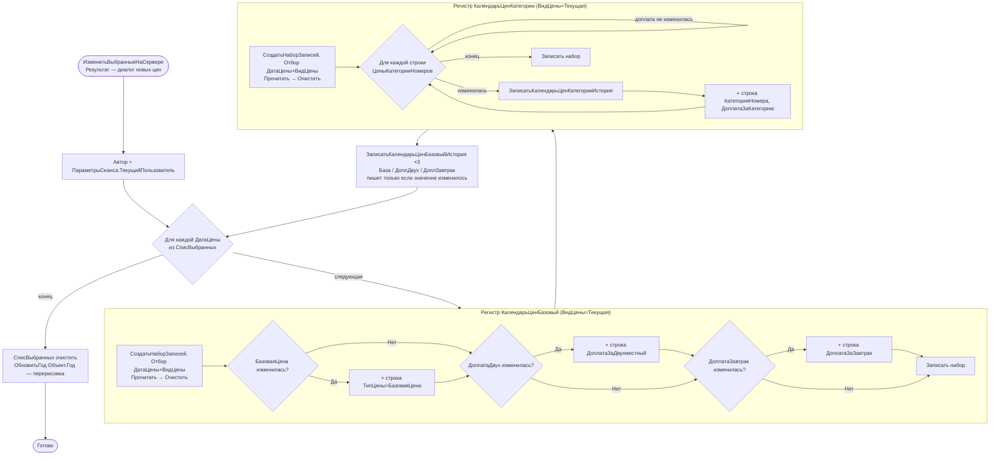

# Flowchart функции: ИзменитьВыбранныеНаСервере (запись изменения цен в календарь)

`DataProcessors/КалендарьЦен/Forms/Форма/Module.bsl:1565-1661` (+ `ЗаписатьКалендарьЦенБазовыйИстория:1664`, `ЗаписатьКалендарьЦенКатегорииИстория:1681`).

Записывает изменённые цены в регистры календаря для набора выбранных дат (`СписВыбранных`). Это **фактический механизм изменения цен** — документы `ИзменениеЦены`/`ИзменениеБазовойЦены` движений не делают.

## Ключевые правила (🟢 подтверждено кодом)

- **Полная перезапись по дате**: набор записей по `(ДатаЦены, ВидЦены)` сначала читается и `Очистить()`, затем заполняется заново только изменёнными типами цен. Запись со значением, равным исходному, НЕ создаётся (точечное хранение только отклонений).
- **ВидЦены = Текущая** для интерактивного изменения; долгосрочные цены меняются отдельной процедурой `ИзменитьДолгосрочныеЦеныНаСервере` (ВидЦены=Долгосрочная).
- **История**: каждое изменение базовой цены/доплаты и доплаты за категорию логируется в `*История` (измерение `ДатаВремяИзменения`, ресурс — новое значение, реквизит `Автор`); запись истории пропускается, если значение не изменилось.
- **Аудит**: каждая запись цены несёт `Автор` (текущий пользователь) и `ДатаИзменения` (`ТекущаяДата()`).

## 🔴 Пробелы / риски
- 🔴 Нет транзакции: запись наборов `КалендарьЦенБазовый`, `КалендарьЦенКатегории` и записей истории идёт без `НачатьТранзакцию/Попытка` — при сбое в середине цикла часть дат/регистров останется в несогласованном состоянии.
- 🔴 Документы `ИзменениеЦены`/`ИзменениеБазовойЦены` существуют как метаданные (с ТЧ `ДатаЦены`: Процент/Категория/Двухместный/БезЗавтрака), но не имеют `ObjectModule` и движений — реальная запись идёт мимо них из формы обработки; назначение документов как «реестра намерений» не подтверждено.
- 🟡 `ТекущаяДата()` (серверное время) вместо `ТекущаяДатаСеанса()` — потенциальная проблема часовых поясов в аудите.
- 🟡 Запись наборов в цикле по датам без агрегации (по записи на дату).

Шкала доверия: 🟢 подтверждено кодом / 🟡 выведено / 🔴 пробел.
