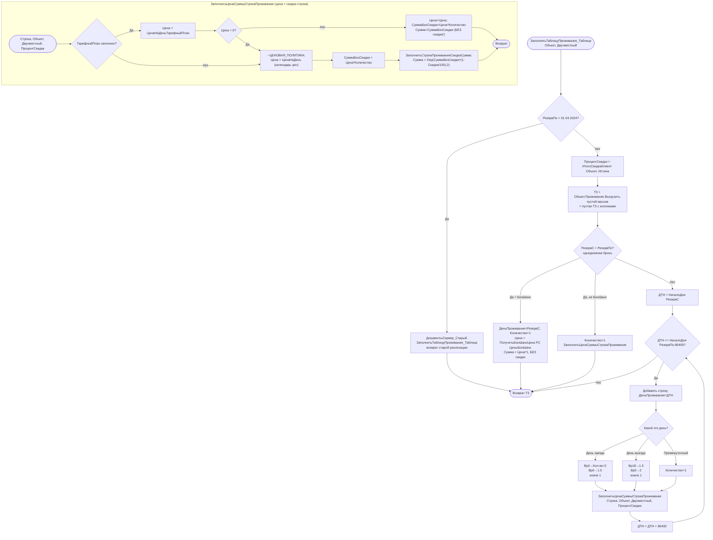

# Flowchart функции: ЗаполнитьТаблицуПроживания_Таблица (расчёт стоимости проживания)

`CommonModules/ДокументыСервер/Module.bsl:428-513` (вызывает `ЗаполнитьЦенаСуммыСтрокаПроживание:515-539`).

Принадлежит **Ценообразованию**; источник вызова — модуль «Бронирование» (форма заявки), `Объект` = `ДокументОбъект.ЗаявкаНаБронирование`. Результат — ТаблицаЗначений со строками `ДеньПроживания, Количество, Цена, СуммаБезСкидки, ПроцентСкидкиКлиента, Сумма`, выгружаемая в ТЧ `Проживание`.

## Ключевые правила (🟢 подтверждено кодом)

- **Граница legacy** `01.04.2024` (`ДатаПереходаНаНовыйКалендарьЦен`): период с `РезервПо` ДО неё или день ДО неё считается старым модулем `ДокументыСервер_Старый` (две независимые реализации цены сосуществуют).
- **Коэффициент частичных суток** зависит от времени заезда/выезда: ранний заезд (Вр0/Вр6) и поздний выезд (Вр18/Вр0) добавляют 0.5–1.0 ночи. Период считается по `[РезервС; РезервПо-86400]` (последняя ночь — день перед выездом).
- **Однодневная бронь** (`РезервС = РезервПо`): отдельная ветка, `Количество=1`; коэффициенты заезда/выезда закомментированы.
- **БонШанс** (последний-час горящий тариф): отдельная цена из РС `ЦеныБонШанс` (последняя ≤ даты), **скидка клиента не применяется**.
- **Приоритет источника цены**: тарифный план → (если цена=0) ценовая политика календаря. У тарифа скидка клиента НЕ применяется (`Сумма = СуммаБезСкидки`), у ценовой политики — применяется.
- **Скидка** = `MAX(категорийная скидка из Категория.Скидка, клиентская/комиссионная скидка)` — см. `ИтогоСкидкаКлиент`.

## 🔴 Пробелы / риски
- 🔴 Двойная кодовая база (`ДокументыСервер` vs `ДокументыСервер_Старый`, `КалендарьЦен` vs `КалендарьЦен_Старый`) с жёсткой датой-границей `'20240401'` (`MagicDate`).
- 🟡 Несимметрия скидок: тарифный план игнорирует скидку клиента, ценовая политика — учитывает.
- 🟡 Коэффициенты суток зашиты числами (2/1.5/1) — `MagicNumber`; для однодневной брони закомментированы (поведение отличается).
- 🟡 86400 (секунд в сутках) как магическая константа во всех циклах по дням.

Шкала доверия: 🟢 подтверждено кодом / 🟡 выведено / 🔴 пробел.
