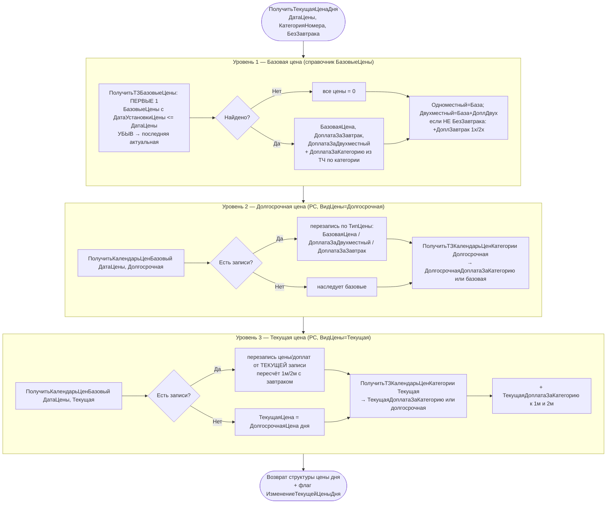

# Flowchart функции: ПолучитьТекущаяЦенаДня (каскад цены дня по календарю цен)

`CommonModules/КалендарьЦен/Module.bsl:161-224`, опирается на `ПолучитьБазоваяЦенаДня:57-99` и `ПолучитьДолгосрочнаяЦенаДня:101-159`.

Возвращает структуру `{ТекущаяЦенаДняОдноместный, ТекущаяЦенаДняДвухместный, ТекущаяДоплатаЗаКатегорию, ИзменениеТекущейЦеныДня}`. Реализует трёхуровневый каскад: **Базовая цена → Долгосрочная цена → Текущая цена**, каждый уровень может переопределить предыдущий точечными записями календаря.

## Ключевые правила (🟢 подтверждено кодом)

- **Трёхуровневый каскад**: каждая дата имеет базовую цену (из справочника, действует «с даты установки»), которую может переопределить долгосрочная запись календаря, которую в свою очередь может переопределить текущая запись. Текущая цена при отсутствии текущих записей = долгосрочная цена.
- **Состав цены дня**: `Одноместный = База + ДоплатаЗаКатегорию (+ ДоплатаЗаЗавтрак ×1, если с завтраком)`; `Двухместный = База + ДоплатаЗаДвухместный + ДоплатаЗаКатегорию (+ ДоплатаЗаЗавтрак ×2)`.
- **Разрез цены** в регистрах календаря: `ДатаЦены × ТипЦены(База/ДоплДвух/ДоплЗавтрак) × ВидЦены(Долгосрочная/Текущая)` для `КалендарьЦенБазовый`; `ДатаЦены × Категория × ВидЦены` для `КалендарьЦенКатегории`.
- **Флаги изменения** (`ИзменениеТекущейЦеныДня` и др.) — используются формой `КалендарьЦен` для подсветки изменённых ячеек.
- Выбор одно/двухместной цены делает вызывающий код (`ПолучитьЦенуПоЦеновойПолитике:630-645` по флагу `Двухместный`).

## 🔴 Пробелы / риски
- 🔴 `CreateQueryInCycle` — `ПолучитьТекущаяЦенаДня` выполняет 4+ отдельных запроса (база, долгосрочная база, долгосрочная категория, текущая база, текущая категория) на КАЖДЫЙ день; при расчёте проживания вызывается в цикле по дням → N×5 запросов на бронь.
- 🟡 Опечатка ключа структуры `ИзменениЦеныДня` (без «е») в `ПолучитьЦенаДня:266` — потенциальный «битый» флаг.
- 🟡 Завтрак для двухместного считается двойным (`2 * ДоплатаЗаЗавтрак`) — зашитое допущение «2 гостя = 2 завтрака».

Шкала доверия: 🟢 подтверждено кодом / 🟡 выведено / 🔴 пробел.
