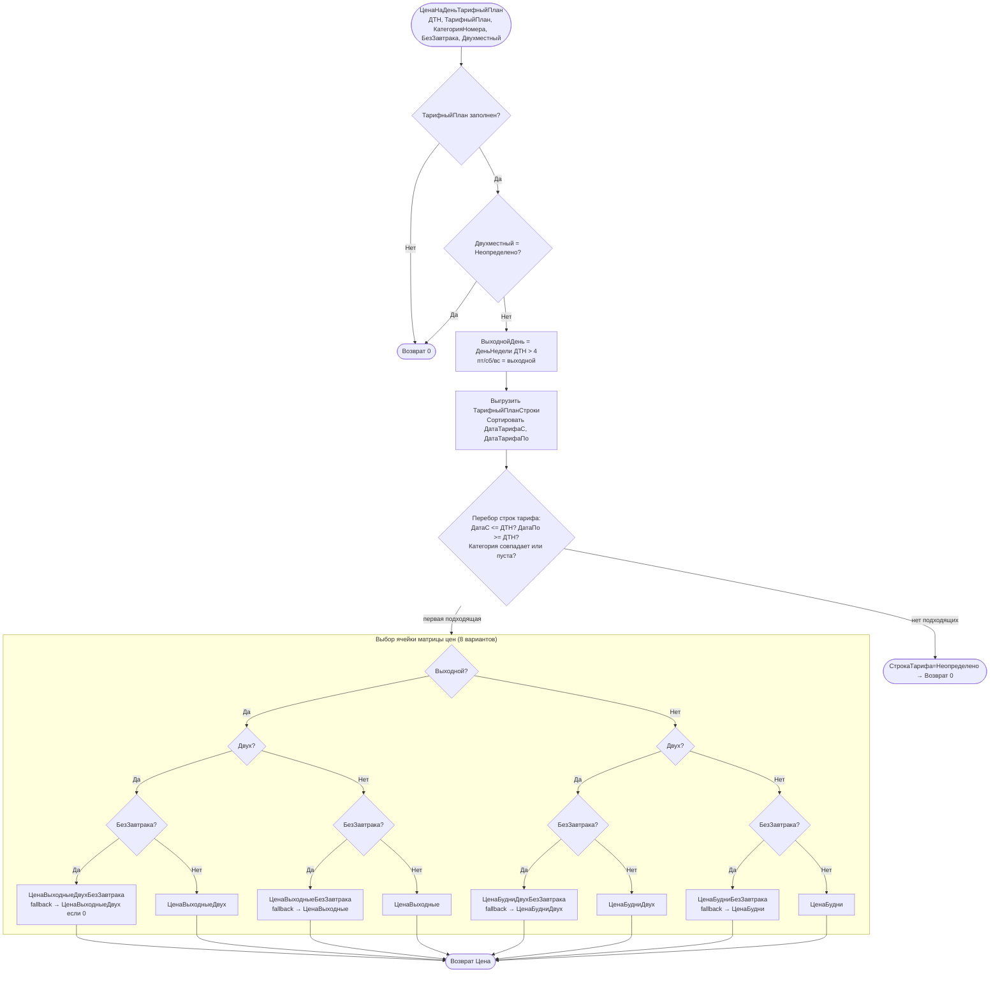

# Flowchart функции: ЦенаНаДеньТарифныйПлан (цена дня по тарифному плану)

`CommonModules/ДокументыСервер/Module.bsl:553-628`.

Возвращает цену за сутки по выбранному тарифному плану, выбирая подходящую строку тарифа (по дате/категории) и ячейку матрицы 2×2×2 (будни/выходные × двух/одноместный × с/без завтрака). Возвращает `0`, если тариф не подходит (тогда вызывающий код откатывается к ценовой политике календаря).

## Ключевые правила (🟢 подтверждено кодом)

- **Выходной день** = `ДеньНедели(ДТН) > 4` (пятница, суббота, воскресенье считаются выходными для тарификации).
- **Выбор строки тарифа**: первая по сортировке `(ДатаТарифаС, ДатаТарифаПо)`, у которой `ДатаС <= ДТН <= ДатаПо` (пустые границы = без ограничения) и категория совпадает либо не задана (пустая категория = «для всех»).
- **Матрица 8 цен**: будни/выходные × одно/двухместный × с/без завтрака. Цены «без завтрака» имеют **fallback** на цену «с завтраком», если поле = 0 (т.е. незаполненная «без завтрака» цена = обычная цена).
- **0 как сигнал отсутствия**: возврат 0 (нет тарифа/строки) переключает вызывающий `ЗаполнитьЦенаСуммыСтрокаПроживание` на ценовую политику календаря (`Перейти ~ЦЕНОВАЯ_ПОЛИТИКА`).
- Глобальный тумблер тарифов: `Константы.ТарифныеПланы` (видимость поля `ТарифныйПлан` на форме калькулятора).

## 🔴 Пробелы / риски
- 🟡 «Двухместный = Неопределено → 0»: тариф молча не применяется, если флаг двухместности не определён.
- 🟡 Цена тарифа применяется БЕЗ скидки клиента (см. `РасчетПроживания.md`).
- 🟡 `CyclomaticComplexity` — 8-веточный if по матрице; дублирование fallback-логики.

Шкала доверия: 🟢 подтверждено кодом / 🟡 выведено / 🔴 пробел.
