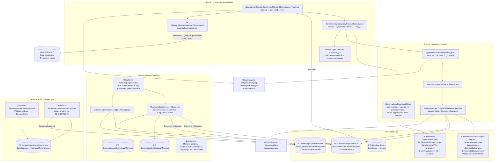

# Flowchart модуля: Ценообразование

Домен охватывает четыре связанных контура:

1. **Базовые / долгосрочные цены** — справочник `БазовыеЦены` (стартовая цена + доплаты за завтрак/двухместный/категорию, дата установки) и тарифные планы (`ТарифныеПланы` с ТЧ `ТарифныйПланСтроки`: 8 цен по матрице будни/выходные × одно/двух × с/без завтрака).
2. **Календарь цен (динамические цены по датам)** — регистры `КалендарьЦенБазовый` / `КалендарьЦенКатегории` (точечные изменения базовой цены и доплаты за категорию на конкретную дату, в разрезе `ВидЦены` = Долгосрочная/Текущая) + история (`*История`). Цена дня рассчитывается каскадом: БазовыеЦены → ДолгосрочнаяЦена → ТекущаяЦена.
3. **Расчёт стоимости проживания** — ядро `ДокументыСервер.ЗаполнитьТаблицуПроживания_Таблица` раскладывает период брони по дням, для каждого дня берёт цену (тариф → ценовая политика календаря), применяет коэффициент за частичные сутки (время заезда/выезда), скидку клиента, комиссию/B2B-наценку.
4. **Аналитика конкурентов и задание цен** — документ/регистр `ЦеныКонкурентовАналитика` (загрузка % загрузки, ADR, глубины бронирования и цен конкурентов из TravelLine) и обработка `КалендарьЦенЗаданиеНаЦены` (динамическое задание цены по корзинам загрузки 30/45/60/75/90%).

> Изменение цен **записывается не документами** `ИзменениеЦены`/`ИзменениеБазовойЦены` (это UI-реестры без `ObjectModule` и без движений), а напрямую наборами записей регистров из формы обработки `КалендарьЦен`. Финансовые суммы счёта/долга (`СчетаДетально*`, регистры `Долги`/`Взаиморасчеты`) принадлежат «Финансы и касса» — здесь показаны как связь-приёмник рассчитанных сумм.

## Точки входа

| Точка входа | Файл | Триггер |
|---|---|---|
| Заполнение ТЧ Проживание брони | `CommonModules/ДокументыСервер/Module.bsl:ЗаполнитьТаблицуПроживания_Таблица` | пересчёт цены брони (форма заявки) |
| Цена дня по ценовой политике | `CommonModules/КалендарьЦен/Module.bsl:ПолучитьТекущаяЦенаДня` | расчёт проживания, шахматка цен |
| Цена дня по тарифному плану | `CommonModules/ДокументыСервер/Module.bsl:ЦенаНаДеньТарифныйПлан` | при заданном `Объект.ТарифныйПлан` |
| Изменение цен (запись) | `DataProcessors/КалендарьЦен/Forms/Форма/Module.bsl:ИзменитьВыбранныеНаСервере` / `ИзменитьДолгосрочныеЦеныНаСервере` | команда «Изменить выбранные» / «Изменить долгосрочные» |
| Калькулятор стоимости | `DataProcessors/РасчетПроживания/Forms/Форма/Module.bsl:РассчитатьПроживаниеНаСервере` | изменение дат/категории на форме |
| Задание цен по загрузке | `DataProcessors/КалендарьЦенЗаданиеНаЦены/Forms/Форма/Module.bsl:СоздатьЗаданиеНаСервере` / `ЗаписатьЗаданиеНаСервере` | команда «Создать/Записать задание» |
| Аналитика конкурентов | `CommonModules/КалендарьЦен/Module.bsl:ПолучитьТабДокРасшифровкаКонкурентыЦенаАналитика` | расшифровка ячейки календаря |

Шкала доверия: 🟢 подтверждено кодом / 🟡 выведено / 🔴 пробел.
