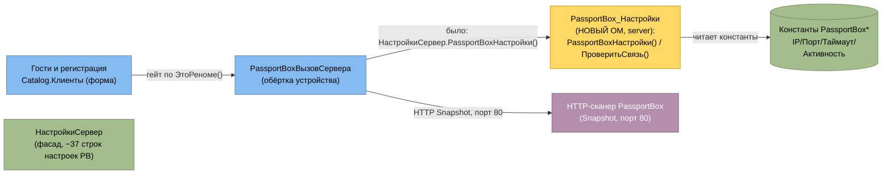

# Архитектурная дельта — повторное извлечение №1 (коммит «Изменения ПСН»)

> **Агент:** Architect (повторное извлечение)
> **Дата:** 2026-06-18
> **Диапазон git:** `ec0e8d9` (Первичный) → `c52a282` (Изменения ПСН)
> **Вход:** `code-analysis-delta.md` (Археолог) + `domain-delta.md` (Детектив), сверка по `git diff` и каноническим артефактам.
> Этот документ — **дельта** к каноническим `../../erd-complete.md`, `../../c4-components.md`, `../../architecture.md`, `../../traceability/spec-impact-matrix.md`. Канон описывает систему на момент `Первичный`; здесь — только архитектурно значимые изменения коммита. При расхождении канона и дельты приоритет у дельты.

## Шкала доверия
🟢 ПОДТВЕРЖДЕНО (из `.mdo`/diff) · 🟡 ВЫВЕДЕНО · 🔴 ПРОБЕЛ

---

## 0. Архитектурный итог коммита

🟢 Коммит **не меняет архитектурный стиль** (монолит на 1С:Предприятие 8 поверх БПО ред. 3.2), не добавляет контейнеров, не вводит новых протоколов интеграции. Изменения локализованы внутри контейнера «Сервер 1С»:

- **1 новый объект метаданных** — общий серверный модуль `PassportBox_Настройки` (рефакторинг-вынос настроек сканера паспортов из `НастройкиСервер`). 🟢
- **1 новый реквизит сущности** — `Документ.ЗаявкаНаБронирование.ЦенаПродажиАгентом`. 🟢
- **1 deprecation сущности** — `Документ.ЛистОжидания` → `ЛистОжидания_НеИспользуется` (узел сохранён, помечается deprecated, не удаляется). 🟢
- **Контрактные правки интеграций** — выравнивание поля ответа мессенджеров (`ОписаниеОшибки`→`Описание`), фикс ставки НДС в обмене с бухгалтерией. 🟢

Blast-radius — узкий: затронуты слой БПО (PassportBox), доменный слой Бронирование, слой интеграций. C4-контекст (L1) и C4-контейнеры (L2) **не меняются**. 🟢

---

## 1. Дельта ERD

### 1.1 `ЗаявкаНаБронирование` — новый реквизит `ЦенаПродажиАгентом` 🟢

Канон (`erd-complete.md`, блок 1) описывает сущность без агентской цены. Коммит добавляет денежный реквизит — база печати «Чека агента» (см. `domain-delta.md` Δ-BR-A1).

Затронутый фрагмент (только дополняемая сущность):

```mermaid
erDiagram
    ЗаявкаНаБронирование {
        ref PK
        ref Клиент FK
        ref Бронирует FK "контрагент-плательщик (турагентство → гейт Чека агента)"
        date РезервС
        date РезервПо
        enum Статус
        bool ЛистОжидания "флаг парковки спроса (в строю)"
        number Сумма
        number ЦенаПродажиАгентом "НОВЫЙ Число(10,2): агентская цена продажи; база Чека агента"
    }
```

- Тип `Число(10,2)`, денежный, **необязателен** (нет `fillChecking`). 🟢 тип / 🟡 обязательность.
- Кардинальности и связи сущности **не меняются** — это скалярный реквизит, новых FK/ТЧ нет. 🟢
- 🔴 ПРОБЕЛ (унаследован): используется ли `ЦенаПродажиАгентом` где-либо помимо печати чека (взаиморасчёты/отчёты/комиссия) — в дельте только печать.

### 1.2 `ЛистОжидания` → `ЛистОжидания_НеИспользуется` — deprecation узла 🟢

Канон (`erd-complete.md`, блок 1) содержит самостоятельную сущность `ЛистОжидания` (PK, `Клиент` FK, `РезервС`, `РезервПо`, `КатегорияНомера` FK). Коммит переименовывает объект (UUID, состав реквизитов, регистрация в `Configuration.mdo` сохранены) — узел **не удаляется**, а помечается выведенным из эксплуатации.

```mermaid
erDiagram
    ЛистОжидания_НеИспользуется {
        ref PK "DEPRECATED — объект сохранён, поток отключён"
        ref Клиент FK
        date РезервС
        date РезервПо
        ref КатегорияНомера FK
    }
```

- **Важно:** deprecation касается **документа-очереди**, а не булева флага `ЗаявкаНаБронирование.ЛистОжидания` — флаг «парковки спроса» **сохраняется в строю** (`domain-delta.md` §2.1). Термин «Лист ожидания» получает двойственную семантику. 🟢
- Связь «(создание) → ЛистОжидания → Бронь» через отдельный документ фактически отключена; основной путь — прямое создание `ЗаявкаНаБронирование`. 🟡
- 🔴 ПРОБЕЛ: чем заменён бизнес-поток документа и откуда он вызывался — вне дельты.

### 1.3 Прочее
🟢 Новых сущностей/регистров/перечислений в ERD нет. `ОбщаяФорма.Чек.СуммаКОплате` и параметр `ОплатаКартойВключена` — элементы формы, не сущности БД, в ERD не отражаются.

---

## 2. Дельта C4 — компоненты (L3)

Затрагивается только уровень компонентов внутри контейнера «Сервер 1С». L1/L2 без изменений.

### 2.1 Новый компонент `PassportBox_Настройки` (слой БПО) 🟢

Канон (`c4-components.md`) показывает PassportBox внутри узла «Гости и регистрация» (`D3`) с фасадом настроек в `НастройкиСервер` (`F1`). Коммит выделяет настройки сканера в отдельный серверный модуль-фасад.



- `PassportBox_Настройки` — новый серверный ОМ, зарегистрирован в `Configuration.mdo` (единственный новый объект метаданных). Чистый вынос: `PassportBoxНастройки()` (чтение констант, дефолты Порт=80/Таймаут=30) и `PassportBoxПроверитьСвязь()` (Snapshot через `PassportBoxВызовСервера`). 🟢
- Зависимость `PassportBoxВызовСервера → НастройкиСервер` (для настроек PB) **переключена** на `→ PassportBox_Настройки`. Узел `F1`/`НастройкиСервер` облегчён на −37 строк. 🟢
- **Поведение не изменилось** — рефакторинг без функциональной дельты. Протокол прежний: **HTTP Snapshot, порт 80** (не COM). 🟢

### 2.2 Гейты видимости (новое доменное измерение авторизации) 🟡

Не новые компоненты, но новые связи «компонент → условие видимости» (форма авторизации функциональности, согласована с код-уровневым RBAC канона):
- Кнопки сканера паспорта на форме `Клиенты` видны только при `НастройкиСервер.ЭтоРеноме()` → PassportBox теперь **эксклюзив площадки «Реноме»**. 🟢 факт / 🟡 «почему только Реноме».
- Группа «Чек агента» на форме брони доступна только при `Бронирует = турагентство` (`ОбщийФункционалСервер.ЗначениеРеквизитаНаСервере`). Первое правило видимости, привязанное к флагу контрагента `Турагентство` на уровне формы. 🟢

### 2.3 Deprecation узла «Лист ожидания»
🟢 В компонентной декомпозиции узел документа-очереди `ЛистОжидания` помечается deprecated (`ЛистОжидания_НеИспользуется`); входящих активных путей не остаётся. Узел не удаляется.

---

## 3. Дельта карты интеграций

Карта интеграций канона живёт в слое `INTG` диаграммы `c4-components.md` и в `architecture.md`. Новых интеграций/протоколов нет; меняются **контракты** и **параметры** существующих.

| Интеграция (канон) | Изменение коммита | Тип | Доверие |
|---|---|---|---|
| Мессенджеры: `МесенджерСервер → TelegramСервер / MAXСервер` (GREEN-API, HTTP) | Поле структуры-ответа отправки `ОписаниеОшибки` → `Описание` — выравнивание с консьюмером `МесенджерСервер.Ответ.Описание`. Транспорт не тронут. 🟡 несимметрия: `ПроверитьНаличие*` сохранили `ОписаниеОшибки`. | контракт | 🟢 / 🟡 |
| Рассылка `РассылкаWhatsApp` (GREEN-API, HTTP) | Сняты гейты площадок (`ЭтоЧехов/ЭтоЛайв`) и порог ≥3 заявок; новый текст оффера; удалён мёртвый `ПроверитьWhatsAppGreen`. Транспорт не тронут. | правила/контент | 🟢 |
| Обмен с бухгалтерией `ОбменБухгалтерияНДС` (файл/FTP) | Фикс двойного преобразования ставки НДС: `СтавкаНДСЧисло(СтавкаНДСТекущий)` (8 мест). Формат файла и набор `ТипыСчетов` не менялись. | фикс данных | 🟢 |
| PassportBox-сканер (HTTP Snapshot, порт 80) | Источник настроек интеграции переключён с `НастройкиСервер` на `PassportBox_Настройки`; протокол/порт/логика вызова без изменений. | рефакторинг точки конфигурации | 🟢 |
| Эквайринг (`ОбщаяФорма.Чек` → ЭТ/PayKeeper) | Видимость кнопки «Оплатить картой» параметризована (`ОплатаКартойВключена`, дефолт Истина). Сам поток фискализации/эквайринга не тронут. | параметр UI | 🟢 |

- 🟢 **MAX** подтверждён как самостоятельный мессенджер-адаптер (GREEN-API, токен `GREENApiToken_MAX`), симметричный Telegram/WhatsApp; в каноне узел `I3` стоит уточнить добавлением MAX рядом с Telegram. 🟡 рекомендация к канону.

---

## 4. Дельта Spec Impact Matrix

Затронутые коммитом модули/спеки и причина (blast-radius коммита). Обозначения канона: ✍ пишет · 📖 читает · 🔗 ссылается.

| Модуль / компонент | Затронутая сущность / интеграция / спека | Существо влияния коммита | Доверие |
|---|---|---|---|
| **Бронирование** | `ЗаявкаНаБронирование` (+`ЦенаПродажиАгентом`); `ОбщаяФорма.Чек` (📖, печать) | Новый реквизит + под-поток «Чек агента» (печать одной позиции, расчёт НДС, гейт по турагентству). Движений регистров не добавляет. | 🟢 |
| **Бронирование** | `ЛистОжидания` → deprecated | Узел-очередь выведен из эксплуатации; флаг `ЗаявкаНаБронирование.ЛистОжидания` сохранён. Влияет на машину состояний «Бронь». | 🟢 |
| **Подключаемое оборудование (БПО)** | новый ОМ `PassportBox_Настройки`; константы `PassportBox*` (📖); `PassportBoxВызовСервера` (зависимость) | Вынос настроек сканера в выделенный фасад; смена точки конфигурации интеграции PassportBox (HTTP/Snapshot, порт 80). Поведение неизменно. | 🟢 |
| **Гости и регистрация** | форма `Catalogs.Клиенты` | Гейт видимости кнопок сканера по `ЭтоРеноме()` — PassportBox как эксклюзив «Реноме». Новое измерение авторизации (по площадке). | 🟢 |
| **Интеграции и обмен** | мессенджеры `TelegramСервер`/`MAXСервер` (↔ `МесенджерСервер`) | Выравнивание контракта поля ответа `Описание`. Остаточная несимметрия в `ПроверитьНаличие*`. | 🟢 / 🟡 |
| **Интеграции и обмен** | рассылка `РассылкаWhatsApp` | Снятие гейтов площадок и порога лояльности; новый оффер; запуск пакетно под спец-пользователем `РассылкаДеньРождения`. | 🟢 |
| **Интеграции и обмен** | `ОбменБухгалтерияНДС` (FTP) | Фикс ставки НДС в выгрузке заявок (меняет числовую ставку в файле обмена). | 🟢 |
| **Аудит и отчётность** | `ОтчетКассоваяСмена` (📖 `ЗаявкаНаБронирование`, `ГрупповыеСчета`); `ПечатьСервер` | Групповые счета в отчёте кассовой смены (новые `ТЗ_Заявка`/`ПрисоединитьГруппа`); юр. формулировка услуги проживания. Мёртвый клон `ТабДокКасса_1`. | 🟢 |
| **Аудит / Финансы** | `ДокументыСервер` (расчёт комиссии, ↔ FN-05) | Фикс базы комиссии: `Цена×Количество` вместо `Сумма`. Меняет суммы исторических расчётов комиссий турагентам. | 🟢 |
| **Финансы и касса** | `ОбщаяФорма.Чек` (📖 оплаты) | Разведение `СуммаКОплате`/`СуммаОплаты`; фикс ветки «Полный расчёт»; параметр видимости эквайринга. | 🟢 |
| **Доп. услуги / Коворкинг** | `КоворкингСервер` (✍ ТЧ возвратов) | Два фикса возврата оплаты коворкинга (правильная ТЧ + накопительный остаток). Уточняет переход «возврат» в машине состояний счёта коворкинга. | 🟢 |

**Не затронуты коммитом** (для контраста blast-radius): Размещение/Номерной фонд, Горничные, Минибар, Ценообразование (кроме фикса комиссии в общем `ДокументыСервер`), Персонал и зарплата, отчёт `ФинансовыйРезультатКоворкинг`, поток фискализации ККТ/эквайринга, обмен `ОбменГостиницы`/`ОбменСайт`. 🟢

---

## 5. Технический долг — дельта

🟡 Коммит добавляет несколько кандидатов в техдолг (находки, не правки — Reversa легаси не меняет):
- Мёртвый клон `ОтчетКассоваяСмена.ТабДокКасса_1` (не вызывается, кандидат на удаление). 🟡
- Несимметрия контракта мессенджеров: `Описание` (отправка) vs `ОписаниеОшибки` (проверка наличия). 🟢
- Дефект имени локальной переменной в `НастройкиСервер.ЭтоРеноме()` (присваивание в `ЭтоСтритАрт`, возврат корректен) — риск при будущих правках. 🟢 наличие / 🟡 влияние.
- `ЦенаПродажиАгентом` без `fillChecking` — чек агента пробьётся на нулевую сумму при пустом значении. 🟡
- Хардкод бренд-текста рассылки ДР («Реноме»/Екатеринбург) при снятых гейтах площадок — риск некорректной рассылки с других площадок. 🟡

---

## 6. Открытые вопросы (наследие от Археолога/Детектива)
- 🔴 Чем заменён бизнес-поток документа `ЛистОжидания` после депрекации; единственный ли механизм парковки спроса теперь флаг `ЗаявкаНаБронирование.ЛистОжидания`.
- 🔴 Назначение `ЦенаПродажиАгентом` за пределами печати чека.
- 🟡 Окончательность снятия гейтов рассылки ДР; обязательность `ЦенаПродажиАгентом`; узаконивание единого имени поля результата мессенджеров; пересверка исторических комиссий после смены базы (Δ-AU-A3).
