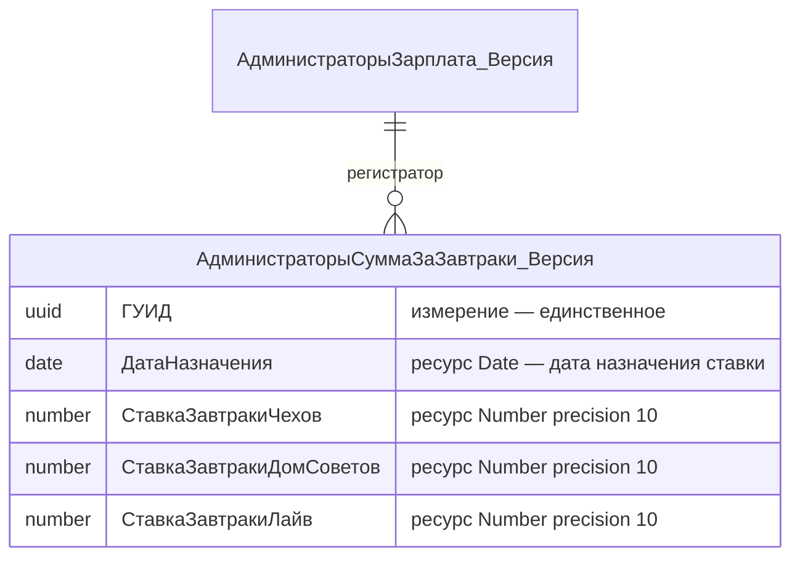
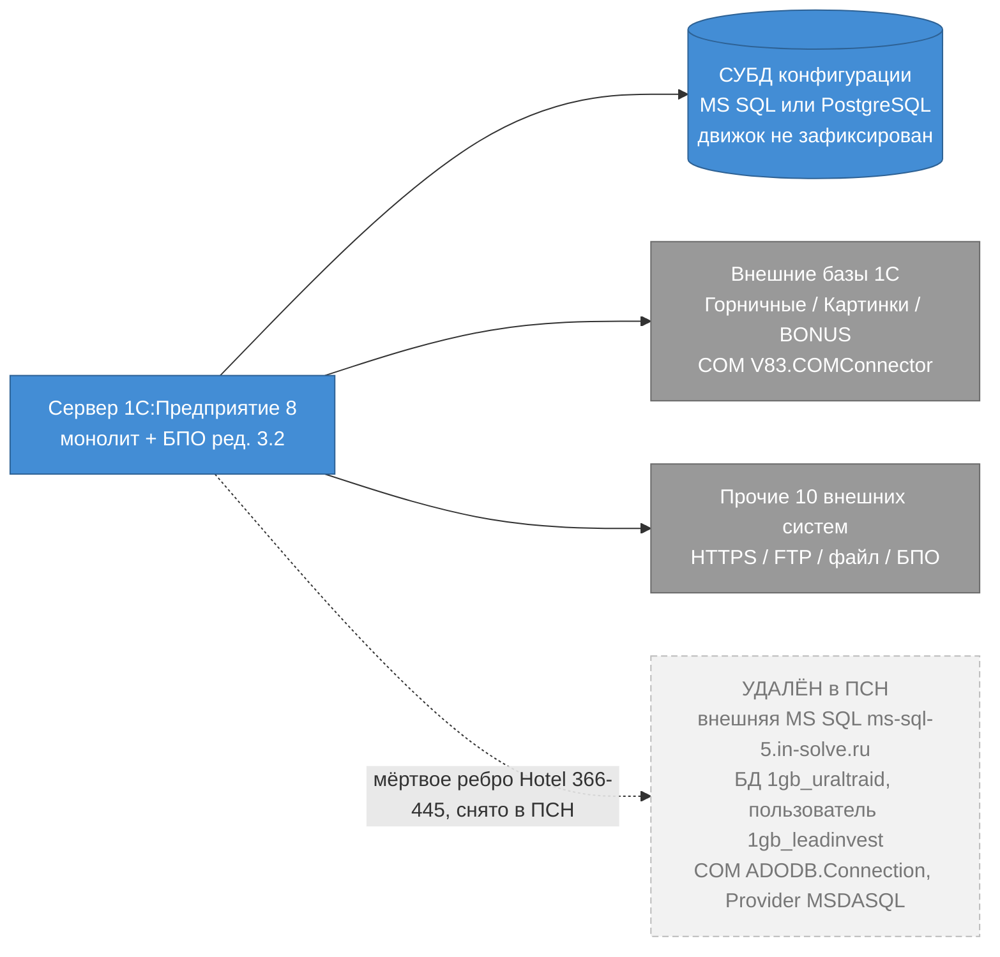
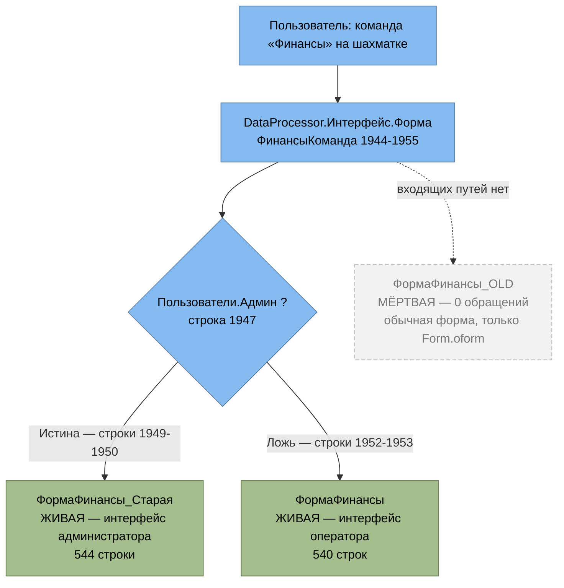
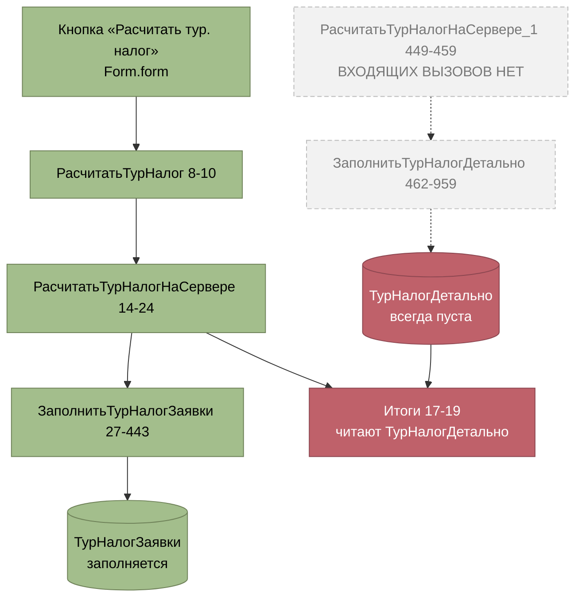

# Архитектурная дельта — повторное извлечение №2 (собственная ветка ПСН «Реноме»)

> **Агент:** Architect (задача плана 6.11)
> **Дата:** 2026-08-22
> **Диапазон:** конфигурация `ПСН_РЕНОМЕ__АУДИТ/src` против канона `_reversa_sdd/` (импорт из Hotel, состояние `ec0e8d9`) и против принятой дельты `re-extraction/2026-06-18-ПСН/` (состояние `c52a282`).
> **Вход:** `code-analysis-delta.md` (Археолог, 9 секций, 3509 строк) + `domain-delta.md` (Детектив, 523 строки) + **обязательная поправка** `../../integrity-report.md` (задачи 6.1–6.9) + собственная сверка по исходникам и по git-деревьям Hotel.
> Этот документ — **дельта** к каноническим `../../erd-complete.md`, `../../erd-data-master.md`, `../../architecture.md`, `../../c4-context.md`, `../../c4-containers.md`, `../../c4-components.md`, `../../deployment.md`, `../../traceability/spec-impact-matrix.md`, `../../traceability/code-spec-matrix.md`. При расхождении канона и дельты приоритет у дельты.
> **Границы записи задачи 6.11:** канонические файлы не правятся — их правит задача **6.12**. Здесь правки формулируются, а не применяются.

## Шкала доверия
🟢 ПОДТВЕРЖДЕНО (прочитано в `.mdo`/коде/диффе настоящей задачей) · 🟡 ВЫВЕДЕНО · 🔴 ПРОБЕЛ

---

## 0. Архитектурный итог переизвлечения

🟢 **Архитектурный стиль не меняется.** Монолит на 1С:Предприятие 8 поверх БПО ред. 3.2,
единая СУБД, тонкий/толстый клиент, интеграции файлом, HTTP и COM. Новых контейнеров нет,
удалённых контейнеров нет, новых протоколов нет, **ни один контракт внешней системы не изменён**
(установлено задачей 6.6: 18 смежных транспортных модулей и `.mdo` плана обмена побайтово
идентичны Hotel).

🟢 **Дельта состава конфигурации — три удалённых объекта метаданных и 35 переименований,
ноль добавленных.** 812 объектов в Hotel против 809 в ПСН (`IMPORT.md` §4.1);
арифметика сходится: 812 − 3 = 809.

| Категория изменения | Кол-во | Что именно |
|---|---|---|
| Удалено объектов | **3** | `SettingsStorage.Справочники_Клиенты_ФормаЭлемента_Настройки`, `Constant.ЗаголовокСистемы_КУдалению`, `DataProcessor.РасчетТурНалога1` |
| Переименовано (deprecation) | **35** | 32 × `Constant.БазовыйТариф*_XXX`, `Constant.ПередачаДанныхНаСайт_XXX`, `Report.ПроданыеСНаценкой_OLD`, `Report.СверкаПоЮрЛицам_LOD` |
| Добавлено объектов | **0** | — |
| Изменён режим поддержки БПО | **нет** | `Configuration.distr` расходится только сериализацией (§3.2) |

🟢 **Единственное архитектурно значимое изменение топологии — удаление COM/ADODB-моста
к внешней MS SQL** из `Documents/ЗаявкаНаБронирование/ObjectModule.bsl` (Hotel `366–445`,
80 строк). Мост был мёртв уже в Hotel (`возврат неопределено;` первой строкой тела,
Hotel `:403`), поэтому **поведение системы не меняется**; меняются поверхность утечки
секретов и четыре утверждения канона (§2.2).

🟡 **Blast-radius узкий по слоям и широкий по документам.** Затронуты: слой данных
(состав констант / отчётов / обработок), слой техдолга и рисков, матрицы трассируемости.
**Не затронуты:** C4-контекст (L1), топология C4-контейнеров (L2), карта интеграций,
деплой-топология, все восемь доменных блоков `erd-complete.md`, учётное ядро
`erd-data-master.md` §§1–5. Подробно — §9.

🔴 **Главный итог не про изменения, а про покрытие.** Переизвлечение вскрыло **контур
туристического налога** (`DataProcessor.РасчетТурНалога`, `DataProcessor.ПрогнозТурНалог`,
`InformationRegister.ТурналогИстория`), отсутствующий в архитектурной документации целиком:
ноль вхождений в `architecture.md`, `c4-*.md`, `erd-*.md`, `deployment.md`, `gaps.md`,
`adrs/`, обеих матрицах `traceability/` и во всех 12 папках unit (§7.3).

---

## 1. Дельта ERD

Канон моделирует ERD на двух уровнях: `erd-complete.md` — восемь доменных блоков
(справочники, документы, регистры, перечисления); `erd-data-master.md` — учётное ядро
(регистры накопления и сведений, карта регистраторов). **Ни один из двух файлов не моделирует
константы, отчёты и обработки** — проверено чтением обоих файлов (463 и 230 строк).
Отсюда следует главный вывод раздела.

### 1.1 Константы `БазовыйТариф*_XXX` и `ПередачаДанныхНаСайт_XXX` — вне модели ERD 🟢

🟢 32 константы `Constant.БазовыйТариф{Будни|Выходные}{—|Полулюкс|Люкс|СтБ}{—|Двух}{—|БезЗавтрака}`
и `Constant.ПередачаДанныхНаСайт` переименованы с суффиксом `_XXX`. Это переименование,
а не пересоздание: UUID и `producedTypes/typeId` сохранены (§6.1.2 раскопок), значения
в информационной базе не теряются.

🟢 **Правки ERD не требуется ни в одном из двух файлов.** Сплошной поиск `БазовыйТариф` даёт
в `erd-complete.md` ровно три вхождения — строки **124–126**, и это реквизиты сущности
`КатегорииНомеров` (`number БазовыйТарифБудни`, `БазовыйТарифВыходные`, `БазовыйТарифБудниДвух`),
а не константы. Прочитаны строки 116–126: блок `КатегорииНомеров {` открывается на `:120`.
Реквизиты `Catalog.КатегорииНомеров.БазовыйТариф*` (8 шт., `КатегорииНомеров.mdo:173–299`)
**никогда не переименовывались**, `.mdo` побайтово идентичен Hotel. В `erd-data-master.md`
вхождений маски — **ноль**.

⚠️ Это окончательно снимает тревогу `IMPORT.md` §4.2 («`erd-complete.md` — 3 упоминания»),
уже частично скорректированную задачей 6.1: **правок ERD по тарифным константам нет**.

🟡 Смысловая правка остаётся, но она в `database.md` §6.1 и заявлена ранее:
`:379` «Constants, 90» → 89 и `:382` «44 константы» → 32 (задача 6.1);
`:392` `ПередачаДанныхНаСайт` как несуществующий тумблер (задача 6.6, Δ-IN-B5).

### 1.2 Три удалённых объекта — ни один не является сущностью ERD 🟢

| Объект | Присутствие в Hotel | Класс | Отражён в ERD? |
|---|---|---|---|
| `Constants/ЗаголовокСистемы_КУдалению` | во всех 4 коммитах + рабочем дереве | константа | **нет** (константы не моделируются) |
| `DataProcessors/РасчетТурНалога1` | во всех 4 коммитах + рабочем дереве | обработка | **нет** (обработки не моделируются) |
| `SettingsStorages/Справочники_Клиенты_ФормаЭлемента_Настройки` | **только в рабочем дереве**, ни в одном коммите | хранилище настроек | **нет** |

🟢 Первые два — осознанное удаление стороной ПСН (§6.9.2 раскопок, `git ls-tree` × 4 коммита).
Третий — не удаление: объект создан в Hotel и не закоммичен, каталога `src/SettingsStorages/`
в ПСН не существовало никогда (§6.3.6 раскопок).

🟢 **Правок ERD нет.** Сплошной поиск `settingsStorage|SettingsStorage|ХранилищеНастроек`
по всем 177 каноническим `.md` и 2 `.yaml` даёт **одно** вхождение — `IMPORT.md:148`,
то есть саму констатацию отсутствия.

### 1.3 Отчёты `ПроданыеСНаценкой_OLD` / `СверкаПоЮрЛицам_LOD` — вне модели ERD 🟢

🟢 Оба отчёта переименованы и одновременно лишены расчётного ядра (§6.9.3 раскопок).
`erd-complete.md` и `erd-data-master.md` отчётов не моделируют — ноль вхождений обеих масок.
**Правок ERD нет.** Правки идут в `code-analysis.md:948,958` (заявлено задачами 6.1 и 6.9)
и в `traceability/code-spec-matrix.md:142` (§6; заявлено задачей 6.9).

### 1.4 `АдминистраторыСуммаЗаЗавтраки_Версия` — единственная содержательная правка модели данных 🟢

Это **не дельта ПСН**, а поправка к канону: регистр присутствует в **обоих** деревьях,
и регистра **без** суффикса не существует ни там, ни там. Проверено перечнем каталогов:
в обоих деревьях ровно пять регистров семейства — `АдминистраторыНадбавкаЗаСтаж`,
`АдминистраторыСуммаЗаЗавтраки_Версия`, `АдминистраторыСуммаЗаПроживающих`,
`АдминистраторыСуммаЗаПроживающих_Версия`, `АдминистраторыТабель`.

🟢 Регистр **живой и читается**: `Documents/АдминистраторыЗарплата_Версия/Forms/ФормаДокумента/Module.bsl`
`:457`–`:465` — запрос `ИЗ РегистрСведений.АдминистраторыСуммаЗаЗавтраки_Версия`;
`:472`–`:480` — выгрузка в табличную часть формы; `:2996`–`:2998` —
`Функция СуммаЗавтракиЧеховЗаСмену`, чтение `АдминистраторыСуммаЗаЗавтраки[0].СтавкаЗавтракиЧехов`
(обе границы функции проверены: `&НаСервере` на `:2995`, сигнатура на `:2996`).

🟢 Структура из `.mdo` (разобраны все `<dimensions>` и `<resources>`):



🟢 Регистр **непериодический**: тегов `<informationRegisterPeriodicity>` и `<writeMode>`
в `.mdo` нет, действуют платформенные умолчания. Проверено сравнением по всему каталогу
`InformationRegisters/`: тег периодичности присутствует только у трёх регистров
(`ЗначенияЕМРЦ`, `МинибарСебестоимость`, `СебестоимостьТоваров`); ни у одного из пяти
регистров семейства `Администраторы*` его нет.

🟡 **Архитектурное следствие.** «Дата назначения» ставки лежит в **ресурсе**, а не в периоде
регистра. Отбор по дате поэтому не платформенный, а рукописный — и он неполон:
`_Версия:456`–`:465` содержит `УПОРЯДОЧИТЬ ПО ДатаНазначения УБЫВ` **без секции `ГДЕ`**
(установлено задачей 6.7 и подтверждено её проверкой целостности), то есть берётся
максимальная дата назначения, включая будущую. Это тот же антипаттерн «периодичность,
эмулированная ресурсом», что у `АдминистраторыНадбавкаЗаСтаж` и `ГорничныеНадбавкаЗаСтаж`
(измерение `ГУИД` + ресурс `ДатаНазначения`) — но там канон его хотя бы описывает
(`database.md:97`), а здесь регистр числится «дублем-версией» без структуры.

**Правки:**

| Файл | Строка | Что там сейчас | Что должно стать | Кем заявлено |
|---|---|---|---|---|
| `database.md` | `:101` | `АдминистраторыСуммаЗаЗавтраки_Версия` — измерения «—», ресурсы «—», «🟡 дубль-версия (техдолг)» | измерение `ГУИД`; ресурсы `ДатаНазначения`, `СтавкаЗавтракиЧехов/ДомСоветов/Лайв`; 🟡→🟢; снять «дубль-версия» | уже заявлено задачей **6.7** |
| `traceability/code-spec-matrix.md` | `:96` | `n/a (дубли-версии)` для **обоих** регистров | разделить строку: для `АдминистраторыСуммаЗаПроживающих_Версия` метка верна (близнец есть на `:95`); `АдминистраторыСуммаЗаЗавтраки_Версия` — `Персонал / 🟢`, единственный носитель ставки завтраков | впервые названо `integrity-report.md` 6.7 HIGH 2; формулируется **здесь** (§6) |
| `erd-data-master.md` | §6, таблица 14 регистров | регистра нет | 🔴 **пробел, не поломка**: добавить строку `АдминистраторыСуммаЗаЗавтраки_Версия · IR · подчинён · 1 изм. · 4 рес. · АдминистраторыЗарплата_Версия · 🟢` | **здесь** |

⚠️ Классификация «`erd-*` правок не требует», сделанная задачей 6.7, **остаётся верной**:
устаревших утверждений об этом регистре в `erd-data-master.md` нет — там нет утверждений
вовсе. Это пробел покрытия, и он квалифицируется как дополнение, а не как правка.

### 1.5 Что в ERD не меняется — доказательство 🟢

| Утверждение | Проверка |
|---|---|
| Ни одна сущность из восьми блоков `erd-complete.md` не добавлена, не удалена, не переименована | Ни один из 3 удалённых и 35 переименованных объектов не является Catalog, Document, Enum, AccumulationRegister или InformationRegister (§3.1) |
| Кардинальности и связи не меняются | Сводка `erd-complete.md:444–457` (9 связей) прочитана — все опираются на объекты, которых дельта не касается |
| Регистры накопления не тронуты | 7 в ПСН, 7 в Hotel; секция `<accumulationRegisters>` в диффе `Configuration.mdo` не появляется |
| Регистры сведений не тронуты | 53 в ПСН, 53 в Hotel; секция `<informationRegisters>` в диффе не появляется |
| Справочники и документы не тронуты | Catalogs 74/74, Documents 41/41 |
| 🔴 ПРОБЕЛЫ ERD (`erd-complete.md:458–463`) не устарели | Четыре пункта прочитаны: `Деньги`/`ПродажиТоваров`, разрыв товарных контуров, выведенные имена ТЧ, классификаторы ФМС — ни один не затронут дельтой |

---

## 2. Дельта C4

### 2.0 Уровень 1 (контекст) — изменений нет 🟢

🟢 `c4-context.md` §4 (`:73`–`:87`, прочитан целиком) перечисляет **11** внешних систем:
сайт/каналы, Green API, PayKeeper/СБП, PassportBox, ФМС/МВД, бухгалтерия/НДС, банк,
фискальное оборудование, базы сети отелей, внешние базы 1С по COM, HTTP-сервисы заселений.
**Внешней MS SQL среди них нет.** Сплошной поиск маски
`MS SQL|ADODB|in-solve|ВыполнитьЗапросСайт` по файлу — **ноль** вхождений.

🟢 Следствие: **удаление COM/ADODB-моста не меняет диаграмму L1 и не убирает из неё узел** —
узла там никогда не было. Персоны, протоколы и направления обмена не меняются.

### 2.1 Удаление COM/ADODB-моста — что именно удалено 🟢

Проверено по коду обоих деревьев:

| Факт | Проверка |
|---|---|
| В ПСН моста нет | `Documents/ЗаявкаНаБронирование/ObjectModule.bsl` — **375 строк**; вхождений `ВыполнитьЗапросСайт` / `ADODB` / `in-solve` / `bf02a805` — **ноль** |
| В Hotel мост есть | тот же файл — **453 строки**; прочитан фрагмент `362–450` |
| Границы удалённого блока | маркер `// + Сайт НЕ Работает` — Hotel **`:366`**; `// - Сайт НЕ Работает` — Hotel **`:444`**; удалено `366–445` = **80 строк** |
| Две функции, обе границы прочитаны | `ВыполнитьЗапросСайт___` — Hotel `367`…`400` (`конецфункции` на `:400`); `ВыполнитьЗапросСайт` — Hotel `402`…`443` (`конецфункции` на `:443`) |
| Мост был мёртв уже в Hotel | Hotel `:403` — первая строка тела `ВыполнитьЗапросСайт` = `возврат неопределено;`; весь код ниже недостижим |
| Секрет | Hotel `:416` (живая копия) и `:376` (закомментированная): `Provider=SQLOLEDB.1;Password=bf02a805;…User ID=1gb_leadinvest;Initial Catalog=1gb_uraltraid;…` |
| Транспорт | `New COMObject("ADODB.Connection")`, `Provider="MSDASQL"` — Hotel `:410`–`:413` |
| Нетто по файлу | 453 → 375 = −78 (−80 по блоку, +2 по правке L1 на `:219-221`) |

### 2.2 Четыре координаты канона, объявленные «не требующими правок» 🟢

Задача 6.6 под меткой 🟢 утверждала, что внешняя MS SQL «в картах интеграций не упоминается
вовсе, поэтому правок не требует», и распространила вывод на `deployment.md`.
`integrity-report.md` 6.6 CRITICAL это опровергла. Настоящая задача **проверила каждую
из четырёх координат по файлам канона и по коду** и формулирует правку.

| # | Координата | Текст канона сейчас | Почему сломано | Что должно стать | Доверие |
|---|---|---|---|---|---|
| **A-1** | `architecture.md:109` | «**Хардкод строки подключения MS SQL с паролем** в `ЗаявкаНаБронирование/ObjectModule.bsl:402-443` (функция отключена, но код присутствует). 🟢» | 🔴 **🟢-утверждение стало ложным**: диапазона `402-443` в ПСН не существует (файл 375 строк), кода нет. Ссылка ведёт в никуда | удалить пункт из §7.4 либо переписать: «🟢 Устранено в ПСН: COM/ADODB-мост к внешней MS SQL (Hotel `ObjectModule.bsl:366-445`, 80 строк, пароль `bf02a805`) удалён целиком. Функция была мертва и до удаления (`возврат неопределено;` первой строкой тела)» | 🟢 |
| **A-2** | `architecture.md:124` | R2 — «Утечка секретов (COM-пароли, **строка MS SQL**) в исходниках», серьёзность высокая | 🔴 одна из двух названных составляющих риска устранена | «Утечка секретов (FTP-креды, Green API токен, COM-пароли `Pwd="123"`, дефолты `СерверККМ`) в исходниках»; серьёзность **остаётся высокой** — закрыта 1 точка из 5 (§7.1) | 🟢 |
| **A-3** | `c4-containers.md:100` | «🔴 Конкретный движок СУБД (MS SQL vs PostgreSQL) не зафиксирован в исходниках (**хардкод строки MS SQL присутствует в отключённой функции** — см. `architecture.md` §техдолг).» | 🔴 скобочное обоснование опирается на удалённый код. Сам пробел (движок СУБД неизвестен) **остаётся** | «🔴 Конкретный движок СУБД (MS SQL vs PostgreSQL) не зафиксирован в исходниках. Косвенный признак — строка подключения `SQLOLEDB` — исчез вместе с удалённым COM-мостом; пробел стал полным» | 🟢 |
| **A-4** | `deployment.md:90` | «🔴 Захардкоженные пути/учётные данные COM и **строка MS SQL в коде** (см. `architecture.md` §техдолг) указывают на ручную, не автоматизированную конфигурацию развёртывания.» | 🔴 то же | «🔴 Захардкоженные пути (`C:\_Base1C\…`, FTP :21) и учётные данные COM указывают на ручную, не автоматизированную конфигурацию развёртывания» | 🟢 |

🟢 **Больше в архитектурном слое таких мест нет.** Сплошной поиск маски
`MS SQL|ADODB|in-solve|ВыполнитьЗапросСайт` по всем 177 каноническим `.md`
(исключены `re-extraction/` и `integrity-report.md`) и 2 `.yaml` даёт **16 файлов**:

- **архитектурный слой — 4 координаты выше:** `architecture.md` (2 вхождения), `c4-containers.md` (3, из них `:25` и `:76` описывают собственную СУБД конфигурации и правки не требуют), `deployment.md` (3, из них `:28` и `:71` — собственная СУБД);
- **ноль вхождений:** `c4-context.md`, `c4-components.md`, `erd-complete.md`, `erd-data-master.md`, `database.md`, `data-dictionary.md`, `domain.md`, `state-machines.md`, `permissions.md`, `dependencies.md`, `inventory.md`, `adrs/` (все 12, включая `0005` о COM — там `Pwd="123"` и `ConnectБаза_BONUS`, MS SQL не упоминается), `traceability/spec-impact-matrix.md`, `traceability/code-spec-matrix.md`, `openapi/` (2 `.yaml` + `README.md`), `user-stories/` (кроме `bronirovanie.md`), `flowcharts/` (все 48);
- **вне архитектурного слоя** (правки заявлены задачей 6.2): `code-analysis.md` (2), `gaps.md` (2), `questions.md` (2), `confidence-report.md` (1), `audit-bugs-2026-06-11.md` (1), `user-stories/bronirovanie.md` (1), `Бронирование/*` (10 вхождений в семи файлах: `contracts` 1, `design` 1, `edge-cases` 2, `legacy-mapping` 1, `questions` 2, `requirements` 2, `tasks` 1).

Контроль: 3 файла архитектурного слоя + 13 вне его = **16**; вхождений 8 (архитектурный слой:
`architecture.md` 2 + `c4-containers.md` 3 + `deployment.md` 3) + 19 (вне его) = **27**.

### 2.3 Уровень 2 (контейнеры) — топология не меняется 🟢

Фрагмент L2 «до/после». Изменение — исчезновение одного исходящего ребра из контейнера
«Сервер 1С»; сам контейнер, его технология и все прочие рёбра сохранены.



🟢 Правка `c4-containers.md` — одна, `:100` (A-3). Диаграмма (`:10`–`:69`), таблица
контейнеров (`:70`–`:83`) и таблица протоколов (`:84`–`:97`) правок **не требуют**:
внешней MS SQL там нет, а ребро «Сервер ↔ внешние базы 1С / COM `V83.COMConnector`» (`:95`)
относится к живому COM-контуру горничных/картинок/BONUS и не менялось.

### 2.4 Уровень 3 (компоненты) — два пробела покрытия, ноль изменённых компонентов 🟢

🟢 `c4-components.md` §3 перечисляет 10 доменных модулей плюс 2 вынесенных слоя (БПО,
Интеграции), §4 — три сквозных фасада. Ни один перечисленный компонент дельтой не затронут:
удалённые и переименованные объекты в §3 и §4 не фигурируют (прочитано `:108`–`:132`).

🔴 **Пробел П-1 — контур туристического налога отсутствует в компонентной декомпозиции.**
Строка «Аудит и отчётность» (`c4-components.md:117`) называет `Document.ЕжедневныйАудит`
и `DataProcessor.ЕжедневныйОтчетФакт(Сводный)`. Ни `РасчетТурНалога`, ни `ПрогнозТурНалог`,
ни регистр `ТурналогИстория` там не упомянуты. Подробно — §7.3.

🔴 **Пробел П-2 — финансовые формы `DataProcessor.Интерфейс` не отнесены к компоненту
«Финансы».** Строка «Финансы и касса» (`c4-components.md:116`) называет `КассовыйДокумент`,
`ГрупповойСчетСервер`, `ЗаявкаОбщееКлиентСервер`. Обработка `DataProcessor.Интерфейс`
фигурирует только в строке «Размещение / Номерной фонд» как «шахматка», хотя внутри неё
живут **две рабочие финансовые формы**, разведённые по признаку `Админ`. Подробно — §7.2.

Обе позиции — **дополнения к канону, а не опровержения**: ложных утверждений о них
в `c4-components.md` нет, там нет утверждений вовсе.

---

## 3. `Configuration.mdo` и `Configuration.distr` — разбор диффа

Единственные два файла среза, не разобранные ни одной задачей раскопок: в `IMPORT.md` §4.3
они проходят строкой «— (состав конфигурации)» без указания unit-спеки.

### 3.1 `Configuration.mdo` 🟢

🟢 **Метрика.** Hotel **879** строк → ПСН **876** строк (−3). `diff -u` по LF-нормализованным
копиям: **5 хунков, +41 / −44**. Заголовки хунков: `@@ -367,7 +367,6 @@`,
`@@ -391,58 +390,56 @@`, `@@ -451,11 +448,12 @@`, `@@ -722,9 +720,9 @@`, `@@ -804,7 +802,6 @@`.

🟢 **Разложение диффа по существу** (сделано `comm` над отсортированными копиями — так
перестановки отделяются от содержательных изменений):

| Класс | Строк `−` | Строк `+` | Итого |
|---|---:|---:|---|
| Переименования (объект тот же, имя другое) | 35 | 35 | **35 объектов** |
| Удаления объектов | 3 | 0 | **3 объекта** |
| Добавления объектов | 0 | 0 | **0** |
| Перестановки внутри секции `<constants>` (имя и объект те же, изменилась позиция) | 6 | 6 | **6 строк** |
| **Всего** | **44** | **41** | сходится с `diff -u` |

Арифметика: 44 − 41 = 3 = 879 − 876. ✅ Множественная разница `comm`: 38 строк только
в Hotel (35 старых имён + 3 удалённых объекта), 35 строк только в ПСН (35 новых имён).

🟢 **Переименования (35):**

- 32 × `Constant.БазовыйТариф*` → `*_XXX`;
- `Constant.ПередачаДанныхНаСайт` → `_XXX` — прочитана строка `Configuration.mdo:393`;
- `Report.ПроданыеСНаценкой` → `_OLD` (`:723`), `Report.СверкаПоЮрЛицам` → `_LOD` (`:725`) — обе строки прочитаны.

⚠️ 🟢 **Опечатка в имени подтверждена третий раз и независимо.** У 31 константы суффикс —
латинский `_XXX`; у `Constant.БазовыйТарифБудни_XXХ` (`Configuration.mdo:394`, прочитано)
последний символ — кириллическая `Х` (U+0425). Задача 6.1 подтвердила это в `.mdo` самой
константы и в `Form.form` мёртвой формы; настоящая задача подтверждает **в корневом
`Configuration.mdo`**. Опечатка сквозная и согласованная во всех трёх точках регистрации.

🟢 **Удаления (3)** — раскладка по секциям:

| Хунк | Секция | Удалённая строка |
|---|---|---|
| `@@ -367,7 +367,6 @@` | `<settingsStorages>` | `SettingsStorage.Справочники_Клиенты_ФормаЭлемента_Настройки` — единственная строка секции; в ПСН секции `<settingsStorages>` **нет вовсе** |
| `@@ -391,58 +390,56 @@` | `<constants>` | `Constant.ЗаголовокСистемы_КУдалению` |
| `@@ -804,7 +802,6 @@` | `<dataProcessors>` | `DataProcessor.РасчетТурНалога1` |

🟢 Соседние по секции `<dataProcessors>` строки `DataProcessor.РасчетТурНалога`
и `DataProcessor.ПрогнозТурНалог` **остались** — удалена ровно соперничающая версия (§7.3).

🟢 **Перестановки (6)** — шум, содержательного значения не имеют. Переехали внутри секции
`<constants>`: `ПАПКА_Подтверждения`, `Папка_Горничные`, `ПолучательПлатежаБезнал`,
`БонШансЦена`, `СуммаЗаЗавтрак`, `ИспользуетсяПротоколRDPвБПО`. Ни одна из шести не удалена
и не переименована — все шесть присутствуют в обоих деревьях (подтверждено `comm`: ни одна
не попала ни в «только Hotel», ни в «только ПСН»). 🟡 Причина — пересохранение корневого
объекта в EDT после операций переименования.

🟢 **Проверка по каталогам файловой системы** (независимо от `.mdo`):

| Вид | Hotel | ПСН | Дельта |
|---|---:|---:|---|
| Constants | 90 | **89** | −1 (`ЗаголовокСистемы_КУдалению`) |
| DataProcessors | 84 | **83** | −1 (`РасчетТурНалога1`) |
| SettingsStorages | 1 | **0** | −1 (каталога нет) |
| Reports | 39 | 39 | 0 (только переименования) |
| CommonModules | 184 | 184 | 0 |
| Catalogs / Documents / InformationRegisters / AccumulationRegisters | 74 / 41 / 53 / 7 | 74 / 41 / 53 / 7 | 0 |

Совпадает с `surface.json` (`Constants 89`, `DataProcessors 83`).
⚠️ `surface.json` фиксирует `CommonModules: 183 → 184`; расхождением это не является:
183 — замер Hotel на `ec0e8d9`, а `PassportBox_Настройки` появился в Hotel коммитом `c52a282`
(дельта `2026-06-18-ПСН` §2.1). В рабочих деревьях обоих проектов сегодня по 184,
и секция `<commonModules>` в диффе `Configuration.mdo` не появляется.

🟢 **Прочие свойства корневого объекта не менялись** — в диффе нет ни одного хунка вне
четырёх названных секций. В частности, неизменны: имя и версия конфигурации (ОТЕЛЬ /
3.2.7.38), `<defaultRunMode>ManagedApplication</defaultRunMode>` (`:16`, прочитано),
состав подсистем, ролей, планов обмена, регламентных заданий, определяемых типов
и XDTO-пакетов.

### 3.2 `Configuration.distr` — ноль семантических изменений 🟢

🟢 **Метрика.** 1255 строк с обеих сторон. `diff -u` даёт **один** хунк `@@ -3,1253 +3,1253 @@`,
внутри которого **1248 строк `<items>` заменены один к одному**. Байт после LF-нормализации:
162 162 (Hotel) → 147 186 (ПСН), **−14 976**.

🟢 **Единственное отличие — отсутствие атрибута `used="true"`** у всех 1248 элементов:

```
Hotel: <items userId="3fb0f944-…" parentId="3fb0f944-…" userMode="ChangesAllowed" used="true"/>
ПСН:   <items userId="3fb0f944-…" parentId="3fb0f944-…" userMode="ChangesAllowed"/>
```

🟢 **Арифметическое доказательство полноты объяснения:** подстрока ` used="true"` — ровно
**12** символов; 1248 × 12 = **14 976** байт, то есть вся разница размеров без остатка.
Иных отличий в файле нет.

🟢 **Семантика поставки идентична:**

| Признак | Hotel | ПСН |
|---|---:|---:|
| Элементов `<items>` | 1248 | 1248 |
| Множество `userId` | — | **совпадает полностью** (0 только в Hotel, 0 только в ПСН) |
| `userMode="ChangesAllowed"` — изменяемые с сохранением поддержки | 241 | 241 |
| `userMode="Cancelled"` — снятые с поддержки | 309 | 309 |
| Без `userMode` — на поддержке, редактирование запрещено | 698 | 698 |
| `<rules …>`, `<supportLanguages/>`, `<parentConfigurationInfos … configRelease="3.2.7.38" …>` | — | **побайтово идентичны** |

Контроль: 1248 − 241 − 309 = 698. ✅

🟡 **Вывод.** Расхождение `Configuration.distr` — **артефакт сериализатора 1C:EDT**
(атрибут, равный значению по умолчанию, в одной версии пишется, в другой опускается),
а не изменение режима поддержки БПО. **Правок канона не требует.** Из списка «34
различающихся файла» (`IMPORT.md` §4.3) этот файл должен быть переклассифицирован
в «различие сериализации, семантически идентичен» — иначе он останется вечно
нерасследованным.

🔴 **Пробел П-3 (новый).** Режим поддержки БПО зафиксирован в каноне только качественно:
`inventory.md:135` называет файл («поставка и родительские конфигурации»), `adrs/0006:12-13`
— факт встраивания БПО ред. 3.2 и подсистему из 255 объектов. **Количественной картины
поддержки нет нигде:** 1248 объектов под правилами поставки, из них 241 «изменяемых
с сохранением поддержки», 309 «снятых с поддержки», 698 «на поддержке без изменений».
Это архитектурно значимо для миграции (обновляемость от вендора) и подлежит внесению
в `adrs/0006` и/или `inventory.md`.

---

## 4. Дельта карты интеграций

Карта интеграций живёт в трёх местах канона: `architecture.md` §5 (11 строк),
`c4-context.md` §4 (11 строк), `c4-containers.md` §3 (таблица протоколов).

🟢 **Новых интеграций нет. Удалённых интеграций нет. Изменённых контрактов нет.**
Последнее — вывод задачи 6.6, проверенный её проверкой целостности: 18 смежных транспортных
модулей побайтово идентичны Hotel, `.mdo` плана обмена `ВГ_ВыпискаГостиницы` идентичен
(`6f5439b7…` в обоих деревьях), состав плана пуст.

| Интеграция канона | Что изменило переизвлечение | Тип изменения | Доверие |
|---|---|---|---|
| Внешние базы 1С по COM (`V83.COMConnector`) | Ничего в транспорте. Из **соседнего** контура удалён COM/ADODB-мост к внешней MS SQL — другой транспорт (`ADODB.Connection`), в карте интеграций никогда не значившийся | ноль | 🟢 |
| Сайт / каналы (HTTPS + JSON) | Ничего. `Constant.ПередачаДанныхНаСайт` **никогда не была тумблером обмена с сайтом** (ноль чтений в обоих деревьях), переименование в `_XXX` ничего не отключило | контракт не тронут, **утверждение канона `database.md:392` неверно** | 🟢 (заявлено 6.6) |
| Бухгалтерия / НДС (XML, план обмена) | Ставка НДС и гейт `ФизЛицоПредоплата` — правки **внутри** формирования файла; формат файла и набор `ТипыСчетов` не менялись. Контроль ИНН снят (H25) — меняется состав выгружаемых данных, не контракт | данные, не контракт | 🟢 |
| Банк (выписки, XML + FTP) | Ключ `"ДатаОплаты"` без хвостового пробела — исправление внутреннего сопоставления, а не формата файла | данные, не контракт | 🟢 |
| PayKeeper / СБП | Правка распределения суммы в ТЧ — внутренняя, контракт REST не тронут | данные, не контракт | 🟢 |
| Green API (WhatsApp / Telegram / MAX) | Ничего сверх дельты `2026-06-18-ПСН` | ноль | 🟢 |
| PassportBox, ФМС/МВД, фискальное оборудование, базы сети отелей, HTTP-сервисы заселений | Ничего | ноль | 🟢 |

🟢 **Правок в `architecture.md` §5 и `c4-context.md` §4 нет.** Все 11 строк каждой таблицы
прочитаны; ни одна не описывает удалённый мост и ни одна не содержит устаревшего имени
объекта из дельты.

🟡 **Единственная рекомендация к карте.** `architecture.md:109` (A-1) сейчас — единственное
место канона, где внешняя MS SQL вообще упоминалась как факт кода. После правки A-1
след контура исчезнет полностью. Чтобы историческое знание не потерялось при миграции,
формулировку правки A-1 стоит делать **не удалением, а переписыванием в прошедшем времени**
(вариант из §2.2), — тогда `Бронирование/contracts.md:59` («исторический прямой запрос
к внешней MS SQL не является контрактом») сохранит опору в архитектурном документе.

---

## 5. Дельта Spec Impact Matrix (`traceability/spec-impact-matrix.md`)

Файл прочитан целиком. Состав: §1 «модуль × ключевые сущности и регистры» (12 строк × 11
столбцов), §2 «модуль × внешняя интеграция» (12 × 9), §3 «модуль × ADR» (12 строк),
§4 «высоко-влияющие компоненты» (6 строк), блок 🔴 ПРОБЕЛЫ.

🟢 **Ни одна ячейка §1, §2 и §3 не меняется.** Доказательство:

| Матрица | Почему не меняется |
|---|---|
| §1 модуль × сущность | Столбцы — `ЗаявкаНаБронирование`, `ЗанятостьНомеров`, `Клиенты`, `НомернойФонд`, `ДопУслуги`, `Минибар*`, `УборкиНомеров` и др. Ни одна из этих сущностей дельтой не затронута (§1.5): удалены и переименованы только константы, отчёты, обработки и хранилище настроек |
| §2 модуль × интеграция | Столбцы — Сайт/каналы, Green API, PayKeeper, PassportBox, ФМС, Банк/Бух, ККТ/БПО, План обмена, COM. Внешней MS SQL столбца нет; новых интеграций нет; направления ✍/📖 не менялись (§4) |
| §3 модуль × ADR | ADR 0001–0012 — ни один не отменён и не переформулирован дельтой. ADR-0005 (COM) сохраняет силу: живой COM-контур горничных/картинок/BONUS не тронут, `Pwd="123"` на месте (§7.1) |

**Правки:**

| # | Место | Что должно стать | Тип | Доверие |
|---|---|---|---|---|
| **SIM-1** | `:3` — баннер о повторном извлечении №1 | добавить вторую строку баннера: ссылку на настоящую дельту (`re-extraction/2026-08-21-ПСН-РЕНОМЕ/architecture-delta.md`), по образцу `erd-complete.md:3` | обязательная | 🟢 |
| **SIM-2** | §3, таблица «модуль × ADR» | добавить строку `0013 · Кампания починки по audit-bugs-2026-06-11 с маркерной разметкой // + Аудит · сквозной (10 из 12 unit)` — **условно**: только если задача 6.12 материализует ADR-кандидат из `domain-delta.md` §5 | условная | 🟡 |
| **SIM-3** | §4 «высоко-влияющие компоненты» | 🟡 рекомендация: добавить `DataProcessor.Интерфейс` — он одновременно шахматка (Размещение), точка входа маршрутизации по `Админ` и носитель двух финансовых форм (Финансы). Единая точка отказа для двух модулей сразу (§7.2) | рекомендация | 🟡 |
| **SIM-4** | блок 🔴 ПРОБЕЛЫ | добавить пункт: «🔴 Контур туристического налога (`РасчетТурНалога`, `ПрогнозТурНалог`, `ТурналогИстория`) ни одному модулю матрицы не принадлежит — строки для него нет вовсе» (§7.3) | обязательная | 🟢 |

🔴 **Структурное следствие SIM-4.** Матрица построена по 12 unit-модулям. Тур. налог
не относится ни к одному из них: `Аудит и отчётность` его не включает (`c4-components.md:117`),
`Финансы и касса` — тоже. Пока владелец контура не назначен (`Q-6.9-02`), строку в §1/§2
добавить некуда — фиксируется как пробел, а не как новая строка.

---

## 6. Дельта Code/Spec Matrix (`traceability/code-spec-matrix.md`)

⚠️ Файл **трижды выпадал** из списков правок задач раскопок (установлено `integrity-report.md`
6.7 HIGH 2 и 6.9). Здесь он разобран целиком: 178 строк, 10 разделов
(Легенда, Catalogs, Documents, Registers, CommonModules, DataProcessors, Reports,
ExchangePlans/прочие, Крупные непокрытые зоны, Оценка покрытия).

| # | Координата | Текст сейчас | Вердикт | Что должно стать | Кем заявлено |
|---|---|---|---|---|---|
| **CSM-1** | `:96` | «`InformationRegisters/АдминистраторыСуммаЗаПроживающих_Версия`, `АдминистраторыСуммаЗаЗавтраки_Версия` — Персонал — `n/a (дубли-версии)`» | 🔴 **опровергнуто задачей 6.7** для второго регистра: близнеца без суффикса не существует ни в ПСН, ни в Hotel; регистр живой и читается (§1.4) | разделить строку: `…СуммаЗаПроживающих_Версия` — метка верна (близнец на `:95`); `…СуммаЗаЗавтраки_Версия` — `Персонал / 🟢` | `integrity-report.md` 6.7 HIGH 2 → формулируется **здесь** |
| **CSM-2** | `:142` | «`Reports/*` остальные ~25 на запросах (`ЕжемесячныеФинансы`, …, **`СверкаПоЮрЛицам`**, `ОтчетКассоваяСмена`, и др.) — Аудит — 🟡 (по имени/синониму)» | 🔴 имя `СверкаПоЮрЛицам` устарело (`_LOD`); оба выпотрошенных отчёта скрыты внутри «~25» без признака деприкации | переименовать в `СверкаПоЮрЛицам_LOD`; вынести `ПроданыеСНаценкой_OLD` и `СверкаПоЮрЛицам_LOD` отдельной строкой с меткой «выведены из эксплуатации; `_LOD` даёт исключение времени выполнения» | заявлено задачей **6.9** |
| **CSM-3** | раздел `## DataProcessors` (`:115`–`:135`) | 21 строка; ни `РасчетТурНалога`, ни `ПрогнозТурНалог` не упомянуты | 🔴 **пробел покрытия**: весь контур тур. налога не сопоставлен ни одной unit-папке. `РасчетТурНалога1` в матрице тоже нет, поэтому его удаление правки не требует | добавить строку `DataProcessors/РасчетТурНалога, ПрогнозТурНалог — <владелец не назначен> — n/a (не разобран, см. Q-6.9-02)` | **здесь** |
| **CSM-4** | `:120` | «`DataProcessors/Интерфейс` (шахматка) — Размещение — 🟢 (контракт) / 🔴 внутр. отрисовка» | 🟡 **неполно**: обработка несёт также `Форма` (маршрутизация по `Админ`), `ФормаФинансы`, `ФормаФинансы_Старая`, `ФормаФинансы_OLD` — финансовый интерфейс, принадлежащий unit «Финансы» | «`DataProcessors/Интерфейс` — Размещение (шахматка) / **Финансы** (формы `ФормаФинансы`, `ФормаФинансы_Старая`) — 🟢 (контракт) / 🔴 внутр. отрисовка / 🔴 финансовые формы не разобраны» | **здесь** |
| **CSM-5** | `:165` | «**Дубли _OLD / _Старая / _Исходный / _Версия / _НеИспользуется** — …, `Администраторы(Зарплата)_Версия`, … — tech-debt, n/a.» | 🔴 **критерий опровергнут трижды** (`domain-delta.md` §4.2, Q-6.10-03): `ФормаФинансы_Старая` — живой интерфейс администратора; `АдминистраторыЗарплата_Версия` достижим из UI и чинился как живой; `АдминистраторыСуммаЗаЗавтраки_Версия` — не дубль вовсе | заменить синтаксический критерий достижимостным: перечень пересобрать по признаку «нет входящих путей из UI и из кода», а не по суффиксу имени | **здесь** |
| **CSM-6** | раздел `Constants` | **отсутствует как класс** | 🔴 **структурный пробел**: 89 констант ПСН, включая 33 деприкированные `_XXX`, не сопоставлены ни одной unit-папке ни одной строкой | добавить раздел `## Constants` минимум тремя строками: тарифные `_XXX` (Ценообразование, n/a — выведены), интеграционные/секреты (Интеграции), файловые каталоги и тумблеры (сквозные) | **здесь** |

🟢 **Дополнительная находка, ранее не названная ни одной задачей.**
`_reversa_sdd/Размещение/questions.md:32` (вопрос **Q-04** «Дубли-версии обработок и мёртвый
код», `:28`–`:34`) перечисляет `ФормаФинансы_Старая` среди мёртвых версий и на `:34`
предлагает решение: «Все `_OLD/_Исходный/_Старая/__` считать мёртвым кодом и не переподнимать?».
Это **пятое** место канона, воспроизводящее опровергнутый синтаксический критерий, и оно
не попало в перечень `domain-delta.md` §0.3 (там названы только `code-analysis.md:268`
и `IMPORT.md:197-199`). 🟡 Unit «Размещение» уже числится в `needs_review` (задача 6.15) —
эта правка добавляется к её объёму.

🟢 **Проверено и правок не требует:** разделы `Catalogs` (`:31`–`:51`), `Documents`
(`:52`–`:76`), `CommonModules` (`:99`–`:114`), `ExchangePlans/XDTOPackages/ScheduledJobs`
(`:147`–`:157`), `Оценка покрытия` (`:171`–`:178`). Ни одно устаревшее имя объекта в них
не встречается: сплошной поиск по шести маскам дельты (`БазовыйТариф`,
`ПередачаДанныхНаСайт`, `ПроданыеСНаценкой`, `СверкаПоЮрЛицам`, `ЗаголовокСистемы`,
`ТурНалог`) даёт по всему файлу попадания только на `:96` и `:142`.

---

## 7. Архитектурная квалификация трёх находок

### 7.1 Удаление COM-моста как закрытие одной из пяти точек утечки секретов 🟢

`gaps.md` §G-C01 «Секреты в исходном коде (FTP / Telegram / COM-пароли / MS SQL / Admin-Admin)»
прочитан целиком (`:13`–`:16`). Все пять адресов из строки «**Где.**» проверены по коду ПСН:

| # | Точка | Адрес в ПСН | Статус после ПСН | Проверка |
|---|---|---|---|---|
| 1 | Строка подключения MS SQL, `Password=bf02a805` | `ЗаявкаНаБронирование/ObjectModule.bsl:402-443` | 🟢 **ЗАКРЫТА** — кода нет, файл 375 строк | ноль вхождений маски по файлу и по всему `src` |
| 2 | FTP-креды `mnbvcxz*279` | `ФТПСервер/Module.bsl:199-202` | 🔴 жива | прочитаны `:194`–`:205`: `:199` адрес `212.176.32.173`, `:200` порт 21, `:201` `INVINA/streg`, `:202` пароль. Обе границы диапазона верны |
| 3 | Green API токен Telegram | `TelegramСервер/Module.bsl:4, 20, 59, 120` | 🔴 жива | прочитаны все четыре: `:4` — `ApiToken = Константы.GREENApiToken_Telegram.Получить(); // "84a944…"`; `:20`, `:59`, `:120` — тот же токен в комментариях-хвостах. Плюс `idInstance` на `:3`, `:19`, `:58`, `:119` |
| 4 | COM-пароль `Pwd="123"` | `ОбменКартинкаСервер:8,16`; `ОбменГорничныеСервер:8,22`; `СлужебныеСервер:177` | 🔴 жива | прочитаны все пять строк; `СлужебныеСервер:177` — `Usr="Admin";Pwd="123"` для базы `BONUS` |
| 5 | Дефолты `СерверККМ` | `СерверККМ/Module.bsl:8` | 🔴 жива | прочитаны `:1`–`:12`: `:6` — `ИмяПользователя … например: admin`, `:7` — `ПарольПользователя … например: puPW0Mag2QmMXk7w`, `:8` — сигнатура `Функция СоздатьСоединение` |

🟢 **Квалификация: 1 из 5 закрыта, серьёзность G-C01 не снижается.** Пробел остаётся
🔴 КРИТИЧНЫМ по трём независимым причинам:

1. **Закрыта наименее опасная из пяти.** Функция была мертва и до удаления — секрет
   не использовался и в Hotel. Устранена утечка *хранения*, но не утечка *применения*;
   четыре живые точки продолжают передавать боевые креды в работающие внешние системы.
2. **Секрет не ротирован.** Удаление кода не отзывает пароль `bf02a805`, пользователя
   `1gb_leadinvest` и базу `1gb_uraltraid` на хосте `ms-sql-5.in-solve.ru`. Значение
   остаётся в рабочем дереве Hotel и во всех четырёх его коммитах — то есть в истории VCS,
   ровно там, куда `gaps.md` §G-C01 «Рекомендация» и указывает («вычистить историю Git»).
3. **Центр тяжести сместился, а не исчез.** До правки утечки распределялись между unit
   «Бронирование» (MS SQL) и «Интеграции» (остальные четыре). После — **все четыре живые
   точки принадлежат unit «Интеграции»** (FTP, Green API, COM, ККМ). Это меняет адресата
   работ по G-C01 и подтверждает вывод `domain-delta.md` Δ-IN-B8.

🟢 **Правка `gaps.md` §G-C01** (принадлежит задаче 6.12, здесь формулируется):
из строки «**Где.**» удалить `ЗаявкаНаБронирование/ObjectModule.bsl:402-443`; из строки
«**Описание.**» — «строка MS SQL `Password=bf02a805`» либо перевести её в прошедшее время
с пометкой «устранено в ПСН, пароль не ротирован, значение живо в истории Hotel».
Уровень пробела — **без изменений, 🔴 КРИТИЧНЫЙ**.

➕ **Правка `gaps.md` §G-M11 (`:144-145`) — добавлено задачей 6.12a.** Второй кросс-юнит
пункт того же реестра ни одной задачей раскопок в список правок не попал (`integrity-report.md`
6.4 HIGH «10 файлов канона», 6.7 MEDIUM 3). Пункт сшит из двух независимых дефектов и **правится
раздельно по трём unit — единой правки нет**:

| Половина пункта | Unit | Состояние по коду ПСН | Что должно стать |
|---|---|---|---|
| «расчёт часов клиент (`*8`) vs сервер (`ДлинаСмены`)» (`:144`) | **Персонал** | 🟢 такого кода **нет и не было**: `КоличествоЧасовНаКлиенте` по всему `src` — 2 вхождения, оба в `ГорничныеЗарплата` (`:847` объявление, `:1319` вызов); маски `* 8` / `КоличествоСмен *` / `* ДлинаСмены` по `Documents/АдминистраторыЗарплата*` — 0 совпадений | вычеркнуть «и персонала»; снять `PE-08` (`questions.md:662-665`), `Персонал/questions.md:52-54` (Q-08), `Персонал/design.md:94` и `adrs/0011…:34` как заданные о несуществующем коде |
| та же половина | **Горничные** | 🟡 дефект **был и починен** ПСН: `ГорничныеЗарплата/…/Module.bsl:851-854` — `// + Аудит`, закомментированный `КоличествоСмен * 8` (`:852`), живой `КоличествоСмен * ДлинаСмены` (`:853`), совпадающий с серверным `:842` | перевести в прошедшее время; координату `:846-853` (нумерация `ec0e8d9`) пересчитать на **`:846-856`** — сама цитата в своей нумерации **корректна**, вопреки утверждению §6.5.7 A5 «неверна дважды» |
| та же половина | **Коворкинг** | 🟢 дефекта **никогда не было**: все 10 вхождений `*8…` в четырёх коворкинговых модулях — `86400`-арифметика | из области действия пункта исключить |
| «дублирование `КоворкингСервер` ↔ `КоворкингКлиент`, расхождение в `СчетДатаПо`» (`:144`) | **ДопУслугиКоворкинг** | 🔴 **жива и усугублена**: `Возврат НачалоДня(ДатаПо);` (`КоворкингСервер:530`) против `Возврат ДатаПо;` (`КоворкингКлиент:207`); ПСН скопировал новый 20-строчный каскад `Попытка` дословно в обе копии | оставить 🔴, отметить рост объёма дубля |

Уровень пробела G-M11 — **остаётся открытым**, но формулировку необходимо расщепить:
в нынешнем виде одна строка реестра утверждает живой дефект сразу для трёх unit, где он
в двух отсутствует, а в третьем закрыт.

### 7.2 `ФормаФинансы_Старая` как живой интерфейс администратора 🟢

🟢 **Факт проверен по коду настоящей задачей.**
`DataProcessors/Интерфейс/Forms/Форма/Module.bsl`: `&НаКлиенте` на `:1943`,
`Процедура ФинансыКоманда(Команда)` на **`:1944`**, `КонецПроцедуры` на **`:1955`**.
Обе границы прочитаны. Тело:

| Строка | Код |
|---|---|
| `:1945` | `ТекПол = ОбщийФункционалСервер.ПолучитьЗначениеПараметраСеанса("ТекущийПользователь");` |
| `:1946` | `ТекПолАдмин = ОбщийФункционалСервер.ПолучитьЗначениеРеквизитаНаСервере(ТекПол,"Админ");` |
| `:1947` | `Если ТекПолАдмин тогда` |
| `:1948` | `//ПолучитьФорму("ФормаФинансы").Открыть();` — мёртвый комментарий |
| `:1949`–`:1950` | `ОткрытьФорму("Обработка.Интерфейс.Форма.ФормаФинансы_Старая", , ЭтаФорма ,,,,, РежимОткрытияОкнаФормы.Независимый);` |
| `:1951` | `иначе` |
| `:1952`–`:1953` | `ОткрытьФорму("Обработка.Интерфейс.Форма.ФормаФинансы", , ЭтаФорма ,,,,, …Независимый);` |
| `:1954` | `конецесли;` |



🟢 **Ключевое архитектурное уточнение, которого нет ни у Археолога, ни у Детектива:
файл `Форма/Module.bsl` побайтово идентичен Hotel** — MD5 `7b97d7ac35388a13f736c393661d34e3`
в обоих деревьях. Следовательно **маршрутизация по `Админ` не является дельтой ПСН**:
она существовала на момент `ec0e8d9`, то есть **на момент построения самого канона**.
Это не «ПСН что-то поменял, канон отстал», а «канон был неверен изначально и импортирован
вместе с ошибкой».

🟢 **Архитектурная квалификация — три следствия:**

1. **Это второй, не описанный в C4, паттерн разграничения.** Канон (`architecture.md` §6,
   ADR-0010) знает два механизма: роли платформы и код-уровневый RBAC по
   `Catalog.Пользователи.Админ` внутри одной формы. Здесь — **третий**: признак `Админ`
   не расширяет права внутри формы, а **выбирает другую форму**. `permissions.md` §3.2
   строки такого вида не содержит (правка заявлена `domain-delta.md` §3.3).
2. **Компонентная декомпозиция неполна (Пробел П-2).** В `c4-components.md`
   `DataProcessor.Интерфейс` числится за «Размещение» как шахматка. Фактически это
   единственная точка входа в финансовый интерфейс **обоих** классов пользователей.
   Компонент несёт ответственность двух доменных модулей сразу — кандидат в §4
   `spec-impact-matrix.md` «высоко-влияющие компоненты» (SIM-3).
3. **Достоверность двух документов подорвана одним и тем же способом.**
   `audit-bugs-2026-06-11.md:6` исключил `_Старая`/`_OLD` из охвата как «мёртвые ветки» —
   значит **финансовое меню администратора не проверялось аудитом вовсе**. Канон
   повторяет ту же ошибку в **пяти** местах: `code-analysis.md:268`, `Размещение/questions.md:32`
   (найдено здесь, §6), `traceability/code-spec-matrix.md:165`, `inventory.md` §дубли,
   `architecture.md:90–95` §7.1. Критерий «мёртвости» во всех пяти — синтаксический
   (суффикс имени), а не достижимостный. Это `Q-6.10-03`.

🟢 **Что при этом действительно мертво:** `ФормаФинансы_OLD` — ноль обращений из кода,
`defaultForm` обработки — `DataProcessor.Интерфейс.Form.Форма` (`Интерфейс.mdo:12`).
Пересмотр критерия не отменяет этот вывод, а подтверждает его другим способом.

### 7.3 Контур туристического налога — не документирован в каноне вообще 🔴

🟢 **Состав контура в ПСН** (проверено по файловой системе и `Configuration.mdo`):

| Объект | Размер в ПСН | Присутствие в Hotel |
|---|---|---|
| `DataProcessors/РасчетТурНалога` | `Форма/Module.bsl` 1593 строки, `Form.form` 5355 строк | есть; модуль 3198 строк (ПСН вырезал 1605) |
| `DataProcessors/ПрогнозТурНалог` | `Форма/Module.bsl` 270 строк, `Form.form` 1048 строк | есть; модуль 28 строк (ПСН дописал 242) |
| `DataProcessors/РасчетТурНалога1` | **отсутствует** | есть во всех 4 коммитах — удалён стороной ПСН |
| `InformationRegisters/ТурналогИстория` | есть | есть (побайтово вне среза) |
| `Catalog.ДопУслуги.ТуристическийНалог` (реквизит Boolean) | есть | есть |

🔴 **Доказательство отсутствия в каноне.** Сплошной поиск маски
`ПрогнозТурНалог|РасчетТурНалога|турналог|Турналог|ТурНалог|туристическ` по всем
177 каноническим `.md` (исключены `re-extraction/` и `integrity-report.md`) и 2 `.yaml`
даёт **6 файлов**:

| Файл | Вхождений | Что там |
|---|---:|---|
| `audit-bugs-2026-06-11.md` | 11 | пункты H12–H14, M15, L7, L12, сводка приоритетов — **дефекты, а не описание контура** |
| `IMPORT.md` | 5 | констатация расхождения деревьев, «нет прямых ссылок» |
| `pending-questions.md` | 3 | `Q-6.9-02`, `Q-6.9-03` — вопросы настоящего переизвлечения |
| `data-dictionary.md` | 1 | `:657` — реквизит `ТуристическийНалог` (Boolean) справочника `ДопУслуги` |
| `database.md` | 1 | `:112` — строка регистра `ТурналогИстория`: «по периодам / туристический налог / История турналога 🟡» |
| `ДопУслугиКоворкинг/requirements.md` | 1 | `:42` (RF-01) — «реквизиты чека/НДС/турналога» справочника `ДопУслуги`, **иной контекст** |

**Ноль вхождений** во всём архитектурном слое и во всей поставке спек:
`architecture.md`, `c4-context.md`, `c4-containers.md`, `c4-components.md`,
`erd-complete.md`, `erd-data-master.md`, `deployment.md`, `dependencies.md`,
`inventory.md`, `domain.md`, `state-machines.md`, `permissions.md`, `gaps.md`,
`questions.md`, `confidence-report.md`, `adrs/` (все 12), `traceability/spec-impact-matrix.md`,
`traceability/code-spec-matrix.md`, `openapi/` (3 файла), `user-stories/` (все 6),
`flowcharts/` (все 48), и все 12 папок unit — включая `Аудит/`, куда контур ближе всего
по смыслу.

🟢 **Архитектурная квалификация — почему это тяжелее обычного пробела:**

1. **Это налоговая отчётность.** Единственный контур системы, ошибка в котором создаёт
   обязательство перед государством, а не перед гостем. Аудит отвёл ему три пункта HIGH
   и поставил `H12–H14` в **первую** очередь исправления вместе с `C6`/`H25`
   (`audit-bugs-2026-06-11.md:227`).
2. **Контур неисправен, и дефекты взаимно маскируются.** `H14` подтверждён по коду:
   итоги считаются по `ТурНалогДетально`, а живой расчёт заполняет `ТурНалогЗаявки`;
   заполняющая процедура `ЗаполнитьТурНалогДетально` (`:462`–`:959`) достижима только
   из `РасчитатьТурНалогНаСервере_1` (`:449`–`:459`), у которой **нет вызовов ниоткуда** —
   ни в модуле, ни в `Form.form`. Итоги всегда нули. При этом `H12` (жёсткий делитель `/101`
   в 17 местах живого кода вместо параметризованной ставки) практического вреда сегодня
   не наносит **именно потому**, что весь «детальный» контур недостижим. Починка `H14`
   немедленно активирует занижение налога вдвое за 2026+.
3. **У контура нет владельца в модели.** Матрица `spec-impact-matrix.md` построена
   по 12 unit-модулям; тур. налог не принадлежит ни одному. `code-spec-matrix.md` не имеет
   для него ни строки (CSM-3). То есть отсутствует не текст описания, а **место, куда его
   положить**.
4. **В контуре лежат персональные данные и отладочный код в продуктивном интерфейсе.**
   `ПрогнозТурНалог/Forms/Форма/Module.bsl`: `Процедура Тест(Команда)` `:34`–`:36`,
   привязана к кнопке `ФормаТест` (`Form.form:652`–`:669`, `visible`/`userVisible` = true),
   вызывает `ТестНаСервере()` `:39`–`:122`; ещё две процедуры `ТестНаСервере_1` `:126`–`:189`
   и `ТестНаСервере_2` `:192`–`:269` не вызываются ниоткуда. ФИО реальных гостей —
   **`:115`** («Пахомова Наталья»), `:182` и `:262` («Демидов Кирилл Валентинович»).
   ⚠️ Координата `:115` — исправленная: раскопки называли `:118`, что опровергнуто
   `integrity-report.md` 6.9 HIGH 2 и перепроверено здесь (на `:118` стоит
   `Запрос.УстановитьПараметр("К1", К1);`). Правило ставки продублировано на `:117`, `:184`,
   `:264` (а не `:114`) — плюс **живая четвёртая копия на `:14`** внутри
   `Процедура РасчитатьТурНалог(Команда)` (`:10`–`:16`), унаследованная от Hotel.
   Все девять координат и все шесть границ процедур прочитаны настоящей задачей.



🟢 **Что переизвлечение уже дало контуру:** `H13` закрыт ПСН (нижняя граница отбора
переведена на `ДатаПоМаксимум`, `:218`–`:227`, маркер `// + Аудит` `:237`–`:240`);
`H12` закрыт наполовину удалением соперничающей обработки `РасчетТурНалога1`;
удалены 1293 строки трёх дублирующих «детальных» веток — **крупнейшая зачистка мёртвого
кода во всей конфигурации**. То есть ПСН контур чинил, но никто его не описывал.

🔴 **Архитектурная рекомендация.** Завести **13-й unit «Тур. налог»** либо явно приписать
контур unit «Аудит и отчётность», внеся его в `c4-components.md` §3, в обе матрицы
`traceability/` и в `gaps.md` отдельным пунктом. Решение о владельце требует человека —
`Q-6.9-02` уже открыт; настоящая задача его не дублирует.

---

## 8. Технический долг — дельта

🟡 Находки, а не правки: Reversa легаси не меняет. Раздел `architecture.md` §7 после
переизвлечения выглядит так:

| Подраздел §7 | Что меняется | Доверие |
|---|---|---|
| §7.1 Дубли-версии и мёртвый код | 🟢 **улучшение**: удалены `РасчетТурНалога1` (3 файла) и три «детальные» ветки (1293 строки). 🔴 **ухудшение достоверности**: перечень «мёртвых» построен по суффиксу имени и опровергнут трижды (§7.2) | 🟢 |
| §7.2 Magic-значения | 🔴 **новое**: правило ставки тур. налога `< '20260101' → 101 иначе 102` продублировано **четырежды** в одном модуле (`ПрогнозТурНалог:14, 117, 184, 264`) и пятый раз в другой форме (`РасчетТурНалога:247-251`, в иной записи — через `Год()` и ставку, а не делитель). Плюс жёсткий `/101` в 17 местах живого кода `РасчетТурНалога` | 🟢 |
| §7.3 Недостоверные данные / двойные контуры | 🔴 **новое**: два выпотрошенных отчёта — `СверкаПоЮрЛицам_LOD` даёт исключение времени выполнения при «Сформировать», `ПроданыеСНаценкой_OLD` молча возвращает пустоту. Оба доступны административным ролям через «Все функции» | 🟢 |
| §7.4 Утечки секретов и хардкод | 🟢 закрыта 1 точка из 5 (§7.1 настоящего документа); четыре живы; уровень риска не снижается | 🟢 |
| §7.5 Архитектурные/процессные | 🔴 **новое**: отладочный код с ПДн реальных гостей достижим из продуктивного интерфейса без гейта по `Админ` и без гейта по площадке (§7.3). 🔴 **новое**: `Configuration.distr` числится «различающимся файлом», хотя семантически идентичен — ложный сигнал расхождения на 14 976 байт (§3.2) | 🟢 / 🟡 |
| §7.5 (продолжение) | 🟡 **новое**: «кнопка молча перестала работать» — 8 обработчиков в двух живых финансовых формах состоят только из комментариев; кнопки кликабельны и не сообщают об отказе. Отдельный класс UX-долга, аудитом не описанный | 🟢 |

---

## 9. Blast-radius переизвлечения по слоям

| Слой | Затронут? | Существо | Адресных правок |
|---|:---:|---|---:|
| **C4 L1 — контекст** | **нет** | 11 внешних систем, персоны, протоколы — без изменений; удалённый мост узлом никогда не был | **0** |
| **C4 L2 — контейнеры (топология)** | **нет** | контейнеры, технологии, рёбра — без изменений | **0** |
| **C4 L2 — пробелы** | да | обоснование пробела «движок СУБД» опиралось на удалённый код | **1** (`c4-containers.md:100`) |
| **C4 L3 — компоненты** | **нет** (изменений) / да (пробелы) | ни один компонент §3/§4 не изменён; два контура не покрыты (П-1 тур. налог, П-2 финансовые формы) | **0** правок, **2** дополнения |
| **Карта интеграций** | **нет** | ноль новых, ноль удалённых, ноль изменённых контрактов | **0** |
| **Деплой-топология** | **нет** (топология) / да (пробелы) | узлы, сеть, ОС — без изменений | **1** (`deployment.md:90`) |
| **ERD доменный (`erd-complete.md`)** | **нет** | ни одной сущности, ни одной связи, ни одной кардинальности | **0** |
| **ERD учётный (`erd-data-master.md`)** | **нет** (изменений) / да (пробел) | §§1–5 без изменений; §6 не содержит `АдминистраторыСуммаЗаЗавтраки_Версия` | **0** правок, **1** дополнение |
| **Состав конфигурации** | **да** | −3 объекта, 35 переименований; `Configuration.distr` семантически идентичен | **1** (`IMPORT.md` §4.3, переклассификация `.distr`) |
| **Техдолг и риски** | **да** | §7.1–§7.5 и R2 | **2** (`architecture.md:109`, `:124`) |
| **Трассируемость** | **да** | `code-spec-matrix.md` — 4 правки (+2 структурных пробела); `spec-impact-matrix.md` — 2 правки | **6** |
| **Пробелы (`gaps.md`)** | **да** | G-C01 — 1 точка из 5 закрыта, уровень 🔴 сохранён | **1** |

Сумма столбца: 0 + 0 + 1 + 0 + 0 + 1 + 0 + 0 + 1 + 2 + 6 + 1 = **12**. ✅

**Итого в архитектурном слое: 7 файлов канона, 12 адресных правок.**
Разложение: `architecture.md` — 2 (`:109`, `:124`); `c4-containers.md` — 1 (`:100`);
`deployment.md` — 1 (`:90`); `traceability/code-spec-matrix.md` — 4 (`:96`, `:120`, `:142`, `:165`);
`traceability/spec-impact-matrix.md` — 2 (`:3` баннер, блок ПРОБЕЛЫ); `gaps.md` — 1 (§G-C01);
`IMPORT.md` — 1 (§4.3, `.distr`). 2 + 1 + 1 + 4 + 2 + 1 + 1 = **12**. ✅

Сверх того — **4 дополнения** (не правки, а восполнение пробелов): `erd-data-master.md` §6
(регистр), `c4-components.md` §3 (тур. налог, финансовые формы), `code-spec-matrix.md`
(раздел `Constants`, строки тур. налога), `adrs/0006` либо `inventory.md` (количественная
картина поддержки БПО). Плюс **1 находка вне архитектурного слоя**, впервые названная здесь:
`Размещение/questions.md:32` (§6).

🟢 **Из 12 адресных правок 4 (A-1…A-4) не были заявлены ни одной задачей раскопок** —
они защищались формулировкой «правок не требует» под меткой 🟢 и вскрыты
`integrity-report.md` 6.6 CRITICAL. Ещё 3 (CSM-3…CSM-5) и 1 находка (`Размещение/questions.md:32`)
формулируются впервые настоящей задачей.

---

## 10. Открытые вопросы

Новых вопросов настоящая задача **не заводит**: все её находки укладываются в уже открытые
записи `../../pending-questions.md`.

- 🔴 **`Q-6.9-02` — владелец контура тур. налога.** §7.3 усиливает вопрос: контур не имеет
  места ни в `c4-components.md` §3, ни в обеих матрицах `traceability/`. Пока владелец
  не назначен, строку в `spec-impact-matrix.md` §1/§2 добавить некуда.
- 🔴 **`Q-6.8-02` — финансовое меню администратора.** §7.2 добавляет к вопросу
  архитектурный аргумент: `Форма/Module.bsl` побайтово идентичен Hotel, значит
  двухформенная маршрутизация — не дельта ПСН, а изначальный дефект канона.
- 🟡 **`Q-6.10-03` — пересмотр перечня «мёртвых дублей».** §6 добавляет **пятый** адрес,
  воспроизводящий синтаксический критерий: `Размещение/questions.md:32` (Q-04).
  Unit «Размещение» уже в `needs_review` (задача 6.15).
- 🔴 **`Q-6.9-03` — ПДн в исходниках.** §7.3 п.4 фиксирует исправленные координаты
  (`:115`, `:117` вместо `:118`, `:114`) и добавляет живую четвёртую копию правила ставки
  на `:14`. Запись в `pending-questions.md` правит задача 6.12 (`Q-6.10-01`).

🟢 **Допущение настоящей задачи, зафиксированное без вопроса.** `Configuration.distr`
классифицирован как «различие сериализации EDT» на основании того, что расхождение
исчерпывающе объясняется отсутствием одного атрибута со значением по умолчанию
(арифметика 1248 × 12 = 14 976 сходится без остатка), а множества `userId` и распределение
`userMode` совпадают полностью. Альтернативное объяснение — намеренное редактирование
файла поставки — потребовало бы изменения хотя бы одного `userMode` или состава `userId`;
ни того, ни другого нет. Вопрос человеку не заводится: утверждение проверяемо целиком
по файлу.
