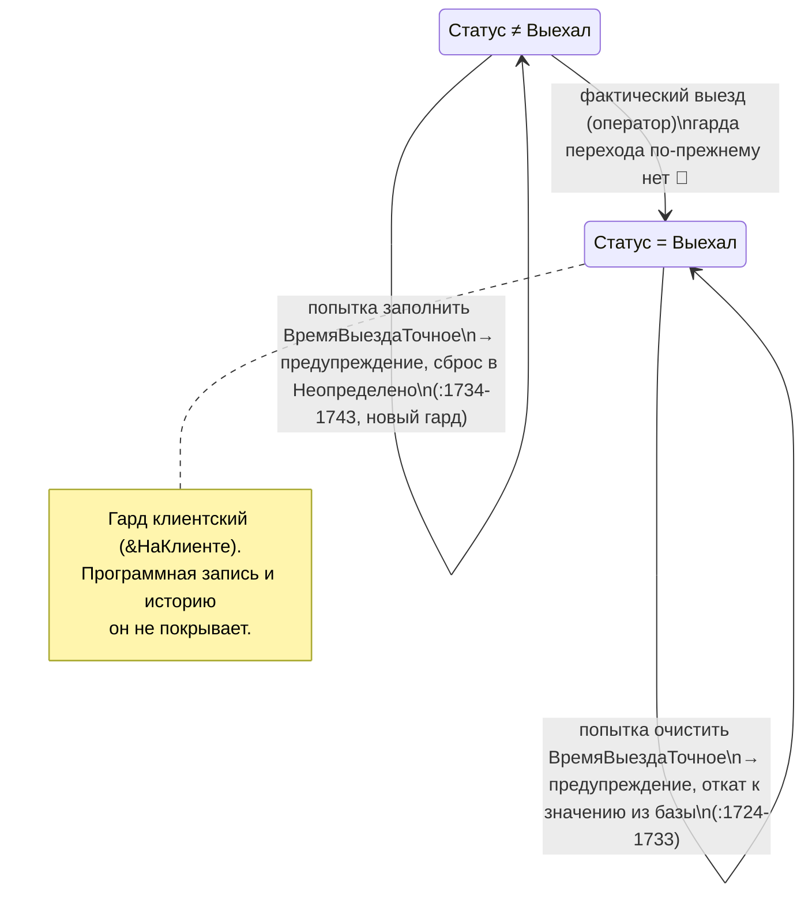

# Дельта доменных знаний — повторное извлечение №2 (собственная ветка ПСН «Реноме»)

> **Агент:** Detective (задача плана 6.10)
> **Дата:** 2026-08-22
> **Диапазон:** конфигурация `ПСН_РЕНОМЕ__АУДИТ/src` против канона `_reversa_sdd/` (импорт из Hotel, состояние `ec0e8d9`) и против уже принятой дельты `re-extraction/2026-06-18-ПСН/` (состояние `c52a282`).
> **Вход:** `code-analysis-delta.md` (Археолог, задачи 6.1–6.9, 9 секций) + **обязательная поправка** `../../integrity-report.md` (11 CRITICAL, задачи 6.1–6.9) + собственная сверка координат по исходникам.
> Этот документ — **дельта** к каноническим `../../domain.md`, `../../state-machines.md`, `../../permissions.md`. При расхождении канона и дельты приоритет у дельты. При расхождении настоящей дельты и `code-analysis-delta.md` в части координат приоритет у настоящей дельты: координаты здесь перепроверены по коду после `integrity-report.md`.
> **Git-истории ПСН нет** (`psn_Renome`, `master` без коммитов). Всё, что здесь выведено о намерениях, выведено из кода и маркерной разметки, а не из истории — поэтому ретроспективный ADR §5 помечен 🟡, а не 🟢.

## Шкала доверия
🟢 ПОДТВЕРЖДЕНО (прочитано в коде ПСН настоящей задачей) · 🟡 ВЫВЕДЕНО · 🔴 ПРОБЕЛ

---

## 0. Метод и границы доверия

### 0.1 Что перепроверено настоящей задачей

Каждая координата, вынесенная в §1–§4 настоящего документа, **прочитана в исходниках
`ПСН_РЕНОМЕ__АУДИТ/src`** — у диапазонов `X–Y` прочитаны обе границы. Всего перепроверено
**47 координат и диапазонов** в 15 файлах (14 строк таблицы; у `ПрогнозТурНалог` читались
и модуль, и форма):

| Файл | Что прочитано | Итог |
|---|---|---|
| `CommonModules/ОбменБухгалтерияНДС/Module.bsl` | `:915`–`:918` (M38), `:968`–`:974` (H25), `:840` (гейт «ЮП») | ✅ |
| `CommonModules/PayKeeperСервер/Module.bsl` | `:310`–`:312`, `:319`–`:322`, ветки `:324`, `:330` | ✅ |
| `CommonModules/ЗаявкаСервер/Module.bsl` | `:1229`–`:1232` | ✅ |
| `CommonModules/КалендарьЦен/Module.bsl` | `:248`–`:253` | ✅ |
| `Documents/ЗаявкаНаБронирование/Forms/ФормаДокумента/Module.bsl` | `:1723`–`:1746`, `:1749`–`:1763`, `:1622` | ✅ |
| `Documents/КоворкингСчета/Forms/ФормаДокумента/Module.bsl` | `:264`–`:280`, `:479`, `:490`–`:494` | ✅ |
| `Documents/АдминистраторыЗарплата/Forms/ФормаДокумента/Module.bsl` | `:93`–`:96`, `:930`–`:931`, `:1009`–`:1012`, `:1806`–`:1810`, `:2205`–`:2210` | ✅ |
| `Documents/ГорничныеЗарплата/Forms/ФормаДокумента/Module.bsl` | `:851`–`:854` | ✅ |
| `Documents/ГорничныеОбщийКвиток/Forms/ФормаДокумента/Module.bsl` | `:79`–`:84`, `:531`, `:534`–`:535` | ✅ |
| `Documents/ГрупповыеСчета/ObjectModule.bsl` | `:18`, `:21`–`:23` | ✅ |
| `Catalogs/Клиенты/Forms/ФормаЭлемента/Module.bsl` | `:22`–`:29` | ✅ |
| `DataProcessors/Интерфейс/Forms/Форма/Module.bsl` | `:1943`–`:1955` | ✅ |
| `DataProcessors/ПрогнозТурНалог/Forms/Форма/Module.bsl` + `Form.form` | `:14`, `:34`–`:36`, `:39`, `:115`, `:117`, `:122`, `:126`, `:182`, `:184`, `:189`, `:192`, `:262`, `:264`, `:269`; `Form.form:652`, `:669`, `:1023`, `:1038` | ✅ |
| `DataProcessors/ВыгрузкаДляФМС/Forms/Форма/Module.bsl` | `:14`–`:23` | ✅ |

### 0.2 Опровергнутые утверждения раскопок, на которых доменные выводы **не строятся**

Пять поправок `integrity-report.md`, изменивших формулировки настоящего документа:

| # | Что заявляли раскопки | Как на самом деле | Источник поправки |
|---|---|---|---|
| П-1 | H25 — блок `ОбменБухгалтерияНДС:968-971` | блок `:968`–`:974`; за границей `968-971` остаётся `//Продолжить;` (`:972`) — **та самая отмена выгрузки**, о которой говорит утверждение | `integrity-report.md` 6.9 HIGH 1; перепроверено настоящей задачей |
| П-2 | ПДн: `:118`, `:182`, `:262`; правило ставки `:114`, `:184`, `:264` | ПДн — `:115`, `:182`, `:262`; правило ставки — `:117`, `:184`, `:264`, плюс живая 4-я копия на `:14` | `integrity-report.md` 6.9 HIGH 2; перепроверено настоящей задачей |
| П-3 | H2 «🔴 открыт для `ГрупповыеСчета`» (задача 6.6) | H2 в контуре `ГрупповыеСчета` **не жив**: мутирующий параметр получает `ЗаявкаОбщееКлиентСервер:73-81`, а групповой контур пишет снимок и пересобирает `ДолгиОплата` из ТЧ | `integrity-report.md` 6.8 MEDIUM 2 — вердикт в пользу 6.8 |
| П-4 | H22 «занижение „Итого начисления“ в `МДМ_Цена` раз» | занижение **аддитивное**: `МДМ_Количество_Э × (МДМ_Цена − 1)`; «в `МДМ_Цена` раз» верно только для самой строки МДМ, но не для итога | `integrity-report.md` 6.4 HIGH |
| П-5 | C4 «🔴 открыт» (задача 6.5) | C4 закрыт волной `c52a282`, обе требуемые строки присутствуют в ПСН | `integrity-report.md` 6.5 CRITICAL 1 |

Дополнительно: систематическая ошибка верхней границы маркерных блоков длиннее 4 строк
(записано `X..X+3`) исправлена здесь для **H25** (`:968-974`), **H15** (`КалендарьЦен:248-253`),
**H17** (`АдминистраторыЗарплата:2205-2210`) — все три прочитаны заново.

⚠️ **Дополнено задачей 6.12a: случаев не три, а шесть.** Остальные три перечитаны по коду
и исправлены в `code-analysis-delta.md` (§6.9.7, §6.9.8 и по месту):

| Пункт | Было | Стало | Что оставалось за границей |
|---|---|---|---|
| **M39** `ВГ_ВыпискаГостиницы/ObjectModule.bsl` | `220-223` | **`:220`–`:225`** | `:224` — вторая строка живого `Сообщить` |
| **H27** `КоворкингСервер/Module.bsl` | `477-480` | **`:477`–`:496`** | 16 строк каскада `Попытка` (откат числа 31→30→29→28) |
| **H28** `КоворкингСервер/Module.bsl` | `843-861` | **`:843`–`:850`** и **`:853`–`:860`** | закрывающий маркер стоит на `:860`, а не `:861`; блоков **два**, не один: старый цикл закомментирован внутри обхода, копия вынесена после `КонецЦикла` (`:851`) |

Правило подтверждено на 20 блоках длиной ровно 4 строки — там координаты раскопок верны все
до одной. Источник: `integrity-report.md` 6.9 HIGH 1; `.reversa/state.json` → `needs_review`,
запись «ВСЕ unit (систематическая ошибка)».

### 0.3 Доказательство «в каноне не затронуто»

Сплошной греп по всему `_reversa_sdd/**/*.md` (включая `gaps.md`, `adrs/`, `traceability/`,
`c4-context.md`, `c4-containers.md`, `c4-components.md`, `architecture.md`, `deployment.md`,
`user-stories/`, `inventory.md`, `dependencies.md`, `confidence-report.md`, `questions.md`,
все 12 папок unit) по шести маскам:

| Маска | Попадания вне отчётов проверки и дельт |
|---|---|
| `ФормаФинансы` | `code-analysis.md:268` (в перечне **мёртвых** дублей-версий), `IMPORT.md:197-199`, ➕ **`Размещение/questions.md:32`** ⚠️ *(добавлено 6.12a — найдено задачей 6.11; в первой редакции таблицы отсутствовало)* |
| `ПрогнозТурНалог` | `IMPORT.md:201` — и всё |
| `ВремяВыездаТочное` | `data-dictionary.md:34` (только реквизит), `audit-bugs-2026-06-11.md:146` |
| `Оклад_Есть` | `audit-bugs-2026-06-11.md:100` — и всё |
| `КонтрольДаты` | **ноль** |
| `ФизЛицоПредоплата` \| `КонтрагентИНН` | **ноль** |

Вывод: три находки §4, оба гейта §2 и маршрутизация §3.3 в канонических спеках
(`domain.md`, `state-machines.md`, `permissions.md`, unit-спеки, ADR, traceability, C4)
**не описаны нигде**. Это пробел покрытия, а не расхождение формулировок.

⚠️ **Дополнено задачей 6.12a — критерий «мёртвости» повторён в каноне в ПЯТИ местах, не в двух.**
Маска `ФормаФинансы` ловит не все: синтаксический признак «суффикс имени ⇒ мёртвый объект»
записан также там, где имени формы нет. Полный перечень (сверен по канону, обе координаты
каждой строки прочитаны):

| # | Координата | Что утверждает | Чем опровергнуто |
|---|---|---|---|
| 1 | `code-analysis.md:268` | «в `Интерфейс` — `Оповещение_OLD`, `ФормаФинансы_OLD`, `ФормаФинансы_Старая` (мёртвые/устаревшие версии)», 🔴 техдолг | `Форма/Module.bsl:1944-1955` — маршрутизация по `Админ`; `_Старая` живая (§4.2) |
| 2 | `audit-bugs-2026-06-11.md:6` | «Не покрыто этим аудитом: … отчёты (Reports) … мёртвые ветки `_Старая/_OLD`» | из охвата выпал живой админский интерфейс финансов и падающий `СверкаПоЮрЛицам_LOD` (§3.1) |
| 3 | ➕ `Размещение/questions.md:32` (Q-04) | тот же список форм как доказательство «дубли-версии и мёртвый код» | то же; **найдено задачей 6.11**, ни одной задачей раскопок не названо |
| 4 | ➕ `traceability/code-spec-matrix.md:165` | «Дубли `_OLD` / `_Старая` / `_Исходный` / `_Версия` / `_НеИспользуется` … — tech-debt, **n/a**» | `АдминистраторыЗарплата_Версия` достижим из UI и чинился ПСН как живой — три маркированные правки (§4.2) |
| 5 | ➕ `inventory.md:50` и `architecture.md:90-95` (§7.1) | «объекты-дубликаты/устаревшие версии с суффиксами … следы незавершённого рефакторинга» 🟢/🟡 | тот же признак; перечень требует пересмотра по достижимости, а не по имени |

🟢 **Ключевое уточнение о природе дефекта.** `DataProcessors/Интерфейс/Forms/Форма/Module.bsl`
**побайтово идентичен** Hotel (MD5 `7b97d7ac35388a13f736c393661d34e3` в обоих деревьях; файла
нет в перечне 34 расходящихся `IMPORT.md` §4.3). Значит маршрутизация по признаку `Админ`
(`:1944-1955`) — **не дельта ПСН, а изначальный дефект канона**: она существовала на `ec0e8d9`,
то есть на момент построения самого канона. Формулировки «ПСН переклассифицировал форму»
здесь неверны — правильная: **канон был неверен изначально и импортирован вместе с ошибкой**.
Это же относится к строке матрицы прав §3.3 и к `Q-6.10-03`.
Источник: `.reversa/checkpoints/6.11.json` → `md5_detail`, `edits_first_named_here_detail`;
`.reversa/state.json` → `needs_review`, запись 6.11 «Финансы / permissions.md»;
`architecture-delta.md` §7.2.

🟢 **Проверено и правки не требует:** `Configuration/Configuration.distr` — **ложное
расхождение**, а не содержательное изменение: снят атрибут `used="true"` у всех 1248
`<items>` (1248 × 12 символов = 14 976 байт — вся разница без остатка), множество `userId`
и распределение `userMode` идентичны, семантических изменений ноль. Артефакт сериализатора
1C:EDT. Переклассифицирован в `IMPORT.md:196-198` и `architecture-delta.md` §3.2; ни
в `code-analysis-delta.md`, ни в настоящем документе он содержательным изменением
не числится — правка не требуется. Источник: `.reversa/checkpoints/6.11.json`
→ `configuration_distr`.

---

## 1. Новые / изменённые бизнес-правила

Нумерация `Δ-<код>-B<n>`: суффикс `B` отделяет вторую волну (собственная ветка ПСН, после
`c52a282`) от первой (`Δ-…-A`, дельта `2026-06-18-ПСН`). Коды модулей — из `domain.md` ч. 2.

### 1.1 Бронирование

| # | Правило | Источник | Доверие |
|---|---------|----------|---------|
| Δ-BR-B1 | **Остаток суммы возврата переносится на следующие брони того же платёжного документа.** Ранее возврат, превышавший распределение по первой броне, обнулялся (`− ОстатокКРаспределению_П`, где `_П` в этой ветке гарантированно 0), цикл рвался на первой итерации и «хвост» возврата молча терялся. Теперь `ОстатокСуммаВозврата = − ОстатокКРаспределению`. Затрагивает возвраты из кассы и из банковской выписки. | `CommonModules/ЗаявкаСервер/Module.bsl:1229-1232` (живая `:1231`, старая в комментарии `:1230`); потребители `Documents/КассовыйДокумент/Forms/ФормаДокумента/Module.bsl:575-587`, `Documents/ВыпискаБанка/Forms/ФормаДокумента/Module.bsl:594-606`. Пункт аудита **H4** | 🟢 |
| Δ-BR-B2 | **Поток «возврат по чеку ККМ» правило Δ-BR-B1 не получил**: `CommonForms/ЧекВозврат/Module.bsl:633` вызывает ту же функцию как процедуру и отбрасывает результат. Бизнес-эффект: возврат, оформленный чеком ККМ, распределения по броням не меняет. | `ЧекВозврат/Module.bsl:633` (дельта §6.2.2) | 🟢 факт / 🟡 доменная трактовка |
| Δ-BR-B3 | **Контракт обмена с сайтом сведён к единственному каналу HTTPS/JSON (`ЗаявкаСайт`/`ОбменСайт`).** COM/ADODB-мост к внешней MS SQL удалён физически; и до удаления он был мёртв (`возврат неопределено;` первой строкой тела, ноль вызовов). Внешняя MS SQL перестаёт быть узлом карты интеграций. | удалён блок Hotel `ЗаявкаНаБронирование/ObjectModule.bsl:366-445` (маркеры `// + Сайт НЕ Работает` `:366` / `:444`); живая часть была `:402-443`. В ПСН `ВыполнитьЗапросСайт` — 0 вхождений по всему `src` | 🟢 |
| Δ-BR-B4 | **Жизненный цикл брони и проведение по существу не изменены.** Единственная правка внутри `ОбработкаПроведения` (`ObjectModule.bsl:4-140`) лежит в закомментированном блоке (`:136`, `ДобавитьДвиженияДолг(Клиент, СуммаПроживание)` → `СуммаУслуги`). Движения занятости/долга, ранние `Возврат` по `ЛистОжидания`/`Отмена`/`Отказ` (BR-01) не тронуты. ⚠ Заявление раскопок «диапазон `:4-140` побайтово идентичен Hotel» **опровергнуто** (`integrity-report.md` 6.2 CRITICAL) — идентично **поведение**, не байты. | `ObjectModule.bsl:4-140`, правка `:136`. Пункт **L1** | 🟢 поведение / 🔴 «побайтово» опровергнуто |
| Δ-BR-B5 | **Снятие дублирующего вызова `ЗаявкаСервер.УдалитьИсториюКлиента` данные клиента не меняет** — первый (живой) вызов остался в `УдалитьДанныеДокумента` (`ObjectModule.bsl:261`); RF-14 в силе. Экономятся два холостых `Записать`. | `ObjectModule.bsl:219-221` (снятый дубль). Пункт **L1** | 🟢 |

### 1.2 Гости и регистрация

| # | Правило | Источник | Доверие |
|---|---------|----------|---------|
| Δ-GR-B1 | **Выгрузка в МВД (ФМС) больше не включает брони, помеченные на удаление.** В отбор добавлено `ЗаявкаНаБронирование.ПометкаУдаления = ЛОЖЬ`. Регуляторное правило: помеченная на удаление бронь не является основанием для уведомления о прибытии. | `DataProcessors/ВыгрузкаДляФМС/Forms/Форма/Module.bsl:22` (запрос `:15-23`, процедура `ДатаЗаездаПриИзмененииНаСервере` `:14`–…). Пункт **M40**, закрыт наполовину | 🟢 |
| Δ-GR-B2 | **Отменённые и отказные брони по-прежнему попадают в файл МВД** — отбора по `Статус` нет. Эталон двойного отбора существует в системе (`ОбменБухгалтерияНДС/Module.bsl:216-217, 285-286, 456-457, 522-523` — там есть и `Статус = Выехал`), но в ФМС-контур не перенесён. Это вторая, **открытая** половина M40: система уведомляет МВД о заездах, которых не было. | `ВыгрузкаДляФМС/Forms/Форма/Module.bsl:15-23` (дельта §6.3.3) | 🔴 открыто |
| Δ-GR-B3 | **Паспортный контур ПСН беднее Hotel и таким останется.** В ПСН нет `ПолучитьСнимок()`, нет мягкого контроля распознавания (`НезаполненныеОбязательныеПоля`, `НераспознанныеПоля`), нет признаков `Страница3Отсутствует`/`РегистрацияОтсутствует`, нет флажка `ПередаватьПолныйСкан` и подсветки паспортных полей. `PassportBoxВызовСервера_Переопределяемый/Module.bsl` в ПСН — 26 строк, одна функция. Эту функциональность Hotel **нельзя переносить в спеки ПСН**. | дельта §6.3.5; `SettingsStorages` в ПСН нет ни в одном виде | 🟢 |

### 1.3 Ценообразование

| # | Правило | Источник | Доверие |
|---|---------|----------|---------|
| Δ-PR-B1 | **Базовые тарифы окончательно выведены из эксплуатации.** 32 константы `БазовыйТариф*_XXX` + `ПередачаДанныхНаСайт_XXX` переименованы; последние читатели закомментированы; экспортная `КалендарьЦен.ПолучитьЦенаДня` переименована в `ПолучитьЦенаДня_НеИспользуется`. Это **завершение** миграции ADR-0004, а не новое ценовое решение — сама смена «константы → регистр `КалендарьЦен`» произошла до развилки Hotel/ПСН. | `CommonModules/КалендарьЦен/Module.bsl:248-253` (маркеры `:248`/`:253`, живая сигнатура `:251-252`, старая закомментирована `:249-250`). Пункт **H15** | 🟢 |
| Δ-PR-B2 | **`КалендарьЦен` — не единственный источник цены и никогда им не был.** Параллельно жива legacy-ветка: `ДокументыСервер_Старый/Module.bsl:202, 217, 219` → `КалендарьЦен_Старый/Module.bsl:5-19` → реквизиты `Catalog.КатегорииНомеров.БазовыйТариф*` (объект, который **не переименовывался** и к депрекации констант отношения не имеет). Обе ветки одинаковы в ПСН и Hotel. | дельта §6.1.1, §6.1.8 п.2 | 🟢 факт / 🟡 кто вызывает `_Старый` — не установлено (Q-6.1-01) |
| Δ-PR-B3 | **Два ценовых отчёта де-факто выведены из бизнеса, но разными способами.** `ПроданыеСНаценкой_OLD` формируется и даёт **ноль строк наценки при любых данных** (не осталось ни одного живого `Вывести`); `СверкаПоЮрЛицам_LOD` **падает** при формировании (`Возврат СуммаОсн;` закомментирован на `:270`, результат `Неопределено` уходит в арифметику на `:70`). Ни один из отчётов не отмечен в метаданных как неиспользуемый — только суффиксы `_OLD`/`_LOD` в имени. | `Reports/ПроданыеСНаценкой_OLD/Forms/ФормаОтчета/Module.bsl:82-171`; `Reports/СверкаПоЮрЛицам_LOD/Forms/ФормаОтчета/Module.bsl:187-271`, `:50`, `:70`, `:270` | 🟢 |
| Δ-PR-B4 | **Единственный UI редактирования 32 тарифных констант мёртв**: `CommonForms/НастройкаТарифов_НеИспользуется` и `НастройкаТарифов_OLD` зарегистрированы в `Configuration.mdo:481, 484`, но не входят ни в одну подсистему и из кода не открываются. Доступ — только через «Все функции». | дельта §6.1.4 | 🟢 |

### 1.4 Горничные

| # | Правило | Источник | Доверие |
|---|---------|----------|---------|
| Δ-HK-B1 | **Часы горничной на клиенте считаются по её `ДлинаСмены`, а не по фиксированной 8-часовой смене.** Клиентская формула приведена к серверной. Денежный итог не меняется (часы — не слагаемое `ЗарплатаИтого`), меняются отображаемые и печатаемые часы. | `Documents/ГорничныеЗарплата/Forms/ФормаДокумента/Module.bsl:851-854` (живая `:853`, старая `//КоличествоЧасов = КоличествоСмен * 8;` на `:852`). Пункт **H21** | 🟢 |
| Δ-HK-B2 | **В квитке горничной строка «МДМ» в колонку «Сумма» получает рубли (`МДМ_Сумма`), а не количество манипуляций.** Прежде `ИмяЗаполненияСумма` совпадало с `ИмяЗаполненияКоличество` (`МДМ_Количество_Э`, `:80`). **Занижение было аддитивным** (поправка П-4): `ИтогоНачисления` и «Остаток к выплате» занижались на `МДМ_Количество_Э × (МДМ_Цена − 1)`, а не масштабировались в `МДМ_Цена` раз — «Итого» накапливается по 13 строкам с `ТипСтроки = 1`, дефект портил одно слагаемое. | `Documents/ГорничныеОбщийКвиток/Forms/ФормаДокумента/Module.bsl:81-84` (живая `:83`); цепочка `:772-776` → `:782-784` → `:791-793` → `:797`. Пункт **H22** | 🟢 |
| Δ-HK-B3 | **Квиток собирается только по непомеченному на удаление документу `ГорничныеЗарплата` за месяц** (`ПометкаУдаления = ЛОЖЬ`). Но при двух и более живых расчётах за один месяц выбор остаётся **произвольным**: сохранены `ВЫБРАТЬ ПЕРВЫЕ 1` и `УПОРЯДОЧИТЬ ПО …Ссылка УБЫВ`, а `Ссылка` — UUID, не хронология. Правило «один действующий расчёт на горничную за месяц» системой по-прежнему не гарантируется. | `ГорничныеОбщийКвиток/Forms/ФормаДокумента/Module.bsl:531`, `:534-535`. Пункт **M30**, закрыт наполовину | 🟢 факт / 🟡 полнота |

### 1.5 Доп. услуги и коворкинг

| # | Правило | Источник | Доверие |
|---|---------|----------|---------|
| Δ-DK-B1 | **Уточнение DK-04 (месячный период аренды).** Если «то же число следующего месяца» не существует (29/30/31), число теперь **зажимается вниз** каскадом `Попытка` до −3 дней, и уже к зажатой дате применяется «−1 день». Следствие для бизнеса: аренда с `ДатаС = 31.01` заканчивается **27.02**, то есть короче календарного месяца на 3 дня. Это изменение **семантики** правила DK-04, а не только устойчивости кода. | `CommonModules/КоворкингСервер/Module.bsl:477-496` (внутри `СчетДатаПо` `:461-531`), шаг «−1 день» `:498-502`; побайтовый дубль на клиенте `CommonModules/КоворкингКлиент/Module.bsl:154-173`. Пункт **H27** | 🟢 фикс / 🟡 семантика |
| Δ-DK-B2 | **Почасовой счёт длиной больше суток считается как `24 × РазницаДни + (ЧасПо − ЧасС)`** вместо прежнего `24 + (ЧасПо − ЧасС)`, работавшего только для однодневного разрыва. Через `Сумма = Цена × Количество` дефект занижал и деньги — при том, что занятость писалась на все часы. | `Documents/КоворкингСчета/Forms/ФормаДокумента/Module.bsl:490-494` (живые `:492-493`, старая `//РазницаЕдиницы = 24 + РазницаЕдиницы;` на `:491`), внутри `СчетСуммаКоличествоЧасы` `:479-499`. Пункт **M32** | 🟢 |
| Δ-DK-B3 | **`ОбновитьОплатыКоворкинг` стала двухфазной**: сначала фаза распределения с накоплением `МассивКУдалению`, затем отдельная фаза удаления после `КонецЦикла` (было — распределение и удаление в одном цикле). Результат тот же, структура процесса другая: описание в каноне подлежит **переписыванию**, а не сдвигу координат. | `КоворкингСервер/Module.bsl:817-862`; старый цикл закомментирован `:843-850`, перенесённый `:853-860`. Пункт **H28** | 🟢 |
| Δ-DK-B4 | **Задвоение оплат по дням в финансовом результате коворкинга (C4) закрыто** — обе требуемые строки (`Если ОстатокСуммаОплаты = 0 Тогда Продолжить;` и сохранение уменьшения в `СтрокаОплата`) присутствуют в ПСН. Закрыто **волной `c52a282`**, а не ветвью ПСН. ⚠ Поправка П-5: раскопки объявляли C4 открытым. | `DataProcessors/ФинансовыйРезультатКоворкинг_Расширенный/ManagerModule.bsl:488` и далее; то же в `ФинансовыйРезультатКоворкинг/ManagerModule.bsl:319-321, 334-336, 346-348`. Пункт **C4** | 🟢 (по `integrity-report.md` 6.5 CRITICAL 1) |
| Δ-DK-B5 | **Канон приписывает `ОбновитьОплатыКоворкинг` транзакцию, которой нет** — ни в ПСН, ни в Hotel. До правки Δ-DK-B3 процедура падала посреди правки денежных ТЧ **без отката**. Ошибочное утверждение — `code-analysis.md:639`, `ДопУслугиКоворкинг/design.md:124`, `ДопУслугиКоворкинг/questions.md:16`, `questions.md:406`. | дельта §6.5.7 A4 | 🟢 факт / 🔴 канон неверен |

### 1.6 Финансы и касса

| # | Правило | Источник | Доверие |
|---|---------|----------|---------|
| Δ-FN-B1 | **FN-07 подтверждено без оговорок**: дата группового счёта = `Макс(Счет.ДатаПо)` по строкам. Правка ПСН в этом контуре — **семантически нулевая**: снято самоприсваивание `ДатаДокумента = ДатаДокумента;`. Групповой счёт по-прежнему **не проводится вовсе** (нет `ОбработкаПроведения`, нет `registerRecords` в `.mdo`) — долги ведутся ТЧ заявки. | `Documents/ГрупповыеСчета/ObjectModule.bsl:18` (`Макс`), `:21-23` (маркерный блок, закомментировано `:22`). Пункт **L2** | 🟢 |
| Δ-FN-B2 | **В контуре `ГрупповыеСчета` дефект «нераспределённый остаток вместо распределённой суммы» (H2) не жив.** Мутирующий по ссылке параметр принадлежит `ЗаявкаОбщееКлиентСервер:73-81`; групповой контур передаёт локальную `СуммаОплатыЗаявка`, пишет в ТЧ снимок `_П` и пересобирает `ДолгиОплата` из ТЧ. ⚠ Поправка П-3: задача 6.6 объявляла H2 открытым для групповых счетов — спор разрешён в пользу 6.8. | `ГрупповойСчетСервер/Module.bsl:454, 480, 502, 563-570`; `ЗаявкаОбщееКлиентСервер/Module.bsl:73-81` | 🟢 (по `integrity-report.md` 6.8 MEDIUM 2) |
| Δ-FN-B3 | **Зеркальное искажение в ветке групповых счетов PayKeeper остаётся открытым**: `ДолгиОплата` получает **полную** `СуммаРаспределено` с `ЗаменитьСумму = Истина`, а `ДобавитьИЗаписатьДокументОплатыВГрупповойСчетОбъект` объявлена `Функция` **без `Возврат`**. Если счёт принял меньше платежа — `ДолгиОплата` завышена, остаток занижен. | `CommonModules/PayKeeperСервер/Module.bsl:324-328`; `ГрупповойСчетСервер/Module.bsl:421-431, :521, :524`. Открыто как **Q-6.8-01** | 🟡 |

### 1.7 Персонал и зарплата

| # | Правило | Источник | Доверие |
|---|---------|----------|---------|
| Δ-HR-B1 | **Ручная корректировка «оклад за смену = 0» теперь переживает переоткрытие документа** — см. §2.3 (машина состояний строки зарплаты). Единственная правка среза «Персонал» с денежным эффектом. | `Documents/АдминистраторыЗарплата/Forms/ФормаДокумента/Module.bsl:930-931`; `_Версия:966`. Пункт **H18** | 🟢 |
| Δ-HR-B2 | **Количество заселений «СтритАрт» снова доезжает до ТЧ `ЗарплатаСмены`** (в отчётность и печатную форму). В том же блоке **депрекированы** количества заселений «ДомСоветов» (закомментированы). Денежная часть блока (`Сумма*`) не тронута. | `АдминистраторыЗарплата/Forms/ФормаДокумента/Module.bsl:2205-2210` (маркеры `:2205`/`:2210`, закомментировано `:2206-2207`, живое `:2208-2209`); `_Версия:2239-2244`. Пункт **H17** | 🟢 |
| Δ-HR-B3 | **В системе сосуществуют две модели тарификации завтраков администраторов.** Главный документ берёт ставку из реквизита справочника (`:2940-2967`); `_Версия` — из периодического РС `АдминистраторыСуммаЗаЗавтраки_Версия` по `ДатаНазначения` (`_Версия:449-468`, `:2996-3033`) плюс автоподстановка числа завтраков по длине смены для площадки «Чехов» (`_Версия:2823-2844`: `≤12 ч → 1, иначе 2`). Это незавершённая миграция модели ЗП, а не дубль-версия. | дельта §6.7.5 | 🟢 |
| Δ-HR-B4 | **Периодический выбор ставки завтраков в `_Версия` закрыт наполовину и даёт денежную ошибку**: добавлено `УПОРЯДОЧИТЬ ПО ДатаНазначения УБЫВ`, но нет `ГДЕ`, а параметр `ДатаНазначения = ДатаУчета` остался неиспользованным. Прошлые периоды пересчитываются по **будущей** ставке. | `АдминистраторыЗарплата_Версия/Forms/ФормаДокумента/Module.bsl:456-465`, `:468`. Пункт **H19**, открыт как **Q-6.7-01** | 🟡 |
| Δ-HR-B5 | **Формулы ЗП (HR-01…HR-07) не изменены ни на символ** — доказано непересечением всех хунков среза `{93–96, 471, 476, 481, 931, 1009–1012, 2205–2210}` с границами расчётных процедур. ⚠ Но каноническое описание состава «Итого» надо **исправить**: оба итога (`:1845-1856`, `:2082-2090`) начинаются с `Оклад_…_Э`, а не состоят «исключительно из полей `Сумма*`» — это ровно то поле, через которое действует денежный эффект Δ-HR-B1. | дельта §6.7.4/§6.7.7; поправка `integrity-report.md` 6.7 HIGH 1 | 🟢 формулы / 🔴 состав «Итого» в раскопках описан неверно |

### 1.8 Аудит и отчётность

| # | Правило | Источник | Доверие |
|---|---------|----------|---------|
| Δ-AU-B1 | **Нижняя граница отбора для расчёта тур. налога переведена с `ДатаСМинимум` на `ДатаПоМаксимум`.** Бизнес-эффект: бронь, пересекающая границу месяца (28.01–03.02), попадает в февральский расчёт и больше не теряется. | `DataProcessors/РасчетТурНалога/Forms/Форма/Module.bsl:218-227` (закомментированная `:219`, живая `:220`, условия `:222`/`:227`); маркер в дубликате блока `:237-240`. Пункт **H13** | 🟢 |
| Δ-AU-B2 | **Ставка тур. налога параметризована по году**: `Если Год(ДатаРасчета) < 2026 Тогда К1 = 1 Иначе К1 = 2`, `К2 = 100 + К1`. Верхней границы года нет — с 2026-го ставка «заморожена» на 2 %. | `РасчетТурНалога/Forms/Форма/Module.bsl:247-251`, `К2` на `:252`, параметры запроса `:254-255` | 🟡 (намеренность заморозки не установлена) |
| Δ-AU-B3 | **Итоги тур. налога на форме всегда равны нулю.** `РасчитатьТурНалогНаСервере` (`:14-24`) заполняет `ТурНалогЗаявки` (`:15`), а итоги (`:17-19`) считает по `ТурНалогДетально`, которую заполняет только `РасчитатьТурНалогНаСервере_1` (`:449-459`) — процедура, не вызываемая **ниоткуда** (сплошной греп по всему `src` даёт три строки: объявление `:449`, единственный вызов `ЗаполнитьТурНалогДетально()` `:450`, объявление `:462`). | `РасчетТурНалога/Forms/Форма/Module.bsl`. Пункт **H14** | 🔴 открыт |
| Δ-AU-B4 | **Делитель `101` захардкожен в 17 местах живого кода** (`:558, 564, 576, 586, 599, 609, 837, 848, 857, 1143, 1151, 1157, 1298, 1306, 1312, 1480, 1485`) плюс 3 закомментированных. Соперничающая обработка `РасчетТурНалога1` удалена, но параметризация ставки (Δ-AU-B2) до этих мест не дошла. **H12 и H14 маскируют друг друга**: починка H14 немедленно активирует занижение налога вдвое за 2026+. | там же. Пункт **H12**, закрыт наполовину | 🔴 |
| Δ-AU-B5 | **Контур туристического налога не документирован в `_reversa_sdd` ни одним unit** — при трёх пунктах HIGH и первом приоритете исправления в отчёте аудита (`audit-bugs-2026-06-11.md:227`). | сплошной греп маской `турналог\|тур. налог\|туристическ` — 12 вхождений в 7 файлах, ни одного в `requirements/design/tasks` какой-либо папки unit. **Q-6.9-02** | 🔴 ПРОБЕЛ |

### 1.9 Интеграции и обмен

| # | Правило | Источник | Доверие |
|---|---------|----------|---------|
| Δ-IN-B1 | **Предоплаты физических лиц начинают выгружаться в бухгалтерию.** Блок «ФП» выгрузки НДС управлялся чужой галкой: гейт проверял `ТипыСчетов.ЮрЛицоПредоплата` (тот же флаг, что и предыдущий блок «ЮП»), из-за чего блок физлиц либо пропускался при снятой галке ЮП, либо исполнялся всегда при поднятой. Теперь блок управляется своим флагом `ФизЛицоПредоплата`. | `CommonModules/ОбменБухгалтерияНДС/Module.bsl:915-918` (маркеры `:915`/`:918`, старая `//…ЮрЛицоПредоплата…` `:916`, живая `:917`); гейт «ЮП» — `:840`. Пункт **M38** | 🟢 |
| Δ-IN-B2 | **Отменён контроль «предоплата юрлица без ИНН не выгружается».** См. §4.1 — квалифицируется как **регрессия под видом фикса**. | `ОбменБухгалтерияНДС/Module.bsl:968-974`. Пункт **H25** | 🟢 факт / 🔴 доменные последствия |
| Δ-IN-B3 | **Дата оплаты по строке банковской выписки доходит до `РегистрСведений.БезналЗагрузка`**: ключ структуры исправлен с `"ДатаОплаты "` (хвостовой пробел) на `"ДатаОплаты"`. Сопоставление в `ЗаполнитьЗначенияСвойств` идёт по имени, поэтому прежде дата терялась при каждой загрузке. | `CommonModules/ОбменВыписка/Module.bsl:132-135` (живая `:134`, старая `:133`). Пункт **H24** | 🟢 |
| Δ-IN-B4 | **В ТЧ `ДолгиОплата` по эквайринговому платежу пишется распределённая сумма**, зафиксированная снимком `СуммаРаспределено_П` **до** распределения, а не нераспределённый остаток. Раньше остаток оплаты завышался и один платёж можно было распределить повторно. Правка покрывает **только ветку заявок** (`ТипЗнч = ДокументСсылка.ЗаявкаНаБронирование`); ветки `ГрупповыеСчета` (`:324`) и `КоворкингСчета` (`:330`) не тронуты — см. Δ-FN-B2 и Δ-FN-B3. | `CommonModules/PayKeeperСервер/Module.bsl:310-312` (снимок `:311`) и `:319-322` (подстановка `:321`, старая `:320`). Пункт **H2** | 🟢 |
| Δ-IN-B5 | **`ПередачаДанныхНаСайт` никогда не была тумблером обмена с сайтом** — ноль чтений и в ПСН, и в Hotel. Переименование в `_XXX` ничего не отключило; живой контур сайта (`ОбменСайт`, HTTPS/JSON) побайтово идентичен Hotel. Канон описывает несуществующий feature-флаг. | `Configuration/Configuration.mdo:393`; ошибочные утверждения канона — `data-dictionary.md:1205`, `database.md:392`, `code-analysis.md:1166` | 🟢 факт / 🔴 канон неверен |
| Δ-IN-B6 | **Уведомление о неудачной загрузке выписки не отправляется**: `Возврат;` в блоке `Исключение` выходит **до** отправки письма; получатель захардкожен. Обмен молча заканчивается строкой в логе (логи без ротации). | `CommonModules/ЗагрузкаВыпискиГостиница/Module.bsl:24` (выход), `:64` (адрес), `:7`, `:11` (лог). Пункты **L10**, **M39** | 🔴 открыто |
| Δ-IN-B7 | **Протокол обмена выпиской врёт при удалении**: между `Очистить()` и `Возврат -1;` нет `Записать()` — запись в `БезналЗагрузка` остаётся, а `УдаленоКоличество` инкрементируется. | `ОбменВыписка/Module.bsl:164`, `:167`; `ExchangePlans/ВГ_ВыпискаГостиницы/ObjectModule.bsl:138`. Пункт **H23** | 🔴 открыто |
| Δ-IN-B8 | **Секреты в исходниках: закрыта 1 точка из 5.** Устранена MS SQL (Δ-BR-B3). Живы: FTP (`ФТПСервер/Module.bsl:199-202`), Green API Telegram (`TelegramСервер/Module.bsl:4, 20, 59, 120`), COM `Pwd="123"`, `СерверККМ` `Admin/Admin`. `gaps.md` G-C01 остаётся 🔴 КРИТИЧНЫМ, центр тяжести сместился в unit «Интеграции». | дельта §6.6.9(д) | 🟢 |

---

## 2. Изменения машин состояний

Канон `state-machines.md` содержит 8 машин. Настоящая дельта затрагивает **одну** из них
(§1 «Бронь» — новым гардом инварианта) и добавляет **два** правила состояния, которых в каноне
нет вовсе. Машины 3, 4, 6, 7, 8 (`КассоваяСмена`, `Счет.Закрыт`, `РучноеИзменение`, узел обмена,
`PayKeeperПлатежи`) — **не затронуты**: подтверждено грепом §0.3, ноль вхождений затронутых
имён в `state-machines.md`. Машина 5 (Счёт коворкинга) — состав состояний не меняется, меняется
арифметика перехода (Δ-DK-B2, Δ-DK-B3).

### 2.1 Бронь — первый исполняемый гард инварианта статуса (изменение машины `state-machines.md` §1)

🟢 **Новый инвариант:** `ВремяВыездаТочное` заполнено **⇔** `Статус = Выехал`.

Обработчик `ВремяВыездаТочноеПриИзменении` (`Documents/ЗаявкаНаБронирование/Forms/ФормаДокумента/Module.bsl:1723-1746`)
после правки читается как две симметричные ветви:

| Ветвь | Условие | Поведение | Координата |
|---|---|---|---|
| «Выехал» | `Статус = Перечисление.СтатусБрони.Выехал` | нельзя **очистить** ранее заполненное время: предупреждение и откат к значению из базы | `:1724-1733` |
| «не Выехал» | все остальные статусы: `Бронь`, `Проживает`, `Неустойка`, `ОтменаБронирования`, `ОтказОтБронирования` | нельзя **заполнить**: предупреждение «должно быть пустое время выезда» и сброс в `Неопределено` | `:1734-1743` (маркерный блок `:1735-1738`, живая `:1737`) |

До правки вторая ветвь проверяла **чужое** поле `Объект.ВремяЗаездаТочное` (copy-paste
с донора `ВремяЗаездаТочноеПриИзменении`, `:1611`), поэтому давала одновременно
**ложноотрицательное** срабатывание (статус `Бронь`, время заезда пусто → проверка молчит,
в базу проходит бронь с непустым временем выезда — инвариант нарушен) и **ложноположительное**
(статус `Проживает`, время заезда заполнено, оператор чистит выезд → ложное предупреждение
и сброс). 🟢

**Доменное значение.** Канон `state-machines.md` §1 фиксирует 🔴 ПРОБЕЛ: «гарды (запрет
недопустимых переходов) в коде не обнаружены». Правка ПСН этот пробел **не закрывает,
но сужает**: появляется первый и пока единственный найденный гард инварианта статуса. Он
**клиентский** (`&НаКлиенте`, «при изменении»), а не серверный:

- 🔴 программная запись брони и любой путь мимо формы гард не проходят;
- 🔴 **исторические записи с нарушенным инвариантом правкой не чинятся** — ретроспективной проверки нет (**Q-6.2-02**);
- 🟢 остаточная асимметрия: у времени **заезда** есть пустая ветвь `ИначеЕсли Статус = Выехал Тогда` (`:1622`) — в статусе «Выехал» время заезда не валидируется вовсе; у времени выезда такой ветви нет.

Хвост обработчика не тронут: `ПроверкаВремяВыездаТочное()` (`:1745`, функция `:1749-1763`) —
предупреждение при `НачалоДня(ВремяВыездаТочное) > РезервПо`. 🟢



### 2.2 Счёт коворкинга — новое ограничение состояния «почасовой счёт» (`state-machines.md` §5 / DK-01)

🟢 **Новое правило состояния:** для счёта коворкинга с `ПериодАренды = "ЧАС"` обязано
выполняться `ДатаС = ДатаПо`. Почасовой счёт — однодневный по определению.

Гейт стоит в `Процедура КонтрольДаты(...)` (`Documents/КоворкингСчета/Forms/ФормаДокумента/Module.bsl:228-297`),
блок `:264-280`, **перед** прежней сверкой с `КоворкингСервер.СчетДатаПо` (`:282-294`).
Вызывается из `ДатаСПриИзменении` (`:219`) и `ДатаПоПриИзменении` (`:224`). При нарушении —
предупреждение «'Дата С' = 'Дата По' для периода аренды 'ЧАС' … ИЗМЕНЕНИЕ НЕ РАЗРЕШЕНО» и
**откат изменённой даты к значению из базы** (`:273-274`), затем `Возврат`. 🟢

Доменные оговорки:
- 🟡 **Гейт живёт только на форме.** `Documents/КоворкингСчета/ObjectModule.bsl` побайтово идентичен Hotel и этого условия не содержит → программное создание многодневного почасового счёта по-прежнему возможно (**Q-6.5-01**).
- 🟡 **Гейт и Δ-DK-B2 разнонаправлены.** В том же файле ПСН исправила арифметику многодневного почасового счёта (`24 × РазницаДни + Δчас`, `:490-494`), то есть одновременно **запретила** такое состояние на форме и **научилась** его считать. Какое из двух намерений окончательное — из кода не следует.
- 🔴 Текст предупреждения сформулирован как утверждение факта, а не как требование — читается двусмысленно оператором.
- ⚠ Разметка: закрывающий маркер блока `:490-494` записан как `// + Аудит` вместо `// - Аудит` — единственный такой случай во всей конфигурации; ломает автопоиск блоков по паре маркеров.

### 2.3 Строка зарплаты администратора — флаг `Оклад_…_Есть` как состояние «ручная корректировка» (новое; в каноне отсутствует)

🟢 **Модель «И / `_Р` / `_Э` / `_Есть`»** (канон описывает её для горничных как HK-02;
для администраторов — только во `flowcharts/Персонал.md:46-50`, без правила в `domain.md`)
**в администраторской зарплате не работала**, и ПСН это починила.

Механика состояния, прочитана целиком:

| Шаг | Что происходит | Координата |
|---|---|---|
| Гейт применения | `Если ТД["Оклад_…_Есть"] Тогда Оклад = ТД["Оклад_…_Р"] Иначе Оклад = ТД["Оклад_…"]`; результат → `ТД["Оклад_…_Э"]` | `:1806-1810`, запись `:1811` |
| Тип флага | реквизит формы `Оклад_DDMMYY_Есть` — `Булево` (`:1072`); реквизит ТЧ `Оклад_Есть` — `Boolean` | `АдминистраторыЗарплата.mdo:282`, `:1400` |
| Восстановление при перечитывании | **было** `НоваяСтрока[Имя] = НайденнаяСтрока.Оклад_Р` (**сумма**), **стало** `= НайденнаяСтрока.Оклад_Есть` (**флаг**) | `:930-931`; `_Версия:966` |

**Доменное следствие.** Прежде булев флаг восстанавливался из числовой суммы: платформа
приводила `0 → Ложь`, и ручная корректировка «оклад за смену = 0» после переоткрытия документа
**исчезала** — день пересчитывался полным окладом. Это переплата в пользу работника, и она
происходила тихо. Обратный случай (ручной ненулевой оклад) флаг сохранял случайно, приведением
`≠0 → Истина`. Теперь состояние «за этот день оклад задан вручную» персистентно. 🟢

Денежный эффект **реален** вопреки формулировке раскопок: `Оклад_…_Э` — первое слагаемое обоих
«Итого» (`:1845-1856` и `:2082-2090`), а не «Итого собирается исключительно из полей `Сумма*`»
(поправка `integrity-report.md` 6.7 HIGH 1). 🟢

⚠ **У этой правки нет маркера `// + Аудит`** — она находится только диффом против Hotel.
Из 21 файла с маркерами это единственное денежное изменение, оставшееся неразмеченным.

🟡 Смежное состояние остаётся дефектным: `НомерСмены = 4` обнуляет только `Оклад*`/`Часы_`,
затем `Перейти ~ВЫХОД` — суммы за проживающих/заселения/завтраки остаются от прежнего расчёта
(`:1779-1791`, пункт **M24**, открыт).

---

## 3. Изменения матрицы прав

> Канон `permissions.md` фиксирует ключевой вывод: доменное разграничение — **код-уровневый RBAC**
> по `Catalog.Пользователи.Админ`, а роли платформы почти пусты по домену. Настоящая дельта этот
> вывод **не опровергает**, а достраивает тремя измерениями, которых в §3.2 канона нет:
> доступ к недостижимой из меню функциональности через «Все функции», гейт по площадке сети
> и **маршрутизацию форм по признаку `Админ`**.

### 3.1 Выпотрошенные отчёты остаются доступными административным ролям через «Все функции»

| Защищаемый элемент | Фактическая доступность | Источник | Доверие |
|---|---|---|---|
| `Report.СверкаПоЮрЛицам_LOD`, `Report.ПроданыеСНаценкой_OLD` | **Право «Просмотр» есть** у `Администратор` и `ПолныеПрава`; из меню недостижимы, но открываются через «Все функции» | `Configuration.mdo:723`, `:725` (объявление); `:16` — `ManagedApplication`; `Roles/Администратор/Rights.rights` — 347 Б, ноль `<object>`, `setForNewObjects=true`; `Roles/ПолныеПрава/Rights.rights` — 6 отрицательных переопределений, все `Catalog.*`, ни одно не касается этих отчётов | 🟢 права / 🟡 фактическая открытость «Всех функций» |
| Кнопки этих отчётов в финансовых формах | **8 точек вызова в двух живых формах**, все тела состоят только из комментариев: `ФормаФинансы:168, 173, 301, 306`; `ФормаФинансы_Старая:172, 177, 305, 310`. Кнопки кликабельны и молча ничего не делают | дельта §6.9.4; ещё 2 точки — в двоичном `ФормаФинансы_OLD/Form.oform:5282, 5286` (итого 10 упоминаний, поправка `6.8-integrity`) | 🟢 |
| Подсистемы | Ни один из двух отчётов не входит ни в одну подсистему (`ОсновнаяСистема.mdo` — 6 `<content>Report.…`, ни одного нашего; `ПоддержкаОборудования` — ноль) | дельта §6.9.4 | 🟢 |

🔴 **Доменное следствие:** `СверкаПоЮрЛицам_LOD` роняет сеанс любого, кто откроет её через
«Все функции» и нажмёт «Сформировать» (Δ-PR-B3). Роли, у которых это право есть, — ровно
административные. Депрекация отчётов выполнена **переименованием и выпотрашиванием тела**,
а не снятием прав или пометкой в метаданных; закрытость пункта «Все функции» — клиентская
настройка сеанса, в исходниках не хранится, поэтому доказать закрытость невозможно. 🟡

### 3.2 Гейт видимости сканера паспорта по площадке «Реноме» — координата исправлена

| Защищаемый элемент | Условие видимости | Источник | Доверие |
|---|---|---|---|
| `ФормаСканироватьРазворотПаспорта`, `ФормаСканироватьРегистрациюПаспорта` в карточке клиента | видны **только если `НастройкиСервер.ЭтоРеноме() = Истина`** | `Catalogs/Клиенты/Forms/ФормаЭлемента/Module.bsl:22-29` — `Если … Тогда Видимость_П = Истина Иначе Ложь КонецЕсли` (`:22-26`), присвоение `.Видимость` (`:28-29`) | 🟢 |

⚠ **Поправка к приоритетной дельте `2026-06-18-ПСН`.** Та дельта (`specs-delta.md:178`,
`code-analysis-delta.md:119-123`) указывает гейт как `ФормаЭлемента/Module.bsl:17-27` и цитирует
однострочник `Видимость_П = НастройкиСервер.ЭтоРеноме();`. Фактически строки **22–29**, и в коде
стоит полная конструкция `Если … Иначе … КонецЕсли`. Координаты `17-27` были взяты из границ
хунка `diff`, а цитата — пересказом. Само правило (§3.1 дельты №1) верно и остаётся в силе;
`permissions.md` §3.3 правок не требует — фасады `Это*()` там уже описаны (`permissions.md:95`,
источник `НастройкиСервер:39-67`). 🟢

### 3.3 Маршрутизация формы финансов по признаку `Админ` — новая строка матрицы прав

| Операция / функция | Требует `Админ` | Поведение | Источник | Доверие |
|---|:---:|---|---|---|
| Открытие финансового меню (команда «Финансы» на шахматке) | ДА → **другая форма** | `Админ = Истина` → `Обработка.Интерфейс.Форма.**ФормаФинансы_Старая**`; иначе → `Обработка.Интерфейс.Форма.**ФормаФинансы**` | `DataProcessors/Интерфейс/Forms/Форма/Module.bsl:1943-1955`: чтение `ТекущийПользователь` `:1945`, чтение реквизита `"Админ"` `:1946`, ветвление `:1947`, `_Старая` `:1949-1950`, обычная `:1952-1953` | 🟢 |

Это **первый обнаруженный случай, когда признак `Админ` не расширяет права внутри одной формы,
а маршрутизирует на другую форму.**
⚠️ **Уточнение 6.12a: это не дельта ПСН.** `Форма/Module.bsl` побайтово идентичен Hotel
(MD5 `7b97d7ac35388a13f736c393661d34e3`), маршрутизация существовала на `ec0e8d9` — то есть
на момент построения канона. Строка матрицы прав отсутствует не потому, что ПСН что-то
изменил, а потому, что **канон был неверен изначально** (см. §0.3). Для задачи 6.12 это
означает правку `permissions.md` как исправление ошибки канона, а не как перенос дельты.
Канон `permissions.md` §3.2 описывает шесть операций вида
«требует `Админ` → иначе запрет/просмотр»; строки «требует `Админ` → иная форма» там нет.
Строку **необходимо добавить** в §3.2, а вывод §4 «Оператор стойки … может вести брони, оплаты,
гостей» уточнить: оператор и администратор работают в **разных** финансовых интерфейсах.

Подробности и последствия для доверия к аудиту — §4.2.

---

## 4. Три находки, требующие доменной квалификации

### 4.1 H25: отмена контроля ИНН, помеченная маркером починки — регрессия под видом фикса

**Что в коде** (прочитано настоящей задачей, `CommonModules/ОбменБухгалтерияНДС/Module.bsl`,
внутри `Функция ЗаписатьЗаявки(Знач ИмяФайла, ДатаС, ДатаПо, ТипыСчетов) Экспорт`, `:68`–`:998`):

```
968: 	// + Аудит
969: 	//Если НЕ ЗначениеЗаполнено(Строка.КонтрагентИНН) Тогда
970: 	//	Сообщить("Контрагент - Юр. лицо. Не заполнен ИНН у контрагента " + Строка.Контрагент +
971: 	//		". Выгрузка заявки " + ЗаявкаНомер + " от " + Строка.ЗаявкаДата + " ОТМЕНЯЕТСЯ.");
972: 	//	Продолжить;
973: 	//КонецЕсли;
974: 	// - Аудит
```

⚠ Границы блока — **`:968`–`:974`**, а не `:968-971`, как записано в §6.9.7/§6.9.8 раскопок и
в `pending-questions.md` (поправка П-1). Отсечённые `:972-973` содержат `Продолжить;` — **саму
отмену выгрузки**, то есть ровно то, о чём утверждение. Читатель, открывший `968-971`,
ключевой строки не увидит.

**Какое бизнес-правило отменено.** Правило звучало так: *«заявка юридического лица,
у контрагента которого не заполнен ИНН, в файл обмена с бухгалтерией не выгружается,
а оператор получает адресное сообщение с номером и датой заявки»*. Это правило было
одновременно **контролем качества НСИ** (заставляло заполнить ИНН в карточке контрагента)
и **предохранителем учёта** (не выпускало в бухгалтерию документ, который там невозможно
привязать к контрагенту). После правки не осталось ни того, ни другого: строка выгружается,
сообщение не выводится. 🟢

**Почему это регрессия, а не починка.** Пункт аудита H25 (`audit-bugs-2026-06-11.md:122-123`)
формулировал дефект иначе: *«блок „ФП“ скопирован с „ЮП“: отбирает физлиц, но пропускает строки
с пустым ИНН (у физлиц он обычно пуст) → большинство предоплат физлиц молча не выгружается»*.
Требовалось **не отбрасывать предоплаты физлиц**. Правильная и достаточная починка уже
существует рядом — Δ-IN-B1: гейт блока переведён на свой флаг `ФизЛицоПредоплата` (`:917`).
Дополнительно снимать фильтр ИНН не требовалось — а он снят **на весь цикл функции**, не только
для блока «ФП». Сама дельта Археолога противоречива: §6.6.3 оправдывает правку («фильтр отсекал
данные, которые в файл всё равно не попадали» — структура «ФП» ИНН/КПП не содержит, `:976-986`),
§6.9.8 квалифицирует как «🔴 не закрыт, ухудшен». **Настоящая дельта разрешает спор в пользу
§6.9.8** по трём основаниям:

1. Блок кода лежит в **общем** цикле `Для Каждого Строка Из ТЗ` (`:964`), а не внутри блока «ФП»: отключён контроль для всех типов счетов, включая юрлица, где ИНН обязателен.
2. Текст удалённого сообщения прямо адресован юрлицам («Контрагент - Юр. лицо»), то есть снятая проверка обслуживала **не** тот сценарий, который требовал починки.
3. Симптом устранён, контроль потерян, и это **замаскировано маркером `// + Аудит`** — тем же, которым размечены остальные 38 маркерных блоков конфигурации, в подавляющем большинстве настоящие починки. Маркер здесь работает как ложный сертификат качества.

**Учётные последствия** (🟡 ВЫВЕДЕНО — обратный контур в бухгалтерии не наблюдался):

- В файл обмена попадают строки юрлиц **без ИНН**. Принимающая сторона либо создаёт дубль контрагента, либо отвергает строку — в обоих случаях **молча**, потому что сообщение оператору снято.
- Расхождение «гостиница ↔ бухгалтерия» по НДС становится **необнаружимым на стороне гостиницы**: раньше оператор видел, какая именно заявка не ушла, теперь считает, что ушли все.
- Контроль качества НСИ по реквизиту «ИНН контрагента-юрлица» больше не поддерживается ничем: ни `fillChecking`, ни проверкой на выгрузке.
- 🔴 Ни один блок функции `ЗаписатьЗаявки` не обёрнут в `Попытка` (ноль вхождений по модулю) — то есть иного места, где ошибка обмена была бы перехвачена и показана, в модуле нет.

🔴 **Требуется решение владельца учёта** (уже открыто как **Q-6.9-01**): восстановить контроль
ИНН для юрлиц (сузив его до блоков «ЮП»/«ЮЛ») или признать отказ от него осознанным.

### 4.2 `ФормаФинансы_Старая` — живая форма администратора, исключённая аудитом как мёртвая

**Факт** (прочитано настоящей задачей, `DataProcessors/Интерфейс/Forms/Форма/Module.bsl:1943-1955`):

```
1944: Процедура ФинансыКоманда(Команда)
1945: 	ТекПол = ОбщийФункционалСервер.ПолучитьЗначениеПараметраСеанса("ТекущийПользователь");
1946: 	ТекПолАдмин = ОбщийФункционалСервер.ПолучитьЗначениеРеквизитаНаСервере(ТекПол,"Админ");
1947: 	Если ТекПолАдмин тогда
1948: 		//ПолучитьФорму("ФормаФинансы").Открыть();
1949: 		ОткрытьФорму("Обработка.Интерфейс.Форма.ФормаФинансы_Старая", , ЭтаФорма
…
1951: 	иначе
1952: 		ОткрытьФорму("Обработка.Интерфейс.Форма.ФормаФинансы", , ЭтаФорма
```

**Правило: `Админ = Истина` → `ФормаФинансы_Старая`; все остальные → `ФормаФинансы`.** 🟢
Имя `_Старая` вводит в заблуждение ровно наоборот: именно эта форма обслуживает
**привилегированного** пользователя. Сам файл `Форма/Module.bsl` отсутствует в списке
34 расходящихся файлов `IMPORT.md` §4.3 и **побайтово идентичен** Hotel
(MD5 `7b97d7ac35388a13f736c393661d34e3` в обоих деревьях, задача 6.11) — то есть маршрутизация
существует и в Hotel, и в ПСН, и существовала на момент импорта канона.
⚠️ **Уточнение 6.12a:** отсюда следует, что это **не «ПСН изменил, канон отстал»,
а «канон всегда был неверен»** — дефект изначальный и импортирован вместе с документацией.
Задача 6.12 правит здесь качество канона, а не переносит дельту конфигурации.

**Последствие для матрицы прав** (§3.3): в `permissions.md` §3.2 должна появиться строка
«открытие финансового меню → `Админ` определяет **какая форма** откроется», а бизнес-резюме §4
(«Оператор стойки … может вести брони, оплаты, гостей») уточнено: администратор и оператор
работают в **разных** финансовых интерфейсах, и функциональность этих интерфейсов **не сверялась
между собой** ни аудитом, ни каноном. Любое утверждение вида «в финансах доступно X»
теперь требует указания, для какой из двух форм оно верно. 🟢

**Последствие для доверия к аудиту** (🔴 — важнее первого):

- Преамбула `audit-bugs-2026-06-11.md:6` исключила из охвата «мёртвые ветки `_Старая`/`_OLD`». Поскольку `_Старая` — живой административный интерфейс, **финансовое меню администратора аудитом 2026-06-11 не проверялось вовсе.**
- Это не единичный промах преамбулы, а третий из трёх: (1) `ФормаФинансы_Старая` — живая; (2) исключённые «отчёты (Reports)» содержат гарантированное исключение времени выполнения (`СверкаПоЮрЛицам_LOD`, Δ-PR-B3), доступное административным ролям (§3.1); (3) `АдминистраторыЗарплата_Версия`, числящийся мёртвым (пункт L12), достижим из UI (`Интерфейс/Forms/Форма/Module.bsl:2866-2867`, кнопка `Form.form:2227-2245` с `visible/enabled/userVisible = true`) и чинился ПСН как живой — **три** маркированные правки.
- 🟡 **Общий вывод о доверии:** критерий «мёртвости», применённый аудитом, был **синтаксическим** (суффикс имени `_Старая`/`_OLD`/`_Версия`), а не достижимостным. Везде, где канон или отчёт аудита ссылается на «мёртвую версию», признак нужно перепроверять по достижимости из UI, а не по имени. ⚠️ **Правка 6.12a: канон повторяет ту же ошибку не в одном месте, а в пяти** — `code-analysis.md:268`, `audit-bugs-2026-06-11.md:6`, `Размещение/questions.md:32`, `traceability/code-spec-matrix.md:165`, `inventory.md:50` / `architecture.md:90-95`; полная таблица с формулировками — §0.3. Пятое место (`Размещение/questions.md:32`) впервые названо задачей 6.11 и ни одной задачей раскопок не фиксировалось.
- 🟢 `ФормаФинансы_OLD` при этом действительно мертва: ноль обращений из кода, `defaultForm` обработки — `DataProcessor.Интерфейс.Form.Форма` (`Интерфейс.mdo:12`).

Открыто как **Q-6.8-02**.

### 4.3 Персональные данные реальных гостей в исходниках `ПрогнозТурНалог` + кнопка «Тест» в интерфейсе

**Факт** (прочитано настоящей задачей, `DataProcessors/ПрогнозТурНалог/Forms/Форма/Module.bsl`,
Hotel — 28 строк, ПСН — 270):

| Что | Координата (перепроверена) | Заявлено раскопками |
|---|---|---|
| `Запрос.УстановитьПараметр("Наименование", "Пахомова Наталья");` | **`:115`** | `:118` ❌ (поправка П-2) |
| `Запрос.УстановитьПараметр("Наименование", "Демидов Кирилл Валентинович");` | `:182`, `:262` | верно |
| копии правила ставки `Если ДатаРасчета < '20260101' Тогда К1 = 101; Иначе К1 = 102;` | **`:117`**, `:184`, `:264` — плюс **живая четвёртая на `:14`** | `:114`, `:184`, `:264` ❌ (поправка П-2) |
| `Процедура Тест(Команда)` → `ТестНаСервере();` | `:34-36` | верно |
| `ТестНаСервере()` (достижима из кнопки) | `:39-122` | верно |
| `ТестНаСервере_1()`, `ТестНаСервере_2()` (вызовов нет) | `:126-189`, `:192-269` | верно |
| команда `Тест` / кнопка `ФормаТест` на форме | `Form.form:1023-1038` / `:652-669`, `<visible>true</visible>`, `<userVisible><common>true</common>` | верно |

**Квалификация как нарушения правила обращения с персональными данными** (🟡 ВЫВЕДЕНО —
правовая оценка вне компетенции Reversa; формулируется доменное правило, которое нарушено):

1. **Правило минимизации и цели.** ФИО гостя — персональные данные, собираемые системой для размещения и регистрации в МВД (`Гости`, GR-01…GR-08, контур ФМС Δ-GR-B1). Литеральное ФИО в **исходном коде** служит отбором отладочного запроса — цель, к первоначальной несовместимая. Данные покидают контур обработки ПДн и попадают в артефакт конфигурации.
2. **Правило контролируемости хранения.** ПДн в исходниках **выходят за периметр базы данных**: они попадают в файлы `.bsl`, в выгрузку конфигурации, в резервные копии, в передачу подрядчику и в любой репозиторий. Ни удаление гостя из справочника, ни его запрос на удаление данных этих копий не затрагивают — механизма удаления ПДн из кода в системе нет.
3. **Правило разграничения доступа.** Отладочный код достижим из продуктивного интерфейса: кнопка «Тест» стоит в командной панели формы прогноза рядом с «Расчитать тур. налог», объявлена `visible`/`userVisible`, гейта по `Админ` или по площадке у неё нет — **доступна любому пользователю, открывшему обработку**. Матрица прав §3 этот элемент не покрывает: он не защищён ни ролью, ни признаком `Админ`, ни фасадом `Это*()`.
4. **Отягчающее — контур налоговой отчётности.** Обработка принадлежит контуру тур. налога, который (Δ-AU-B5) не документирован в `_reversa_sdd` ни одним unit и содержит три открытых пункта HIGH. То есть ПДн лежат в наименее наблюдаемой части системы.
5. **Отягчающее — три процедуры, две из них недостижимы.** `ТестНаСервере_1` и `_2` не вызываются ниоткуда: они не «временный отладочный код в работе», а осадок, который никто не убрал. Все три строят запрос, выгружают в локальную `ТЗ` и ничего с ней не делают — результат не используется даже отладочно.

🔴 **Ни аудит `2026-06-11`, ни канон об этом не знают** (§0.3: `ПрогнозТурНалог` — единственное
вхождение во всём `_reversa_sdd` — `IMPORT.md:201`, «нет прямых ссылок»). Пункт L12 отчёта
(«мёртвый код») этот случай не покрывает: `ТестНаСервере` мёртвым не является.

🟡 Побочно: `:14`, `:117`, `:184`, `:264` — **четыре независимые копии** правила ставки
в одном модуле (три добавлены ПСН). Копии хранят готовый делитель `101`/`102`, а не ставку,
и семантически дублируют `РасчетТурНалога:247-251` (Δ-AU-B2). ПСН воспроизвела здесь сквозной
паттерн № 3 отчёта аудита («copy-paste-вилки версий») **заново**, уже после того как отчёт его
описал.

Открыто как **Q-6.9-03** (запись в `pending-questions.md` содержит опровергнутые координаты
`:118`/`:114` — исправляется настоящей дельтой, см. §6).

---

## 5. Ретроспективный ADR (кандидат)

> ⚠ Файл в `../../adrs/` настоящей задачей **не создаётся** — задача 6.10 пишет только в три
> разрешённых файла. Ниже — готовый к материализации текст; внести его в `adrs/0013-…md`
> надлежит задаче **6.12**, если решение будет признано состоявшимся.

### ADR-кандидат 0013 — Кампания починки по `audit-bugs-2026-06-11` с маркерной разметкой `// + Аудит`

- **Статус:** Принято де-факто (не объявлено) · 🟡 ВЫВЕДЕНО из кода и разметки
- **Дата:** после 2026-06-11, точнее не устанавливается (git-истории ПСН нет)
- **Модуль:** сквозной (10 из 12 unit-спек)

**Контекст.** 2026-06-11 по конфигурации выполнен аудит, оформленный документом на 87 пунктов
(C1–C6, H1–H29, M1–M40, L1–L12). Классические способы работы с таким реестром — трекер задач
или ветки в системе контроля версий. Ни того, ни другого у ПСН нет: репозиторий без истории,
трекера в артефактах не обнаружено.

**Свидетельства** (🟢, воспроизводится сплошным грепом по `ПСН_РЕНОМЕ__АУДИТ/src`):
- **39 маркеров `// + Аудит` и 36 `// - Аудит` в 21 файле.** Разбаланс 3 — дефекты разметки: `КоворкингСчета/Forms/ФормаДокумента` (3 открывающих на 1 закрывающий, включая `:494` — `// + Аудит` вместо `// - Аудит`), `ВГ_ВыпискаГостиницы/ObjectModule.bsl:62` (маркер в конце строки кода, без пары), `ГорничныеОбщийКвиток:537` (сам маркер закомментирован — `//// + Аудит`).
- **Конвенция починки:** старая строка сохраняется рядом закомментированной, новая ставится под ней, обе обёрнуты в пару маркеров. Диффа против предыдущего состояния не требуется — правка самодокументирована прямо в файле.
- **Две волны.** Волна 1 — коммит Hotel `c52a282` (пункты C3, C4, H1, часть коворкинга) — есть и в Hotel, и в ПСН. Волна 2 — только в ПСН (H2, H4, H13, H15, H17, H21, H22, H24, H25, H27, H28, L1, L2, L9, M3, M30, M32, M38, M39, C5). 🟡
- **Итог по реестру:** доказательно закрыто 17 пунктов, частично 9, подтверждённо открыто 4, **не проверялись 57**. Ни один закрытый пункт не отмечен в самом `audit-bugs-2026-06-11.md` — документ остался в состоянии на дату аудита. 🟢
- **Отбор пунктов не случаен:** закрывались дефекты, чинящиеся одной-двумя строками и не требующие решения о бизнес-правиле (H4, M3, L1, H21, H22, H24). Открытыми остались те, где нужен архитектурный заход (H6 — транзакции без `Попытка`/`ОтменитьТранзакцию`) либо подтверждение владельцем бизнес-смысла (M2 — считать ли back-to-back конфликтом; M6 — делится ли счёт юрлица). 🟡

**Решение.** Отрабатывать реестр аудита **правками в коде с маркерной разметкой в исходниках**,
без трекера, без веток и без ведения статусов в самом реестре. Маркер `// + Аудит` … `// - Аудит`
служит одновременно меткой происхождения правки, точкой отката и единственным журналом кампании.

**Рассмотренные альтернативы** (🟡 реконструкция — прямых свидетельств отклонения нет):
- **Трекер задач / ветки VCS.** Требуют инфраструктуры, которой у ПСН нет; правки выполняются в живой конфигурации через EDT.
- **Ведение статусов в самом `audit-bugs-2026-06-11.md`.** Не выбрано: реестр остался неизменным, из-за чего сегодня невозможно отличить закрытый пункт от непроверенного, не читая код.
- **Удаление старой строки вместо комментирования.** Не выбрано: старая редакция сохраняется всегда — приоритет отдан обратимости, а не чистоте.

**Последствия:**
- ➕ Правка самодокументирована в точке применения: видна вместе с кодом, не требует внешнего контекста, легко откатывается.
- ➕ Кампания **измерима постфактум**: сплошной греп по маркерам даёт объём и географию (39/21) без истории версий.
- ➖ 🔴 **Реестр аудита не поддерживается**: 87 пунктов, ни одной отметки. Статус любого пункта восстанавливается только чтением кода — что и потребовало девяти задач раскопок.
- ➖ 🔴 **Маркер не различает починку и отмену контроля.** H25 (§4.1) снял бизнес-проверку и помечен тем же маркером, что 38 настоящих исправлений: разметка работает как непроверяемый сертификат качества.
- ➖ 🔴 **Покрытие неполно и невидимо:** денежная правка H18 (§2.3) маркера **не имеет** и находится только диффом; правка ФМС (Δ-GR-B1) — тоже. Инвентаризация «по маркерам» систематически занижает объём кампании.
- ➖ 🟡 **Разметка сама накопила дефекты** — 3 непарных маркера из 39, один закомментированный, один с перепутанным знаком.
- ➖ 🟡 **Комментированный код удваивает объём правленых мест** и питает сквозной паттерн № 3 самого аудита («copy-paste-вилки версий, живая не всегда очевидна»).
- ⚠ **При миграции:** маркерные блоки — готовый список мест, где поведение легаси менялось последним; но их нельзя считать полным перечнем изменений и нельзя принимать за подтверждение корректности правки (H25).

---

## 6. Открытые вопросы для Рецензента

Записи ниже дополняют уже открытые `Q-6.1-01…Q-6.9-03` в `../../pending-questions.md`;
дубли не заводятся, новые вопросы настоящей задачи — `Q-6.10-01…03`.

- 🔴 **H25 — восстановить или узаконить (Q-6.9-01).** Восстановить контроль ИНН для юрлиц, сузив его до блоков «ЮП»/«ЮЛ», или признать отказ осознанным? Настоящая дельта квалифицирует правку как регрессию (§4.1); §6.6.3 раскопок её оправдывает. Требуется решение владельца учёта, а не аналитика.
- 🔴 **Финансовое меню администратора (Q-6.8-02).** `ФормаФинансы_Старая` аудитом не проверялась вовсе. Нужен ли отдельный проход аудита по этой форме, и подлежит ли устранению сама двухформенная маршрутизация (§3.3, §4.2)?
- 🔴 **ПДн в исходниках (Q-6.9-03).** Считать ли `ТестНаСервере*` отладочным кодом, подлежащим удалению, и требуется ли отдельная процедура обработки ПДн, попавших в файлы конфигурации, резервные копии и выгрузки? (§4.3)
- 🔴 **Контур тур. налога без документации (Q-6.9-02).** Заводить ли unit «Тур. налог» и кто его владелец? Три пункта HIGH, первый приоритет исправления, ноль строк спеки (Δ-AU-B5).
- 🟡 **Гейт «ЧАС ⇒ ДатаС = ДатаПо» — окончательное правило или временный запрет (Q-6.5-01)?** В одном файле ПСН одновременно запретила многодневный почасовой счёт на форме и научилась его считать (§2.2). Если запрет окончателен — гейт нужно перенести в `ObjectModule`; если нет — снять и оставить арифметику.
- 🟡 **Инвариант «ВремяВыездаТочное ⇔ Выехал» и исторические данные (Q-6.2-02).** Гард клиентский и ретроспективной проверки не делает. Нужна ли разовая сверка уже накопленных броней, и должен ли гард стать серверным (§2.1)?
- 🟡 **Δ-DK-B1: месяц, который короче месяца.** Аренда с `ДатаС = 31.01` заканчивается 27.02. Это принятое бизнес-правило или побочный эффект защиты от несуществующей даты? Тарификация зависит от ответа.
- 🟡 **Δ-HR-B4 / H19: ставка завтраков по будущему периоду.** Прошлые периоды `_Версия` пересчитываются по последней ставке. Нужна ли пересверка ранее рассчитанных зарплат администраторов (Q-6.7-01)?
- 🟡 **Δ-HK-B2 / H22: исторические квитки горничных.** Занижение аддитивное — `МДМ_Количество_Э × (МДМ_Цена − 1)`. Требуется ли перезаполнение уже выданных квитков и доплата (Q-6.4-02)?
- 🟡 **Δ-HR-B3: две модели тарификации завтраков.** `АдминистраторыЗарплата` и `_Версия` считают завтраки по-разному. Какая из них целевая, и подлежит ли вторая выводу из эксплуатации?
- 🟡 **Δ-BR-B2: возврат по чеку ККМ.** Фикс H4 в этот поток не попал (результат функции отбрасывается). Это осознанное различие потоков или пропущенное место?
- 🟢 **Q-6.10-01 (координатное).** `pending-questions.md` Q-6.9-03 содержит опровергнутые координаты ПДн (`:118`) и правила ставки (`:114`). Верные — `:115` и `:117` (§4.3, поправка П-2). Запись правит **задача 6.12**; настоящая задача фиксирует расхождение, но чужую запись не редактирует.
- 🟢 **Q-6.10-02 (координатное).** Дельта `2026-06-18-ПСН` (`specs-delta.md:178`) указывает гейт `ЭтоРеноме()` как `ФормаЭлемента/Module.bsl:17-27`; факт — `:22-29` (§3.2). Дельта объявлена приоритетной над каноном, поэтому ошибку нужно править **в ней**, а не только в канонических файлах.
- 🟡 **Q-6.10-03 (доменное).** Признак «мёртвости», применённый аудитом `2026-06-11` и каноном, — синтаксический (суффикс `_Старая`/`_OLD`/`_Версия`), а не достижимостный; опровергнут на **трёх объектах** (§4.2) и записан в **пяти местах канона** ⚠️ *(правка 6.12a: было «(`code-analysis.md:268`)» — одно место; полный перечень пяти — §0.3, пятое, `Размещение/questions.md:32`, найдено задачей 6.11)*. Нужно ли пересмотреть **весь** перечень «мёртвых дублей-версий» канона по критерию достижимости из UI?
