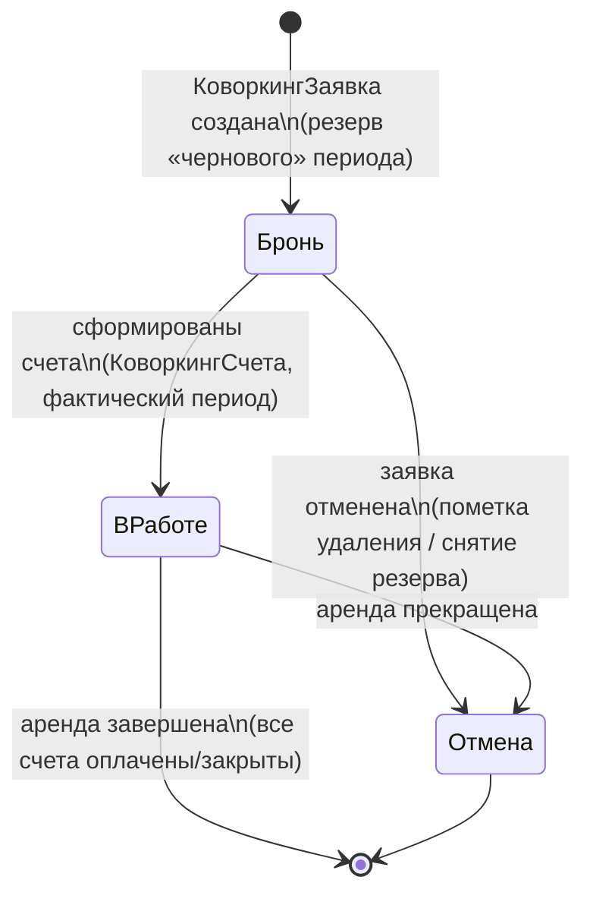
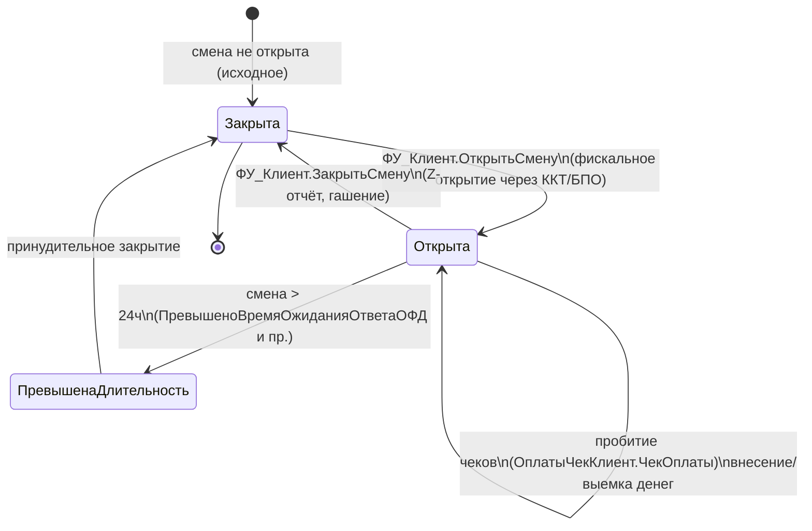
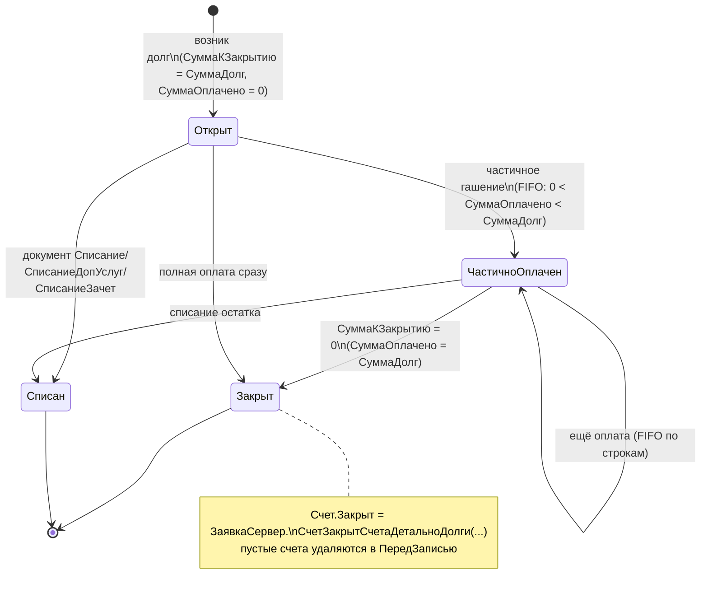
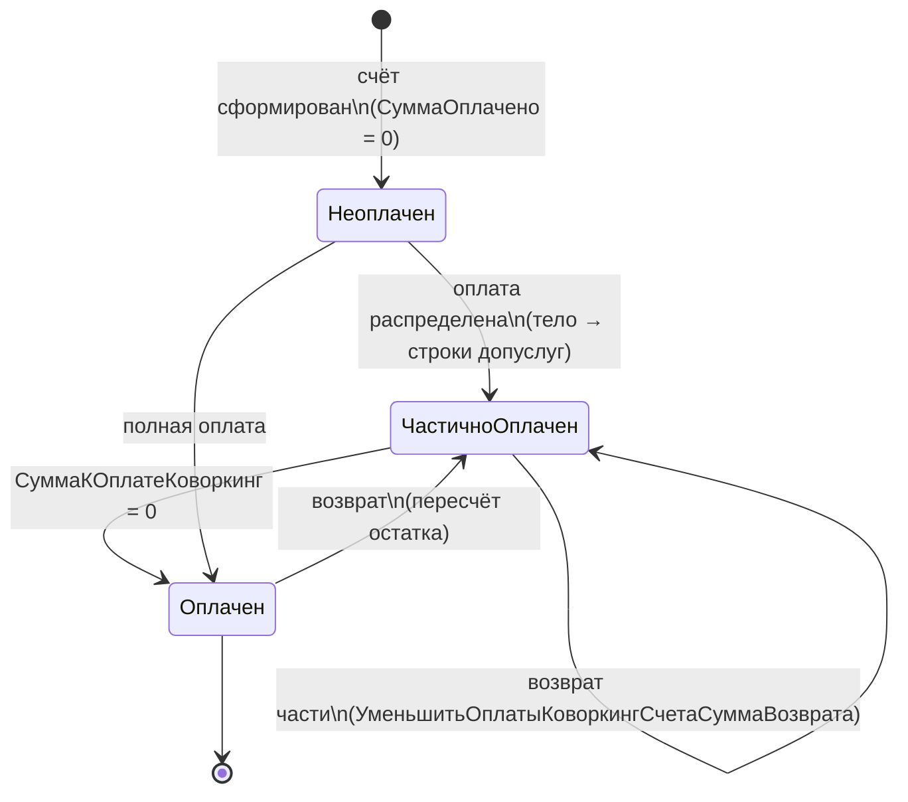
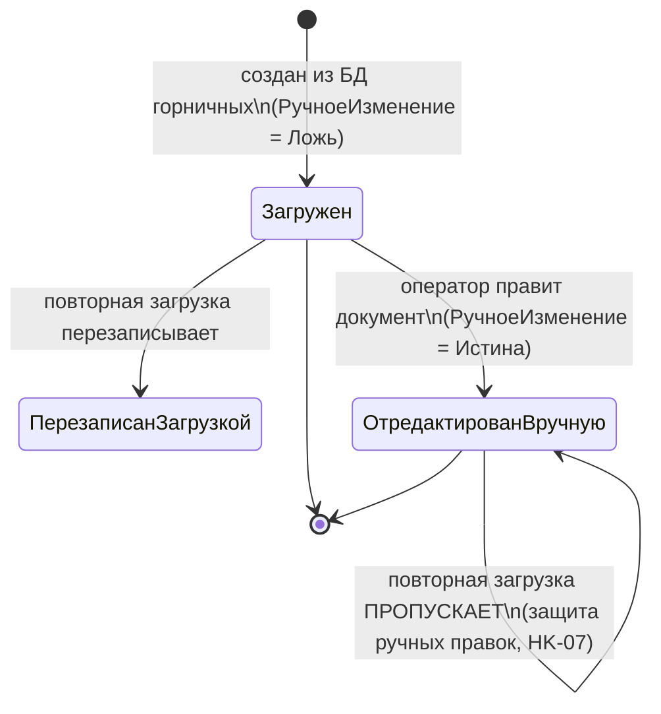
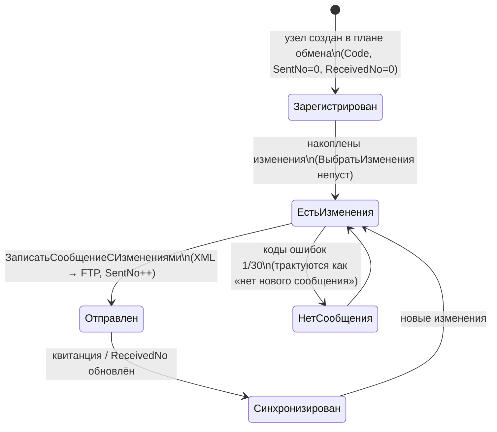
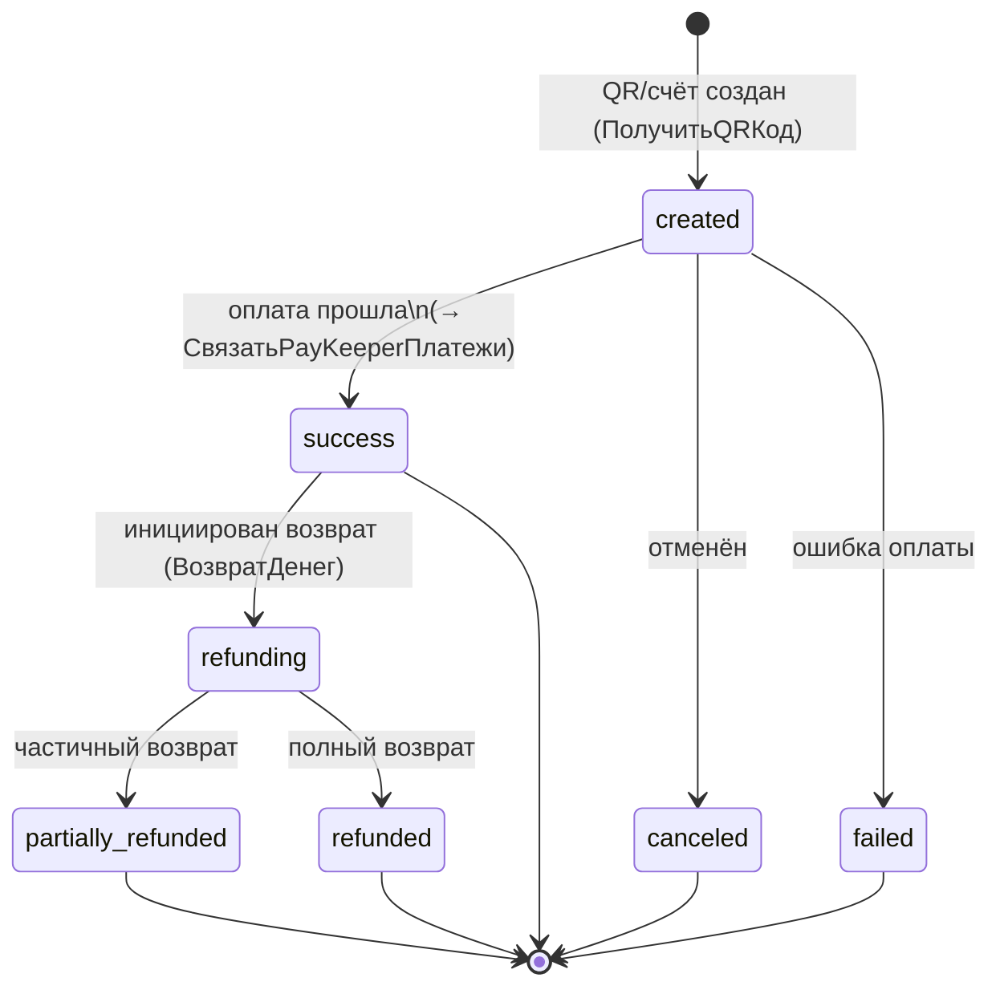

# Машины состояний — ОТЕЛЬ

> ⚠️ **Повторное извлечение №2 (2026-08-21-ПСН-РЕНОМЕ, собственная ветка ПСН «Реноме»):** изменения машин состояний (гард инварианта «ВремяВыездаТочное ⇔ Выехал»; «почасовой счёт коворкинга однодневен»; флаг «Оклад_…_Есть» как состояние ручной корректировки) — в [re-extraction/2026-08-21-ПСН-РЕНОМЕ/domain-delta.md](re-extraction/2026-08-21-ПСН-РЕНОМЕ/domain-delta.md), разд. 2. **Приоритет:** эта дельта старше дельты №1 (2026-06-18) и канона.

> ⚠️ **Повторное извлечение №1 (2026-06-18, коммит «Изменения ПСН» c52a282):** изменения машин состояний (депрекация документа `ЛистОжидания` → `ЛистОжидания_НеИспользуется`; уточнение перехода «возврат» в счёте коворкинга; «Чек агента» — действие без нового статуса брони) — в [re-extraction/2026-06-18-ПСН/domain-delta.md](re-extraction/2026-06-18-ПСН/domain-delta.md), разд. 2. При расхождении смотри дельту.

> Агент: **Detective** (фаза «Интерпретация»). Сущности конфигурации 1С:Предприятие 8 «ОТЕЛЬ» со статусами/состояниями и их переходами.
> Источники: `code-analysis.md`, `flowcharts/`, `modules.json`, точечная дочитка `ПСН_РЕНОМЕ__АУДИТ/src`.
> Шкала доверия: 🟢 ПОДТВЕРЖДЕНО · 🟡 ВЫВЕДЕНО · 🔴 ПРОБЕЛ.
> Диаграммы — Mermaid `stateDiagram-v2`. Переходы в коде НЕ оформлены явным конечным автоматом — статус меняется присваиванием реквизита/флага оператором или обработчиком; ниже реконструкция по поведению.

---

## 1. Бронь — `Document.ЗаявкаНаБронирование` / `Enum.СтатусБрони` 🟢

Центральная машина состояний системы. Значения `Enum.СтатусБрони`: `Бронь`, `Проживает`, `Выехал`, `ОтменаБронирования`, `ОтказОтБронирования`, `Неустойка`. Плюс ортогональный флаг `ЛистОжидания` (булев) — «парковка» спроса вне основной цепочки.

**Ключевой инвариант проведения** (BR-01, `ObjectModule.bsl:8-11`): движения занятости/долгов формируются ТОЛЬКО для «движущих» статусов. Не формируют движения: `ЛистОжидания=Истина`, `ОтменаБронирования`, `ОтказОтБронирования`.

```mermaid
stateDiagram-v2
    [*] --> ЛистОжидания: создана без свободного номера (флаг ЛистОжидания / Document.ЛистОжидания)
    [*] --> Бронь: создана со свободным номером\n(стойка / сайт / мессенджер)

    ЛистОжидания --> Бронь: освободился номер\n(снят флаг, проверка занятости пройдена)

    Бронь --> Проживает: фактический заезд гостя\n(оператор; движения занятости активны)
    Бронь --> ОтменаБронирования: гость отменил\n(ДатаАннуляции; движения НЕ формируются)
    Бронь --> ОтказОтБронирования: отказ / no-show\n(движения НЕ формируются)
    Бронь --> Неустойка: отмена со штрафом\n(удержание неустойки)

    Проживает --> Выехал: фактический выезд\n(закрытие проживания)
    Проживает --> Неустойка: досрочный выезд со штрафом

    Выехал --> [*]: бронь закрыта\n(ЗакрытиеДокументов: Закрыто=Истина)
    ОтменаБронирования --> [*]
    ОтказОтБронирования --> [*]
    Неустойка --> [*]

    note right of Бронь
        Проверка занятости (BR-02):
        конфликт по часу другого
        регистратора → ЗАПИСЬ ОТМЕНЯЕТСЯ
    end note
    note right of ОтменаБронирования
        Не-движущие статусы:
        ObjectModule ранний Возврат,
        движения занятости/долга нет
    end note
```

**Триггеры переходов (🟢, кроме отмеченного):**

| Из | В | Триггер | Источник |
|----|---|---------|----------|
| (создание) | `ЛистОжидания` | нет свободного номера | флаг `ЛистОжидания` / `Document.ЛистОжидания` |
| (создание) | `Бронь` | создана с резервом, занятость свободна | `ObjectModule.ОбработкаПроведения` |
| `ЛистОжидания` | `Бронь` | освободился номер, снят флаг | 🟡 (выведено) |
| `Бронь` | `Проживает` | фактический заезд | оператор стойки |
| `Бронь` | `Отмена/Отказ` | отмена/no-show, проставляется `ДатаАннуляции` | аудит читает `ДатаАннуляции` |
| `Бронь`/`Проживает` | `Неустойка` | отмена/выезд со штрафом | 🟡 |
| `Проживает` | `Выехал` | фактический выезд | оператор |
| `Выехал` | (закрыта) | `ЗакрытиеДокументов` ставит `Закрыто` за месяц | `DataProcessor.ЗакрытиеДокументов` |

**При копировании** (BR-08): статус принудительно сбрасывается в `Бронь`, движения и ТЧ очищаются.

**Раскраска на шахматке по статусу** (RM-04): Проживает=белый, Выехал=серо-бежевый, ОтказОтБронирования=тёмный лосось.

🔴 ПРОБЕЛ: переходы `Бронь→Проживает`, `Проживает→Выехал`, `→Неустойка` не имеют выделенного обработчика-«перехода» — статус меняется вручную в форме; гарды (запрет недопустимых переходов) в коде не обнаружены.

---

## 2. Бронь рабочего места (коворкинг) — `Enum.СтатусыБронированияРМ` 🟡

Отдельная (упрощённая) машина для коворкинга. Значения `Enum.СтатусыБронированияРМ`: `Бронь`, `ВРаботе`, `Отмена`.

**Связь заявка↔счёт** (DK-02, DK-03): заявка резервирует черновой период (`Бронь`), счета формируют фактический (`ВРаботе`); конфликт со счётом другой заявки приоритетнее. Цепочка счетов непрерывна без разрывов.

🟡 Значения статуса подтверждены в `Enum.СтатусыБронированияРМ`, но точные присваивания переходов в коде коворкинга детально не локализованы (статус как реквизит заявки/счёта). 🔴 ПРОБЕЛ: триггеры `ВРаботе`/`Отмена` выведены по семантике, не по явному коду перехода.

---

## 3. Кассовая (фискальная) смена — `Document.КассоваяСмена` / `Enum.СтатусыКассовойСмены` 🟢

Состояние фискальной смены ККТ, управляется через БПО.

**Триггеры (🟢):**

| Из | В | Триггер | Источник |
|----|---|---------|----------|
| Закрыта | Открыта | `ФУ_Клиент.ОткрытьСмену` | `ФУ_Клиент`, БПО |
| Открыта | Открыта | пробитие чека, внесение/выемка денег, отчёт без гашения | `ОплатыЧекКлиент`, `ФУ_Клиент.ВнесениеДенег/ВыемкаДенег` |
| Открыта | Закрыта | `ФУ_Клиент.ЗакрытьСмену` (`ЗакрытьСмену` обёртка в «Финансах») | `ЗакрытьСмену/Forms/Форма/Module.bsl` |

🟡 Промежуточные статусы `Enum.СтатусыКассовойСмены` (типовые БПО) присутствуют, но их полный набор и автопереходы — внутри типовой библиотеки БПО (осознанная граница анализа). 🔴 Внутренняя логика ОФД/ФН не разбиралась.

---

## 4. Долг по счёту брони — состояние `Счет.Закрыт` 🟢

Долг ведётся в ТЧ заявки (`СчетаДетальноДолги`), а не в отдельном документе со статусом; «состояние» — производное от соотношения суммы долга и оплаты.

**Триггеры (🟢):**

| Из | В | Триггер | Источник |
|----|---|---------|----------|
| (возникновение) | Открыт | проведение заявки формирует строки долга | `ЗаявкаНаБронирование.ПередЗаписью` |
| Открыт | Частично/Закрыт | FIFO-распределение оплаты (касса/банк/прочие) | `ЗаявкаОбщееКлиентСервер.РаспределитьОплатаСтрокаДолгСтрока` (FN-04) |
| любое | Списан | документ вида Списание/СписаниеДопУслуг/СписаниеЗачет | `СписаниеДопУслуг`, `ПрочиеОплаты` (FN-08, DK-06) |
| Закрыт (пустой) | (удалён) | пустые счета удаляются отложенно | `ПередЗаписью` (`ObjectModule.bsl:160-181`) |

**Предохранитель списания допуслуг** (DK-06): переход в `Списан` для допуслуг разрешён только если `СуммаДолг = СуммаСчетДолг`, иначе строка → ТЧ `Ошибки`.

---

## 5. Счёт коворкинга — `Document.КоворкингСчета` (состояние оплаты) 🟢

**Триггеры (🟢):** оплата распределяется сначала на тело счёта (`ЭтоУслуга=Ложь`), затем по строкам допуслуг (DK-05); возврат уменьшает строки распределения с последней частично (`КоворкингСервер:2-53`). `ПередЗаписью` пересчитывает `СуммаОплачено` шапки и строк.

---

## 6. Документ уборки (загрузка из БД горничных) — флаг `РучноеИзменение` 🟢

Защита ручных правок при синхронизации.

**Триггер защиты (🟢, HK-07):** при `РучноеИзменение=Истина` повторная загрузка пропускает документ (`ОбменГорничныеСервер.ЗагрузитьОбслуживаниеНомеров`).

---

## 7. Узел плана обмена — состояние синхронизации 🟢

**Триггеры (🟢, IN-01/IN-02):** обмен перебирает узлы (пропуская `ЭтотУзел`): сначала чтение, затем запись через временный XML + FTP. Коды ошибок 1 и 30 — не фатальны.

---

## 8. Платёж PayKeeper — `Статус` из РС `PayKeeperПлатежи` 🟢

Внешний жизненный цикл платежа эквайринга, отражаемый в системе.

**Триггеры (🟢, IN-05/IN-06):** статусы приходят из внешнего API (`success,canceled,failed,refunding,partially_refunded,refunded`). При `success` платёж автоматически привязывается к документу долга/оплаты; upsert в РС идемпотентен по `ИД_Платежа`.

---

## 9. Сводная карта машин состояний

| # | Сущность | Носитель состояния | Тип | Доверие |
|---|----------|--------------------|-----|---------|
| 1 | Бронь | `Enum.СтатусБрони` + флаг `ЛистОжидания` | явный enum, переходы в коде неявные | 🟢 |
| 2 | Бронь рабочего места | `Enum.СтатусыБронированияРМ` | явный enum, переходы 🟡 | 🟡 |
| 3 | Кассовая смена | `Enum.СтатусыКассовойСмены` (БПО) | enum БПО, частично граница | 🟢/🟡 |
| 4 | Долг счёта брони | производное от `СуммаКЗакрытию`/`Закрыт` | расчётное состояние | 🟢 |
| 5 | Счёт коворкинга | производное от `СуммаОплачено` | расчётное состояние | 🟢 |
| 6 | Документ уборки | флаг `РучноеИзменение` | бинарный флаг | 🟢 |
| 7 | Узел плана обмена | `SentNo`/`ReceivedNo` | счётчики синхронизации | 🟢 |
| 8 | Платёж PayKeeper | `Статус` (внешний API) | внешний enum в РС | 🟢 |

## 🔴 ПРОБЕЛЫ

- 🔴 Ни одна машина не оформлена как явный конечный автомат с гардами — допустимость переходов не проверяется кодом (статус меняется присваиванием в форме). Возможны недопустимые ручные переходы (напр. `Выехал → Бронь`).
- 🔴 Триггеры `Бронь→Проживает→Выехал` (главная цепочка) не имеют выделенного обработчика — выполняются оператором стойки; точка изменения статуса размазана по формам.
- 🔴 Полный набор и автопереходы `Enum.СтатусыКассовойСмены` — внутри типовой БПО (не разбирались).
- 🔴 Переходы `Enum.СтатусыБронированияРМ` (коворкинг) выведены по смыслу, явный код присваивания статуса не локализован.
